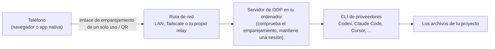

# OOP (oh-our-pi)

**Una app de escritorio para controlar los agentes de programación que ya usas, con un equipo opcional de varios modelos por encima.**

[English](README.md) | [한국어](README.ko.md) | [简体中文](README.zh-CN.md) | [日本語](README.ja.md) | Español


OOP se ejecuta en tu propio ordenador, envuelve las CLI de agentes de programación que ya tienes (Codex, Claude Code, Cursor, Grok Build, OpenCode, Antigravity, ZCode, MiniMax Code) y les da un único espacio de trabajo en forma de chat. Lo usas desde una app de escritorio, un navegador o tu teléfono. **No** es un servicio alojado: traes tus propias suscripciones y claves de API, y tu código se queda en tu máquina.

OOP es un fork de [T3 Code](https://github.com/pingdotgg/t3code) de T3 Tools Inc. (licencia MIT), basado en la versión upstream v0.0.44. La versión actual de OOP está en [`OOP_RELEASE.json`](OOP_RELEASE.json). Muchas gracias al equipo de T3 Code: casi toda la base de este proyecto es obra suya.

## Contenido

- [¿Por qué OOP?](#por-qué-oop)
- [Recorrido por las capturas](#recorrido-por-las-capturas)
- [Referencia de funciones](#referencia-de-funciones)
- [Proveedores compatibles](#proveedores-compatibles)
- [Plataformas compatibles](#plataformas-compatibles)
- [Requisitos](#requisitos)
- [Instalar la app de escritorio](#instalar-la-app-de-escritorio)
- [Instalación / compilación desde el código fuente](#instalación--compilación-desde-el-código-fuente)
- [Conectar desde tu teléfono](#conectar-desde-tu-teléfono)
- [Cómo funcionan las actualizaciones](#cómo-funcionan-las-actualizaciones)
- [Seguridad y privacidad](#seguridad-y-privacidad)
- [Preguntas frecuentes / Solución de problemas](#preguntas-frecuentes--solución-de-problemas)
- [Mapa del repositorio](#mapa-del-repositorio)
- [Estado, contribución, licencia](#estado-y-honestidad-sobre-la-hoja-de-ruta)

## ¿Por qué OOP?

Los agentes de programación son buenos, pero cada uno vive en su propia terminal o app, con su propio inicio de sesión, su historial y sus avisos de aprobación. OOP los pone lado a lado.

- **Un solo lugar para muchos agentes.** Cambia entre Codex, Claude Code, Cursor, Grok Build, OpenCode, Antigravity, ZCode y MiniMax Code por hilo, con el mismo flujo de diff, terminal y aprobaciones.
- **Deja que varios modelos compartan una tarea.** OOP Crew permite que un modelo "brain" (cerebro) delegue el trabajo rutinario en workers más baratos y el trabajo difícil en un expert, y que un auditor revise el resultado.
- **Mantén el control.** Cuatro modos de permisos, un panel de diff con checkpoints que puedes restaurar y una página de uso para que los costes no te sorprendan.
- **Trabaja lejos del teclado.** Empareja tu teléfono con el ordenador que ejecuta los agentes y vigila (o dirige) las tareas largas.
- **Todo en local.** Los proyectos, los inicios de sesión de los proveedores y el trabajo de los agentes se quedan en tu máquina. No hay cuenta de OOP ni servidor de OOP.

Para desarrolladores que ya pagan una o más suscripciones o planes de API de agentes de
programación, aceptan una aplicación de escritorio temprana y sin firma, y quieren una única
superficie de control. Si buscas un producto pulido, firmado y con actualización automática, hoy
encaja mejor el proyecto original (upstream).

### Recorrido de 30 segundos


_Vista principal del chat: elige un proveedor y un modelo, define el modo de permisos y sigue el hilo._

1. Abre OOP e inicia sesión en un proveedor (Settings → Providers).
2. Añade una carpeta de proyecto y empieza un hilo.
3. Elige un modelo y un modo de permisos en el compositor y envía un mensaje.
4. Revisa el resultado en el panel de diff; restaura desde un checkpoint si no te gusta.

## Recorrido por las capturas

Todas las capturas proceden de un perfil de demostración aislado, sin datos personales.

### Chat

El espacio de trabajo principal. Cada proyecto tiene hilos; cada hilo es una conversación con un proveedor y un modelo. El compositor contiene el selector de modelo, el modo de permisos y los controles de Crew y Goal.

**Cómo abrirlo:** añade un proyecto y empieza un hilo desde la barra lateral.


_Chat: compositor con selector de modelo y modo de permisos bajo la línea de tiempo del hilo._

### OOP Crew

Un chat, varios modelos. El modelo propio del chat es el **brain** (cerebro); planifica y habla contigo. Un **worker** (trabajador) se encarga del trabajo rutinario (búsquedas, ediciones, pruebas), un **expert** (experto) se encarga de la implementación difícil y un **auditor** revisa los turnos que modificaron archivos. Los ajustes preestablecidos son **OOP pick**, **Speed** (velocidad), **Quality** (calidad) y **Budget** (presupuesto), y puedes cambiar el modelo de cada rol. Si un modelo del crew falla (por ejemplo, por quedarse sin crédito), OOP pasa la tarea a otro modelo con sesión iniciada del mismo nivel. Los cambios pequeños de 20 líneas o menos que pasan las pruebas no se auditan.

**Cuándo usarlo:** tareas grandes en las que quieres modelos baratos para el grueso del trabajo y un modelo potente para la revisión. **Cómo abrirlo:** **Crew**, junto al selector de modelo en el compositor. El trabajo del Crew se muestra en vivo en **Workflows** y **Agents** en el panel derecho.


_OOP Crew: un chat, varios modelos, con un tablero en vivo de quién hace qué._

> [!NOTE]
> Crew ejecuta varios modelos por chat, así que multiplica el uso de los proveedores. Empieza con el preset **Budget** si vigilas los costes.

### Providers

Instala, actualiza e inicia sesión en cada proveedor desde un solo lugar. La tarjeta indica si la CLI está instalada y si hay sesión iniciada, y ofrece **Install** (cuando `npm` está en tu `PATH`) o **Update now** cuando OOP sabe qué instalador es el dueño de la CLI.

**Cómo abrirlo:** Settings → Providers.


_Settings → Providers: instala, actualiza e inicia sesión en cada proveedor._

### Añadir Z.AI o MiniMax (presets de OpenCode)

Presets para Z.AI (API o Coding Plan) y MiniMax (API o Token Plan) que se ejecutan a través de OpenCode, para que puedas usar esos modelos sin escribir a mano la configuración de OpenCode. La clave de API se guarda como variable de la instancia (`OOP_ZAI_API_KEY` / `OOP_MINIMAX_API_KEY`).

**Cómo abrirlo:** Settings → Providers → Add. Requiere OpenCode 1.14.19 o posterior.


_Add provider: presets de Z.AI y MiniMax que se ejecutan a través de OpenCode._

> [!NOTE]
> Este fork no ha probado el inicio de sesión de pago ni las solicitudes de chat de pago de Z.AI / MiniMax.

### Diff y revisión

Mira exactamente qué cambió el agente en un hilo, revísalo y restaura desde el checkpoint creado al final de cada turno. Los checkpoints son referencias de git ocultas, así que no ensucian tus ramas.

**Cómo abrirlo:** la pestaña **Diff** del panel derecho (hilos del servidor en un repositorio git).


_Panel de diff: revisa lo que cambió el agente y restaura desde los checkpoints._

### Commit y control de código fuente

Conecta GitHub, GitLab, Forgejo/Gitea, Bitbucket o Azure DevOps a través de sus propias CLI en la máquina que ejecuta el servidor; después haz commit, publica y abre pull requests desde el hilo.

**Cómo abrirlo:** Settings → Source Control para detectar tus CLI (pulsa **Rescan** después de iniciar sesión) y, luego, los controles de commit del hilo.


_Control de código fuente: haz commit de los cambios y publícalos desde el hilo._

### Modos de permisos

Elige cuándo debe preguntar el agente antes de actuar. El modo se aplica por hilo.

| Modo                                                      | Comportamiento                                                                                                                                                    |
| --------------------------------------------------------- | ----------------------------------------------------------------------------------------------------------------------------------------------------------------- |
| **Supervised** (supervisado)                              | Pide aprobación para comandos y cambios de archivos.                                                                                                              |
| **Auto-accept edits** (aceptar ediciones automáticamente) | Aprueba automáticamente las ediciones de archivos; otras acciones aún pueden pedir confirmación.                                                                  |
| **Auto**                                                  | Usa la revisión automática del proveedor para las acciones rutinarias y pregunta por el resto (Codex, Claude, Cursor; los demás proveedores vuelven a preguntar). |
| **Full access** (acceso total)                            | Los comandos y las ediciones se ejecutan sin avisos de aprobación. Es el modo **predeterminado** de los hilos nuevos.                                             |

**Cómo abrirlo:** el selector de modo en el compositor. Cambia el valor predeterminado en Settings → General → New threads → Permissions.


_Modos de permisos: de Supervised a Full access._

### Objetivos del hilo

Describe qué debe ser cierto cuando el chat termine. Mientras el objetivo siga abierto, OOP continúa el hilo después de cada turno terminado hasta que el agente informe `GOAL COMPLETE`, informe `GOAL BLOCKED: <reason>` o se agote el número de continuaciones automáticas que elegiste. Con Crew, un turno que modificó archivos solo cuenta después de su auditoría.

**Cómo abrirlo:** **Goal**, junto a **Crew** en el compositor. Usa **Stop goal** para terminarlo.


_Objetivo del hilo: el chat sigue adelante hasta que el objetivo se cumple, se bloquea o se detiene._

### Informes en el chat

Cuando una respuesta incluye cifras o un proceso, el agente puede dibujarlo como gráficos, tarjetas de cifras clave, barras de progreso y diagramas de flujo en lugar de un muro de texto. Cada figura tiene un botón **Source** que muestra los datos que hay detrás.

**Pruébalo:** pídele al agente un gráfico o un diagrama.


_Informes: gráficos y cifras clave representados en la conversación._

### Panel de Workflows y Agents

Un diagrama en vivo de lo que hace el agente: cada llamada a una herramienta, subagente o workflow del proveedor es una tarjeta, el trabajo en paralelo comparte una columna y la tarjeta que seleccionas muestra el modelo, los tiempos y los tokens. El trabajo del Crew también aparece aquí.

**Cómo abrirlo:** el panel derecho (pestañas Workflows y Agents), la paleta de comandos, o `mod+alt+w`.


_Panel Workflows: sigue el trabajo del agente a medida que ocurre._

### Usage

Uso de tokens, ahorro de caché, desgloses por modelo y coste **estimado** equivalente en API de todos los proveedores de los servidores conectados. Son estimaciones, no tu factura de suscripción.

**Cómo abrirlo:** **Usage** en la barra lateral o en la paleta de comandos, o `mod+u` (cuando la terminal no tiene el foco).


_Usage: historial de tokens y coste estimado por proveedor._

### Terminal integrada

Una terminal por hilo en la máquina que ejecuta el servidor, con hasta 5.000 líneas (8 MiB) de historial guardadas en el servidor, así que sobrevive a las reconexiones.


_Terminal integrada junto al chat._

### Tema oscuro


_Tema oscuro._

### Cliente web en tamaño de teléfono

La misma interfaz web funciona en el navegador de un teléfono una vez que lo emparejas (consulta [Conectar desde tu teléfono](#conectar-desde-tu-teléfono)).


_El cliente web en tamaño de teléfono._

### Ajustes de acceso remoto

Donde activas el acceso a la red, creas enlaces de emparejamiento, ves los clientes autorizados y los revocas. Los códigos de emparejamiento de esta captura están ocultos.

**Cómo abrirlo:** Settings → Connections.


_Settings → Connections: acceso remoto y emparejamiento (códigos ocultos)._

## Referencia de funciones

"Added in OOP" (añadido en OOP) significa que la documentación y el código del fork lo marcan como específico de OOP. "Upstream" (del proyecto original) significa que forma parte del upstream (v0.0.44) hasta donde muestran la documentación y el código; el fork no ha hecho una comparación archivo por archivo, así que toma la división como aproximada.

| Función                                                | Qué hace                                                                                                  | Dónde                                                 | Origen                                                         |
| ------------------------------------------------------ | --------------------------------------------------------------------------------------------------------- | ----------------------------------------------------- | -------------------------------------------------------------- |
| OOP Crew                                               | El modelo brain delega en modelos worker, expert y auditor; presets y cambios por rol                     | Compositor → Crew; panel derecho → Workflows / Agents | Added in OOP                                                   |
| Objetivos del hilo                                     | Mantiene un hilo en marcha hasta que pasan las comprobaciones o el objetivo se bloquea                    | Compositor → Goal                                     | Added in OOP                                                   |
| Memorias del proyecto                                  | Sugiere memorias de proyecto guardadas desde el compositor                                                | Compositor, botón de memoria                          | Added in OOP                                                   |
| Preferencias locales de roles                          | Guarda un modelo preferido para implementación o revisión por entorno, con recomendaciones                | Selector de modelo del compositor                     | Added in OOP                                                   |
| Presets de Z.AI / MiniMax                              | Presets de proveedor basados en OpenCode                                                                  | Settings → Providers → Add                            | Added in OOP (solicitudes de pago sin probar)                  |
| Proveedor ZCode (GLM)                                  | El agente de Z.AI sobre ACP                                                                               | Settings → Providers                                  | Added in OOP                                                   |
| Proveedor MiniMax Code                                 | El agente de MiniMax sobre ACP                                                                            | Settings → Providers                                  | Added in OOP                                                   |
| Instalación / actualización de proveedores con un clic | Instala o actualiza las CLI de los proveedores desde la tarjeta del proveedor                             | Settings → Providers                                  | Added in OOP (diferencia exacta con el upstream sin verificar) |
| Verify macOS build                                     | Comprueba la integridad de un `.dmg` de OOP, la firma de código estricta y el arranque en el Mac servidor | Encabezado del chat → Verify macOS build              | Added in OOP                                                   |
| Diálogo de conexión del teléfono                       | QR de emparejamiento del teléfono con un clic para la app de escritorio, con relay propio opcional        | Barra lateral → Connect mobile                        | Added in OOP (solo app de escritorio)                          |
| Relay propio en Cloudflare                             | Un Worker que despliegas tú mismo para que un teléfono llegue a tu escritorio desde cualquier red         | `infra/oop-relay`                                     | Added in OOP, temprano                                         |
| Actualizador desde carpeta local                       | Las compilaciones empaquetadas de OOP pueden recoger paquetes más nuevos de una carpeta que les indiques  | Compilaciones empaquetadas de macOS / Windows         | Added in OOP, temprano, sin probar por terceros                |
| Sesiones multiproveedor                                | Hilos, turnos y checkpoints entre proveedores                                                             | Por todas partes                                      | Upstream                                                   |
| Modos de permisos                                      | Supervised, Auto-accept edits, Auto, Full access                                                          | Compositor; Settings → General                        | Upstream                                                   |
| Panel de diff y checkpoints                            | Revisa y restaura los cambios del agente                                                                  | Panel derecho → Diff                                  | Upstream                                                   |
| Control de código fuente                               | Clonar, commit, publicar y pull requests mediante las CLI de los proveedores                              | Settings → Source Control                             | Upstream                                                   |
| Terminal integrada                                     | Una terminal por hilo en la máquina del servidor                                                          | Dentro de un hilo                                     | Upstream                                                   |
| Informes en el chat                                    | Gráficos, tarjetas de estadísticas, barras de progreso, flujos mermaid                                    | En las respuestas                                     | Upstream                                                   |
| Vista de workflows                                     | Diagrama en vivo de llamadas a herramientas y subagentes                                                  | Panel derecho, `mod+alt+w`                            | Upstream                                                   |
| Página Usage                                           | Historial de tokens y coste estimado                                                                      | Barra lateral, `mod+u`                                | Upstream (las filas de ZCode y MiniMax son de OOP)         |
| SnapShots                                              | Captura una ventana en tu borrador (desactivado por defecto; macOS, Windows, Linux Wayland)               | Settings → SnapShots                                  | Upstream (atribución sin verificar)                        |
| Acceso remoto                                          | Emparejamiento por LAN, Tailscale HTTPS, entornos SSH                                                     | Settings → Connections                                | Upstream                                                   |
| Panel de dispositivo                                   | Mira y toca un simulador de iOS o un emulador de Android junto a un hilo                                  | Panel derecho → Device                                | Upstream (sin probar aquí)                                 |
| Servicio en segundo plano                              | `t3 service install` en macOS (launchd) y Linux (unidad de usuario de systemd); no en Windows             | CLI                                                   | Upstream (sin probar aquí)                                 |
| Atajos de teclado, ajustes de proyecto, temas          | Atajos personalizables, cambios por proyecto, apariencia                                                  | Settings                                              | Upstream                                                   |

## Proveedores compatibles

Instala al menos una CLI de proveedor e inicia sesión antes de empezar un hilo.

| Proveedor                        | Cómo iniciar sesión                                                                                    | Notas                                                                                        |
| -------------------------------- | ------------------------------------------------------------------------------------------------------ | -------------------------------------------------------------------------------------------- |
| Codex                            | Instala la CLI de Codex y luego `codex login` (o **Connect with ChatGPT** en Settings → Providers)     |                                                                                              |
| Claude Code                      | Instala Claude Code y luego `claude auth login`                                                        | Un brain de Claude ejecuta como subagentes los roles de crew de Claude de la misma cuenta.   |
| Cursor                           | Instala la CLI de Cursor y luego `agent login`                                                         |                                                                                              |
| Grok Build                       | Instala la CLI de Grok Build y luego `grok login`                                                      |                                                                                              |
| OpenCode                         | Instala OpenCode 1.14.19 o posterior y luego `opencode auth login`                                     | Necesario para los presets de Z.AI / MiniMax.                                                |
| Antigravity                      | Settings → Providers: actívalo, **Install** y luego **Sign in with Google**                            | No hace falta CLI. La clave de API de Gemini se guarda en texto plano en los ajustes.        |
| ZCode (GLM)                      | Instala ZCode, `zcode login zai` y luego `npm i -g zcode-acp-server`                                   | Ejecuta sus propias herramientas sin aprobación sea cual sea el modo de permisos que elijas. |
| MiniMax Code                     | `npm i -g @minimax-ai/code` y luego `mcode login --region global`                                      |                                                                                              |
| Z.AI / MiniMax mediante OpenCode | Settings → Providers → Add → Z.AI o MiniMax; pon la clave en `OOP_ZAI_API_KEY` / `OOP_MINIMAX_API_KEY` | Solicitudes de pago sin probar.                                                              |

## Plataformas compatibles

| Plataforma                                   | Estado                                                                                                             |
| -------------------------------------------- | ------------------------------------------------------------------------------------------------------------------ |
| macOS, Apple Silicon (arm64)                 | **Probada.** Es el objetivo principal.                                                                             |
| Windows x64                                  | **Experimental.** Compilada por el mantenedor; no verificada en máquinas limpias.                                  |
| macOS Intel                                  | Sin probar por este fork. El script de compilación de macOS se niega a ejecutarse en Intel.                        |
| Linux                                        | Sin probar por este fork. El código de empaquetado del upstream está en el repositorio, sin promesas.              |
| App nativa de iOS / Android                  | Sin probar por este fork. Consulta [app nativa o navegador](#app-nativa-o-navegador).                              |
| Navegador del teléfono (con la interfaz web) | Interfaz web comprobada en tamaño de teléfono; consulta [Conectar desde tu teléfono](#conectar-desde-tu-teléfono). |

## Requisitos

Estos requisitos solo se aplican a la compilación desde el código fuente. El instalador binario no necesita Node.js, pnpm, git ni compilador. Para usar un agente, debes instalar e iniciar sesión en la CLI del proveedor por separado.

- **Node.js 24.x, 24.13.1 o posterior**
- **pnpm 11.10.0**
- **git**
- **rsync** (macOS, lo usa el script de compilación)
- **Al menos una CLI de proveedor**, instalada y con sesión iniciada (consulta [Proveedores compatibles](#proveedores-compatibles))
- Solo para empaquetar en Windows: Rust, Python 3 y Visual Studio Build Tools (Desktop development with C++, con el Windows SDK)

## Instalar la app de escritorio

**macOS (Apple Silicon)**

```sh
curl -fsSL https://raw.githubusercontent.com/AIBeginnerX/oh-our-pi-desktop/main/scripts/install-desktop.sh | sh
```

**Windows (PowerShell, x64)**

```powershell
irm https://raw.githubusercontent.com/AIBeginnerX/oh-our-pi-desktop/main/scripts/install-desktop.ps1 | iex
```

**Linux (x64)**

```sh
curl -fsSL https://raw.githubusercontent.com/AIBeginnerX/oh-our-pi-desktop/main/scripts/install-desktop.sh | sh
```

Consulta la [guía breve de instalación de escritorio](INSTALL.md) para ver las ubicaciones, las
actualizaciones, la seguridad y los requisitos de publicación. La versión v0.0.106 y las
publicaciones anteriores que solo contienen código fuente no incluyen binarios. Usa v0.0.107 o una
versión posterior que muestre el instalador correspondiente y su archivo `.sha256` en **Assets**.

## Instalación / compilación desde el código fuente

```bash
git clone https://github.com/AIBeginnerX/oh-our-pi-desktop.git
cd oh-our-pi-desktop
```

### macOS (Apple Silicon)

Ejecuta el script directamente con `node`, no a través de `pnpm`.

```bash
node scripts/macos.mjs doctor    # checks macOS arm64, Node, pnpm, rsync
node scripts/macos.mjs setup     # installs dependencies in a local cache
node scripts/macos.mjs start     # optional: run an isolated dev copy of the desktop app
node scripts/macos.mjs package   # builds an ad hoc signed DMG into release/macos/
```

Abre el DMG de `release/macos/` y arrastra la app a `/Applications/OOP.app`.

### Windows (x64, experimental)

Compila en un PC con Windows (sin compilación cruzada). Instala antes Rust, Python 3 y Visual Studio Build Tools (Desktop development with C++, con el Windows SDK).

```bat
set OOP_WINDOWS_UPDATE_DIRECTORY=%CD%\release\windows
node scripts\windows.mjs package
```

El instalador (`OOP-<version>-x64.exe`) se escribe en `release\windows`.

### Ruta de desarrollo genérica (cualquier sistema operativo)

Usa Vite+ (`vp`), el ejecutor de tareas que documenta este código (instalación: `curl -fsSL https://vite.plus | bash`); consulta [`docs/operations/development.md`](docs/operations/development.md).

```bash
vp i          # install dependencies
vp run dev    # server + web; open the pairing URL it prints
```

### Lista de comprobación del primer arranque (compilaciones desde el código fuente)

Las compilaciones desde el código fuente están **firmadas ad hoc y no notarizadas**, así que el sistema operativo puede mostrar un aviso. El instalador binario verifica SHA-256 antes de instalar y no elude la cuarentena de Gatekeeper ni SmartScreen de Windows.

- **macOS (Gatekeeper):** haz clic derecho en la app y elige **Open**, o ve a System Settings → Privacy & Security → **Open Anyway**.
- **Windows (SmartScreen):** haz clic en **More info** → **Run anyway**.

Después:

- [ ] Settings → Providers: instala e inicia sesión en **un** proveedor.
- [ ] Añade un proyecto (una carpeta, idealmente un repositorio git).
- [ ] Empieza un hilo y elige un modelo en el compositor.
- [ ] Elige un modo de permisos. Los hilos nuevos usan **Full access** por defecto; usa **Supervised** en los repositorios en los que no confíes.
- [ ] Opcional: activa **Crew** y mira la página **Usage** tras unos cuantos turnos.

## Conectar desde tu teléfono

Los agentes, los archivos y los inicios de sesión de los proveedores se quedan en tu ordenador (el **host**, anfitrión). Tu teléfono es solo un mando a distancia: muestra los hilos y te permite enviar mensajes y responder a los avisos de aprobación. El host tiene que seguir encendido y en ejecución.



Elige la ruta más sencilla que te funcione, en este orden.

|     | Ruta                          | Necesita                                           | Funciona fuera de casa | Riesgo                           |
| --- | ----------------------------- | -------------------------------------------------- | ---------------------- | -------------------------------- |
| a   | Mismo Wi-Fi / LAN             | Teléfono y ordenador en la misma red               | No                     | El más bajo                      |
| b   | Tailscale                     | Cuenta gratuita de Tailscale en ambos dispositivos | Sí                     | Bajo                             |
| c   | Tu propio relay de Cloudflare | Una cuenta de Cloudflare y un despliegue único     | Sí                     | Medio (Cloudflare ve el tráfico) |

> [!WARNING]
> **Los enlaces y códigos de emparejamiento son contraseñas.** No los publiques nunca en issues, chats ni capturas de pantalla. Empareja solo dispositivos que sean tuyos. No expongas nunca el puerto del servidor a internet abierto. Prefiere Tailscale para usarlo fuera de casa. Revoca los dispositivos que no reconozcas. Usa el modo de permisos **Supervised** cuando controles agentes de forma remota.

### a) Mismo Wi-Fi / LAN (lo más sencillo)

**Requisitos previos:** la app de escritorio de OOP en ejecución en tu ordenador y un teléfono en la misma red.

1. En la app de escritorio, haz clic en el icono del teléfono de la barra lateral (**Connect mobile**).
2. Si el diálogo dice que las conexiones móviles están desactivadas, haz clic en **Allow mobile connections**. OOP se reinicia una vez; el ajuste se conserva.
3. Aparece un código QR de un solo uso. Si se ofrecen varias direcciones, elige la que tu teléfono pueda alcanzar (la entrada **LAN** para el mismo Wi-Fi).
4. Escanea el código QR con la cámara del teléfono y abre el enlace en el navegador del teléfono. El teléfono ya está emparejado. El emparejamiento autoriza ese dispositivo para visitas posteriores, así que no necesitas el código original otra vez.

Lo mismo, a mano: Settings → Connections → activa **Network access** y luego **Create link** y abre el enlace en el teléfono. Un enlace creado ahí solo se puede copiar mientras esa página siga abierta; si sales, necesitas un enlace nuevo.

¿Ejecutas el servidor sin la app de escritorio (por ejemplo, con la ruta de desarrollo)?

```bash
t3 serve --host <your-computer's-LAN-address>   # for example 192.168.1.20
t3 pair                                          # prints a fresh pairing QR for the running server
```

Desde una copia del código fuente, `node apps/server/src/bin.ts pair` ejecuta el mismo comando. Los tokens de emparejamiento duran 5 minutos por defecto (`--ttl` lo cambia; `t3 pair --help` lista las opciones). Una dirección de loopback como `127.0.0.1` solo funciona en el propio ordenador, nunca en un teléfono.

### b) Red privada de Tailscale

**Requisitos previos:** una cuenta de [Tailscale](https://tailscale.com), Tailscale instalado tanto en el ordenador como en el teléfono y ambos con sesión iniciada en la misma tailnet.

1. En la app de escritorio, abre Settings → Connections y activa **Tailscale HTTPS**. (Desactívalo en el mismo lugar para quitar la ruta.)
2. Crea un enlace de emparejamiento (o usa **Connect mobile** y elige la ruta de Tailscale). Tiene un aspecto como `https://your-computer.your-tailnet.ts.net/`.
3. Abre el enlace en el teléfono (Tailscale debe estar conectado en el teléfono).

Para un servidor de línea de comandos:

```bash
t3 serve --tailscale-serve     # start a server published over Tailscale HTTPS
t3 pair --tailscale            # for an already-running server
tailscale serve --https=443 off   # remove the mapping later
```

Si el puerto 443 está ocupado, elige otro con `--tailscale-serve-port`. El tráfico de Tailscale no pasa por ningún relay público.

### c) Tu propio relay de Cloudflare (fuera de casa, sin Tailscale)

OOP incluye un pequeño Worker de Cloudflare en [`infra/oop-relay`](infra/oop-relay/README.md) que despliegas en **tu propia** cuenta de Cloudflare. El escritorio marca hacia él, así que no hace falta configurar el router y el teléfono puede conectarse desde cualquier red mientras el escritorio esté en línea.

1. Despliega el Worker como se describe en [`infra/oop-relay/README.md`](infra/oop-relay/README.md) (`npx wrangler login`, `npx wrangler deploy` y luego `npx wrangler secret put OOP_RELAY_SECRET`).
2. En la app de escritorio: Connect mobile → **Use away from home**. Pega el secreto que se muestra en el secreto del Worker, introduce la dirección del relay y pulsa **Save**.
3. Elige **Cloudflare relay** como ruta y luego escanea el código QR.

> [!NOTE]
> Un despliegue sirve a un escritorio. Cloudflare termina el TLS del relay, así que el tráfico es visible para la cuenta de Cloudflare que lo ejecuta. Los teléfonos aún tienen que iniciar sesión en el escritorio con un código de emparejamiento. Esta ruta es nueva y la menos probada de las tres.

**¿Y el servicio de túnel upstream?** El proyecto upstream también incluye un servicio de túnel que depende del inicio de sesión en la nube y de servidores operados por el proyecto upstream. **OOP no opera ningún servicio alojado** y este fork no lo ha probado, así que esta guía no lo cubre.

### ¿App nativa o navegador?

|                       | Navegador del teléfono                                                                                          | App nativa de iOS / Android                                                    |
| --------------------- | --------------------------------------------------------------------------------------------------------------- | ------------------------------------------------------------------------------ |
| Qué es                | La interfaz web de OOP servida por tu ordenador                                                                 | La app móvil del proyecto upstream (sin la marca OOP) |
| Instalación           | Nada                                                                                                            | Ficha del proyecto upstream en App Store / Google Play                                    |
| Conexión              | Abre el enlace de emparejamiento o escanea el código QR                                                         | Añade un entorno: escanea el código QR o pega la URL de emparejamiento         |
| Probado por este fork | Interfaz web comprobada en tamaño de teléfono; emparejamiento desde un teléfono real no verificado por separado | **No**                                                                         |


_Un navegador de teléfono conectado a OOP._

El fork conserva los identificadores de protocolo y autenticación (`internal_protocol_and_auth_identifiers_preserved` en [`UPSTREAM.json`](UPSTREAM.json)), así que la app upstream debería poder emparejarse con un servidor de OOP. **El fork no ha probado la app móvil nativa**, así que considéralo sin confirmar. La documentación upstream describe los ajustes de conexión de la app en Settings → Environments. Usa el navegador si algo falla.

### Notificaciones push

La documentación upstream dice que las notificaciones push del teléfono (el agente terminó, falló o necesita aprobación) requieren iniciar sesión en el servicio de túnel upstream, y que una conexión directa o por Tailscale por sí sola no las activa. Como OOP no opera ese servicio y el fork no lo ha probado, **no esperes notificaciones push con las rutas anteriores.** Mantén abierta la página en el teléfono o vuelve a mirar el hilo más tarde.

### Revocar un dispositivo

1. En el ordenador, abre Settings → Connections → **Authorized clients**.
2. Revoca la sesión del dispositivo para quitar su acceso actual. Revoca cualquier enlace de emparejamiento sin usar para que no pueda utilizarse después.
3. Línea de comandos: `t3 auth session list` / `t3 auth session revoke <id>` y `t3 auth pairing list` / `t3 auth pairing revoke <id>` (consulta `t3 auth --help`).
4. Para cerrar la puerta por completo, desactiva **Network access** (o **Tailscale HTTPS**) en Settings → Connections.

## Cómo funcionan las actualizaciones

Las compilaciones desde el código fuente no se actualizan solas desde GitHub; vuelve a compilarlas con los pasos de abajo. Desde la 0.0.111, las instalaciones de macOS y Windows se actualizan solas: OOP revisa cada pocos minutos los GitHub Releases de este repositorio, descarga en segundo plano la versión nueva, verifica su SHA-256 y la instala cuando eliges reiniciar (en macOS reemplaza la app donde la instalaste; en Windows ejecuta el instalador). En Linux, o desde una versión anterior, cierra OOP y vuelve a ejecutar el comando de instalación correspondiente. Tus datos de usuario se conservan.

1. `git pull`
2. Vuelve a compilar / empaquetar (consulta [Instalación](#instalación--compilación-desde-el-código-fuente)) y reinstala.

Cada versión se publica como **un solo commit** (titulado `OOP <version> source`), una etiqueta llamada `v<version>` y un GitHub Release. Tus datos en `~/.oop-desktop/userdata` se conservan entre actualizaciones. Para enterarte de las versiones nuevas, activa **Watch → Custom → Releases** en el repositorio de GitHub; las versiones anteriores solo tienen etiqueta.

Una app que compilaste tú mismo te ofrece dentro de la app tu siguiente compilación, desde la carpeta fijada al compilarla: `release\windows` en Windows (configurada arriba) y `release/macos` en macOS. En macOS, `package` solo genera el DMG, así que después compila también el paquete de actualización:

```bash
V=<version>
node scripts/build-oop-update-pkg.mjs --dmg release/macos/OOP-$V-arm64.dmg \
  --sha256 "$(awk '{print $1}' release/macos/OOP-$V-arm64.dmg.sha256)" \
  --version $V --output release/macos/OOP-$V-arm64-update.pkg
```

> [!NOTE]
> Los avisos de actualización del servidor en la app y `t3 update` provienen del proyecto upstream. No son un canal de actualización de OOP.

## Seguridad y privacidad

> [!WARNING]
> Los agentes se ejecutan con **los permisos de tu cuenta**. Pueden editar archivos y ejecutar comandos. El modo de permisos predeterminado de los hilos nuevos es **Full access**. Para repositorios no confiables, cambia a **Supervised** (Settings → General → New threads).

- **ZCode** ejecuta sus propias herramientas sin aprobación, sea cual sea el modo de permisos que elijas.
- **Costes:** cada proveedor usa tu propia suscripción o crédito de API. Crew multiplica el uso al ejecutar varios modelos por chat. La página Usage muestra estimaciones, no tu factura.
- **Las claves de API** se guardan en el lado del servidor, en tu máquina. La clave de API de Gemini de Antigravity se guarda **en texto plano** en los ajustes.
- **No subas nunca archivos `.env` ni claves a un commit**, y no los pegues en issues ni en registros.
- **Los instaladores upstream instalan la app upstream, no OOP:** los scripts de instalación de `t3.codes`, `npx t3`, Homebrew `t3-code`, winget `T3Tools.T3Code` y las fichas de App Store / Play pertenecen al proyecto upstream. Usa el instalador de escritorio de OOP de arriba o compila OOP desde este repositorio.
- **La CLI sigue llamándose `t3`**, lo que puede chocar con una instalación upstream.
- **Las compilaciones desde el código fuente están firmadas ad hoc**, sin Developer ID y sin notarización. El instalador binario verifica SHA-256 y no elude la cuarentena de Gatekeeper ni SmartScreen.
- **El actualizador desde carpeta local** confía en quien pueda escribir en la carpeta de actualización; su comprobación SHA-256 solo detecta corrupción.

**Telemetría.** OOP no tiene servidores y los mantenedores no reciben nada de tu app. El código del servidor heredado del upstream contiene un reportero anónimo de uso con PostHog (usa la clave del proyecto upstream y `us.i.posthog.com`); OOP lo deja **desactivado por defecto**, así que no se envía nada salvo que lo actives. Para activarlo, define `T3CODE_TELEMETRY_ENABLED=true` en el entorno del servidor antes de que arranque (consulta [`docs/user/telemetry.md`](docs/user/telemetry.md)). Cuando está activado, los eventos cubren proveedor, modelo, esfuerzo de razonamiento, modo de permisos, resultado del turno, duración y totales de tokens del agente principal, asociados a un identificador de cuenta o instalación con hash, y según la documentación nunca incluyen prompts, respuestas, contenido de archivos, tokens de autenticación ni IDs de conversación.

Para informar de una vulnerabilidad, consulta [SECURITY.md](SECURITY.md).

## Preguntas frecuentes / Solución de problemas

**macOS dice que no se puede abrir la app compilada desde el código fuente o que es de un desarrollador no identificado.**
Las compilaciones desde el código fuente están firmadas ad hoc y no notarizadas. Haz clic derecho en la app y elige **Open**, o ve a System Settings → Privacy & Security → **Open Anyway**. El instalador binario no elude la cuarentena.

**Windows muestra un aviso de SmartScreen en un instalador compilado desde el código fuente.**
El instalador compilado desde el código fuente no está firmado. El instalador binario no elude SmartScreen.

**Un proveedor aparece como "not signed in".**
Inicia sesión con el comando propio del proveedor (consulta [Proveedores compatibles](#proveedores-compatibles)) y luego vuelve a abrir Settings → Providers. La CLI debe estar en el `PATH` de la máquina que ejecuta el servidor. Las cuentas de control de código fuente tienen un botón **Rescan** en Settings → Source Control.

**Mi teléfono no llega al servidor.**

- Comprueba que el acceso a la red esté activado (Connect mobile → **Allow mobile connections**, o Settings → Connections → **Network access**).
- Asegúrate de que el enlace de emparejamiento no sea una dirección `127.0.0.1` / localhost.
- El teléfono y el ordenador deben estar en la misma red (LAN) o en la misma tailnet; el Wi-Fi de invitados suele bloquear el tráfico entre dispositivos.
- Los enlaces de emparejamiento son de un solo uso y de corta duración; crea uno nuevo.
- Comprueba la fecha y la hora de ambos dispositivos y que el ordenador esté despierto.

**`node scripts/macos.mjs doctor` se queja de la versión de Node.**
Necesitas Node.js 24.x, 24.13.1 o posterior, y pnpm 11.10.0. Se rechazan otras versiones mayores de Node.

**¿Dónde están mis datos?**
El estado del servidor de OOP (hilos, ajustes, la base de datos local) está en `~/.oop-desktop/userdata`. El binario de escritorio se instala por separado de estos datos. Los inicios de sesión de los proveedores viven en las carpetas propias de la CLI de cada proveedor, no aquí.

**¿Cómo actualizo una instalación binaria?**
Cierra OOP y vuelve a ejecutar el comando de instalación correspondiente. Tus datos de usuario se conservan.

**¿Cómo restablezco OOP?**
Cierra la app y aparta `~/.oop-desktop/userdata` (no lo borres hasta estar seguro). OOP empezará de cero la próxima vez. Las carpetas de tus proyectos no se tocan.

**¿Cómo lo desinstalo?**
Cierra la app y elimina `~/Applications/OOP.app` (macOS, o la ruta indicada por `OOP_INSTALL_DIR`), desinstala OOP desde la configuración de Windows o elimina `~/.local/bin/oop-desktop`, `~/.local/share/oop-desktop` y la entrada del menú en Linux. Opcionalmente, elimina `~/.oop-desktop` para borrar sus datos. Las CLI de los proveedores se instalan por separado y no se eliminan.

**¿Me costará dinero?**
OOP en sí es gratuito. Los proveedores que ejecuta usan tu propia suscripción o crédito de API. Crew usa varios modelos por chat, y la página Usage muestra costes estimados (no facturados).

**¿Puedo usar la app móvil upstream?**
Debería emparejarse, pero el fork no lo ha probado. Consulta [App nativa o navegador](#app-nativa-o-navegador).

## Mapa del repositorio

| Ruta                                         | Qué hay                                                                                                        |
| -------------------------------------------- | -------------------------------------------------------------------------------------------------------------- |
| `apps/server`                                | Servidor WebSocket de Node: orquestación, proveedores, checkpoints, CLI `t3`                                   |
| `apps/web`                                   | Interfaz React / Vite                                                                                          |
| `apps/desktop`                               | Shell de Electron que envuelve la interfaz web e incluye el servidor                                           |
| `apps/mobile`                                | Cliente React Native (código de la app upstream)                                                               |
| `packages/contracts`                         | Esquemas tipados para todo lo que cruza la red                                                                 |
| `packages/shared`, `packages/client-runtime` | Utilidades de runtime compartidas y código de cliente compartido entre web y móvil                             |
| `infra/oop-relay`                            | El Worker de relay de Cloudflare opcional                                                                      |
| `docs/`                                      | Guías de `user/`, notas de arquitectura de `internals/`, notas de configuración y publicación de `operations/` |

Consulta [`AGENTS.md`](AGENTS.md) para ver cómo está organizado el código y qué convenciones sigue.

## Estado y honestidad sobre la hoja de ruta

OOP está en fase **temprana**. Espera errores. macOS con Apple Silicon es la única plataforma que el fork prueba de verdad; Windows es experimental; Mac Intel, Linux, la app móvil nativa, las notificaciones push y las solicitudes de pago de Z.AI / MiniMax están sin probar. No hay una hoja de ruta prometida: el mantenedor arregla lo que se encuentra y publica versiones cuando están listas.

## Contribuir

Este repositorio es un **espejo de versiones**. Los issues son bienvenidos. Los pull requests se revisan y se vuelven a aplicar en el upstream, en el árbol del mantenedor, así que el historial público es un commit por versión. Consulta [CONTRIBUTING.md](CONTRIBUTING.md). No incluyas nunca secretos, URL de emparejamiento ni rutas personales en los issues.

## Licencia y créditos

[MIT](LICENSE). El aviso original, "Copyright (c) 2026 T3 Tools Inc.", debe mantenerse, y las modificaciones de este fork también tienen licencia MIT.

OOP está construido sobre [T3 Code](https://github.com/pingdotgg/t3code) de T3 Tools Inc. y el equipo de pingdotgg. Los nombres de los proveedores (Codex, Claude Code, Cursor, Grok, OpenCode, Antigravity, ZCode, MiniMax, Z.AI) pertenecen a sus respectivos dueños; OOP no está afiliado con ellos.
