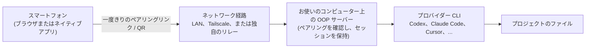

# OOP (oh-our-pi)

**普段使っているコーディングエージェントを1つのデスクトップアプリで操作できます。必要なら、複数モデルのチームも上に載せられます。**

[English](README.md) | [한국어](README.ko.md) | [简体中文](README.zh-CN.md) | 日本語 | [Español](README.es.md)


OOP はあなた自身のコンピューター上で動作し、すでにお持ちのコーディングエージェント CLI (Codex、Claude Code、Cursor、Grok Build、OpenCode、Antigravity、ZCode、MiniMax Code) をラップして、チャット形式の1つのワークスペースにまとめます。デスクトップアプリ、ブラウザ、スマートフォンのいずれからでも使えます。ホスト型サービスでは**ありません**。サブスクリプションや API キーはご自身のものを使い、コードはあなたのマシンの外に出ません。

OOP は T3 Tools Inc. による [T3 Code](https://github.com/pingdotgg/t3code) (MIT ライセンス) のフォークで、アップストリームの v0.0.44 をベースにしています。現在の OOP のバージョンは [`OOP_RELEASE.json`](OOP_RELEASE.json) にあります。ここにある基盤のほとんどは T3 Code チームの成果です。心から感謝します。

## 目次

- [なぜ OOP なのか](#なぜ-oop-なのか)
- [スクリーンショットツアー](#スクリーンショットツアー)
- [機能リファレンス](#機能リファレンス)
- [対応プロバイダー](#対応プロバイダー)
- [対応プラットフォーム](#対応プラットフォーム)
- [要件](#要件)
- [デスクトップアプリをインストール](#デスクトップアプリをインストール)
- [インストール / ソースからのビルド](#インストール--ソースからのビルド)
- [スマートフォンから接続する](#スマートフォンから接続する)
- [アップデートの仕組み](#アップデートの仕組み)
- [セキュリティとプライバシー](#セキュリティとプライバシー)
- [FAQ / トラブルシューティング](#faq--トラブルシューティング)
- [リポジトリマップ](#リポジトリマップ)
- [ステータス、コントリビュート、ライセンス](#ステータスとロードマップの正直なところ)

## なぜ OOP なのか

コーディングエージェントは優秀ですが、それぞれが独自のターミナルやアプリの中にあり、ログインも履歴も承認プロンプトもバラバラです。OOP はそれらを並べて使えるようにします。

- **多くのエージェントを1か所で。** スレッドごとに Codex、Claude Code、Cursor、Grok Build、OpenCode、Antigravity、ZCode、MiniMax Code を切り替えられ、diff、ターミナル、承認の流れは共通です。
- **複数のモデルでタスクを分担。** OOP Crew では、1つの「brain」モデルが日常的な作業を安価な worker に、難しい作業を expert に任せ、auditor が結果をレビューします。
- **主導権はあなたに。** 4つの権限モード、復元できるチェックポイント付きの diff パネル、コストで驚かないための使用量ページを備えています。
- **キーボードから離れても作業。** スマートフォンをエージェントが動いているコンピューターとペアリングして、長いタスクを見守ったり、操作したりできます。
- **すべてローカルに。** プロジェクト、プロバイダーのログイン、エージェントの作業内容はあなたのマシンに残ります。OOP のアカウントも OOP のサーバーもありません。

対象となる方: すでに1つ以上のコーディングエージェントのサブスクリプションや API
プランを利用し、初期段階の未署名デスクトップアプリを使用でき、1つの操作画面に
まとめたい開発者。洗練された署名済みの自動更新プロダクトをお求めなら、
現時点ではアップストリームのプロジェクトのほうが向いています。

### 30秒ツアー


_メインのチャット画面: プロバイダーとモデルを選び、権限モードを設定して、スレッドを追いかけます。_

1. OOP を開き、1つのプロバイダーにサインインします (Settings → Providers)。
2. プロジェクトのフォルダーを追加して、スレッドを開始します。
3. コンポーザーでモデルと権限モードを選び、メッセージを送ります。
4. diff パネルで結果を確認します。気に入らなければチェックポイントから復元できます。

## スクリーンショットツアー

スクリーンショットはすべて、個人データを含まない分離されたデモ用プロファイルのものです。

### チャット

メインのワークスペースです。各プロジェクトにスレッドがあり、各スレッドは1つのプロバイダーとモデルとの会話です。コンポーザーには、モデルピッカー、権限モード、そして Crew と Goal のコントロールがあります。

**開き方:** プロジェクトを追加し、サイドバーからスレッドを開始します。


_チャット: スレッドのタイムラインの下に、モデルピッカーと権限モードを備えたコンポーザーがあります。_

### OOP Crew

1つのチャットで、複数のモデルを使います。そのチャット自身のモデルが **brain** (頭脳役) で、計画を立ててあなたと対話します。**worker** (作業役) は日常的な作業 (検索、編集、テスト) を、**expert** (専門家役) は難しい実装を担当し、**auditor** (監査役) はファイルを変更したターンをレビューします。プリセットは **OOP pick**、**Speed**、**Quality**、**Budget** で、ロールごとにモデルを上書きすることもできます。Crew のモデルが失敗した場合 (たとえばクレジット切れ)、OOP は同じレベルの別のサインイン済みモデルにタスクを引き継ぎます。テストが通る20行以下の小さな変更は監査されません。

**使いどころ:** 大部分は安価なモデルに任せ、レビューは強力なモデルにさせたい大きめのタスク。**開き方:** コンポーザーのモデルピッカーの隣にある **Crew**。Crew の作業は、右パネルの **Workflows** と **Agents** にリアルタイムで表示されます。


_OOP Crew: 1つのチャットで複数のモデルを使い、誰が何をしているかをライブボードで確認できます。_

> [!NOTE]
> Crew は1つのチャットで複数のモデルを動かすため、プロバイダーの使用量が増えます。コストが気になる場合は、まず **Budget** プリセットから始めてください。

### Providers

各プロバイダーのインストール、アップデート、サインインを1か所で行えます。カードには、CLI がインストールされているか、サインイン済みかが表示され、`npm` が `PATH` にある場合は **Install**、OOP がどのインストーラーが CLI を管理しているか把握している場合は **Update now** を選べます。

**開き方:** Settings → Providers。


_Settings → Providers: 各プロバイダーのインストール、アップデート、サインイン。_

### Z.AI または MiniMax の追加 (OpenCode プリセット)

Z.AI (API または Coding Plan) と MiniMax (API または Token Plan) 用のプリセットで、OpenCode 経由で動作します。OpenCode の設定を手書きしなくても、それらのモデルを使えます。API キーはインスタンス変数 (`OOP_ZAI_API_KEY` / `OOP_MINIMAX_API_KEY`) として保存されます。

**開き方:** Settings → Providers → Add。OpenCode 1.14.19 以降が必要です。


_Add provider: OpenCode 経由で動作する Z.AI と MiniMax のプリセット。_

> [!NOTE]
> 有料の Z.AI / MiniMax のサインインとチャットリクエストは、このフォークではテストしていません。

### Diff とレビュー

スレッド内でエージェントが何を変更したかを正確に確認し、レビューし、各ターンの終わりに作られたチェックポイントから復元できます。チェックポイントは非表示の git ref なので、ブランチが散らかることはありません。

**開き方:** 右パネルの **Diff** タブ (git リポジトリ内のサーバースレッド)。


_Diff パネル: エージェントの変更を確認し、チェックポイントから復元します。_

### コミットとソース管理

サーバーを実行しているマシン上の各 CLI を通じて GitHub、GitLab、Forgejo/Gitea、Bitbucket、Azure DevOps に接続すると、スレッドからコミット、公開、プルリクエストの作成ができます。

**開き方:** Settings → Source Control で CLI を検出し (サインイン後に **Rescan** を押します)、スレッドのコミット操作を使います。


_ソース管理: スレッドから変更をコミットして公開します。_

### 権限モード

エージェントが行動する前に確認を求めるタイミングを選びます。モードはスレッドごとに適用されます。

| モード                | 動作                                                                                                                                               |
| --------------------- | -------------------------------------------------------------------------------------------------------------------------------------------------- |
| **Supervised**        | コマンドとファイル変更の承認を求めます。                                                                                                           |
| **Auto-accept edits** | ファイル編集を自動で承認します。それ以外の操作は引き続き確認を求める場合があります。                                                               |
| **Auto**              | 日常的な操作にはプロバイダーの自動レビューを使い、それ以外は確認を求めます (Codex、Claude、Cursor。他のプロバイダーは確認を求める動作になります)。 |
| **Full access**       | コマンドと編集を承認プロンプトなしで実行します。新しいスレッドの**デフォルト**です。                                                               |

**開き方:** コンポーザーのモードセレクター。デフォルトは Settings → General → New threads → Permissions で変更できます。


_権限モード: Supervised から Full access まで。_

### スレッドゴール

チャットが終わったときに何が成り立っているべきかを記述します。ゴールが開いている間、エージェントが `GOAL COMPLETE` を報告するか、`GOAL BLOCKED: <reason>` を報告するか、あなたが選んだ自動継続の回数を使い切るまで、OOP は各ターンの終了後にスレッドを継続します。Crew を使う場合、ファイルを変更したターンは監査を通ったときにのみカウントされます。

**開き方:** コンポーザーの **Crew** の隣にある **Goal**。終了するには **Stop goal** を使います。


_スレッドゴール: ゴールが達成されるか、ブロックされるか、停止されるまでチャットは続きます。_

### チャット内レポート

回答に数値やプロセスが含まれる場合、エージェントは長い文章の代わりに、チャート、主要数値カード、進捗バー、フロー図として描画できます。各図には、背後のデータを表示する **Source** ボタンがあります。

**試し方:** エージェントにチャートや図を頼んでみてください。


_レポート: 会話の中に描画されたチャートと主要数値。_

### Workflows と Agents パネル

エージェントの動きをリアルタイムで表す図です。ツール呼び出し、サブエージェント、プロバイダーのワークフローがそれぞれカードになり、並列の作業は同じ列に並び、選択したカードにはモデル、所要時間、トークン数が表示されます。Crew の作業もここに表示されます。

**開き方:** 右パネル (Workflows タブと Agents タブ)、コマンドパレット、または `mod+alt+w`。


_Workflows パネル: エージェントの作業をリアルタイムで追えます。_

### Usage

接続中のサーバー上のすべてのプロバイダーについて、トークン使用量、キャッシュによる節約、モデル別の内訳、API 換算の**推定**コストを表示します。これらは推定値であり、サブスクリプションの請求額ではありません。

**開き方:** サイドバーまたはコマンドパレットの **Usage**、もしくは `mod+u` (ターミナルにフォーカスがないとき)。


_Usage: プロバイダー別のトークンと推定コストの履歴。_

### 内蔵ターミナル

サーバーを実行しているマシン上に、スレッドごとのターミナルがあります。最大5,000行 (8 MiB) のスクロールバックがサーバー側に保持されるため、再接続しても残ります。


_チャットと並んだ内蔵ターミナル。_

### ダークテーマ


_ダークテーマ。_

### スマートフォンサイズの Web クライアント

ペアリングすれば、同じ Web UI をスマートフォンのブラウザでも使えます ([スマートフォンから接続する](#スマートフォンから接続する)を参照)。


_スマートフォンサイズの Web クライアント。_

### リモートアクセス設定

ネットワークアクセスの有効化、ペアリングリンクの作成、認可済みクライアントの確認と取り消しを行う場所です。このスクリーンショットのペアリングコードはマスクされています。

**開き方:** Settings → Connections。


_Settings → Connections: リモートアクセスとペアリング (コードはマスク済み)。_

## 機能リファレンス

「Added in OOP (OOP で追加)」は、フォークのドキュメントとコードが OOP 固有のものとして示していることを意味します。「Upstream (アップストリーム由来)」は、ドキュメントとコードから判断する限りアップストリーム (v0.0.44) の一部であることを意味します。フォークではファイル単位の差分確認を行っていないため、この区分はおおよそのものとして扱ってください。

| 機能                                                  | 内容                                                                                                | 場所                                           | 由来                                                  |
| ----------------------------------------------------- | --------------------------------------------------------------------------------------------------- | ---------------------------------------------- | ----------------------------------------------------- |
| OOP Crew                                              | brain モデルが worker、expert、auditor モデルに委任します。プリセットとロールごとの上書きがあります | Composer → Crew、右パネル → Workflows / Agents | Added in OOP (OOP で追加)                             |
| スレッドゴール                                        | チェックが通るか、ゴールがブロックされるまでスレッドを継続します                                    | Composer → Goal                                | Added in OOP                                          |
| プロジェクトメモリ                                    | コンポーザーから、保存済みのプロジェクトメモリを提案します                                          | コンポーザー、メモリボタン                     | Added in OOP                                          |
| ローカルのロール設定                                  | 実装用・レビュー用の好みのモデルを環境ごとに保存でき、おすすめも表示されます                        | コンポーザーのモデルピッカー                   | Added in OOP                                          |
| Z.AI / MiniMax プリセット                             | OpenCode ベースのプロバイダープリセット                                                             | Settings → Providers → Add                     | Added in OOP (有料リクエストは未テスト)               |
| ZCode (GLM) プロバイダー                              | Z.AI のエージェントを ACP 経由で利用します                                                          | Settings → Providers                           | Added in OOP                                          |
| MiniMax Code プロバイダー                             | MiniMax のエージェントを ACP 経由で利用します                                                       | Settings → Providers                           | Added in OOP                                          |
| ワンクリックのプロバイダーインストール / アップデート | プロバイダーのカードから、プロバイダー CLI をインストールまたはアップデートします                   | Settings → Providers                           | Added in OOP (アップストリームとの正確な差分は未検証) |
| Verify macOS build                                    | OOP の `.dmg` について、整合性、厳密なコード署名、サーバー Mac での起動を確認します                 | チャットヘッダー → Verify macOS build          | Added in OOP                                          |
| スマートフォン接続ダイアログ                          | デスクトップアプリ向けのワンクリックのスマートフォンペアリング QR。独自のリレーも任意で設定できます | サイドバー → Connect mobile                    | Added in OOP (デスクトップアプリのみ)                 |
| 独自の Cloudflare リレー                              | 自分でデプロイする Worker で、どのネットワークからでもスマートフォンからデスクトップに接続できます  | `infra/oop-relay`                              | Added in OOP、初期段階                                |
| ローカルフォルダーのアップデーター                    | パッケージ版の OOP が、指定したフォルダーにある新しいパッケージを取得できます                       | パッケージ版の macOS / Windows ビルド          | Added in OOP、初期段階、他者による検証なし            |
| マルチプロバイダーのセッション                        | プロバイダーをまたいだスレッド、ターン、チェックポイント                                            | あらゆる場所                                   | Upstream (アップストリーム由来)                           |
| 権限モード                                            | Supervised、Auto-accept edits、Auto、Full access                                                    | コンポーザー、Settings → General               | Upstream                                          |
| Diff パネルとチェックポイント                         | エージェントの変更を確認して復元します                                                              | 右パネル → Diff                                | Upstream                                          |
| ソース管理                                            | プロバイダー CLI 経由のクローン、コミット、公開、プルリクエスト                                     | Settings → Source Control                      | Upstream                                          |
| 内蔵ターミナル                                        | サーバーマシン上のスレッドごとのターミナル                                                          | スレッド内                                     | Upstream                                          |
| チャット内レポート                                    | チャート、統計カード、進捗バー、mermaid のフロー図                                                  | 返信内                                         | Upstream                                          |
| ワークフロービュー                                    | ツール呼び出しとサブエージェントのリアルタイム図                                                    | 右パネル、`mod+alt+w`                          | Upstream                                          |
| Usage ページ                                          | トークンと推定コストの履歴                                                                          | サイドバー、`mod+u`                            | Upstream (ZCode と MiniMax の行は OOP)            |
| SnapShots                                             | ウィンドウをキャプチャして下書きに取り込みます (デフォルトはオフ。macOS、Windows、Linux Wayland)    | Settings → SnapShots                           | Upstream (帰属は未検証)                           |
| リモートアクセス                                      | LAN ペアリング、Tailscale HTTPS、SSH 環境                                                           | Settings → Connections                         | Upstream                                          |
| デバイスパネル                                        | iOS Simulator や Android Emulator をスレッドの隣で表示し、タップ操作もできます                      | 右パネル → Device                              | Upstream (ここでは未テスト)                       |
| バックグラウンドサービス                              | macOS (launchd) と Linux (systemd ユーザーユニット) での `t3 service install`。Windows は非対応     | CLI                                            | Upstream (ここでは未テスト)                       |
| キーバインド、プロジェクト設定、テーマ                | カスタマイズ可能なショートカット、プロジェクトごとの上書き、外観                                    | Settings                                       | Upstream                                          |

## 対応プロバイダー

スレッドを始める前に、少なくとも1つのプロバイダー CLI をインストールしてサインインしてください。

| プロバイダー                   | サインイン方法                                                                                                         | 備考                                                                                           |
| ------------------------------ | ---------------------------------------------------------------------------------------------------------------------- | ---------------------------------------------------------------------------------------------- |
| Codex                          | Codex CLI をインストールし、`codex login` を実行します (または Settings → Providers の **Connect with ChatGPT**)       |                                                                                                |
| Claude Code                    | Claude Code をインストールし、`claude auth login` を実行します                                                         | Claude の brain は、同じアカウントの Claude の crew ロールをサブエージェントとして実行します。 |
| Cursor                         | Cursor CLI をインストールし、`agent login` を実行します                                                                |                                                                                                |
| Grok Build                     | Grok Build CLI をインストールし、`grok login` を実行します                                                             |                                                                                                |
| OpenCode                       | OpenCode 1.14.19 以降をインストールし、`opencode auth login` を実行します                                              | Z.AI / MiniMax プリセットに必要です。                                                          |
| Antigravity                    | Settings → Providers で有効にし、**Install**、続いて **Sign in with Google**                                           | CLI は不要です。Gemini API キーは設定内に平文で保存されます。                                  |
| ZCode (GLM)                    | ZCode をインストールし、`zcode login zai` を実行して、`npm i -g zcode-acp-server` を実行します                         | どの権限モードを選んでも、独自のツールを承認なしで実行します。                                 |
| MiniMax Code                   | `npm i -g @minimax-ai/code` を実行し、`mcode login --region global` を実行します                                       |                                                                                                |
| OpenCode 経由の Z.AI / MiniMax | Settings → Providers → Add → Z.AI または MiniMax を選び、キーを `OOP_ZAI_API_KEY` / `OOP_MINIMAX_API_KEY` に設定します | 有料リクエストは未テストです。                                                                 |

## 対応プラットフォーム

| プラットフォーム                       | 状況                                                                                                                       |
| -------------------------------------- | -------------------------------------------------------------------------------------------------------------------------- |
| macOS、Apple Silicon (arm64)           | **テスト済み。** 主なターゲットです。                                                                                      |
| Windows x64                            | **実験的。** メンテナーがビルドしたもので、クリーンなマシンでは検証していません。                                          |
| macOS Intel                            | このフォークでは未テストです。macOS 用のビルドスクリプトは Intel 上での実行を拒否します。                                  |
| Linux                                  | このフォークでは未テストです。アップストリームのパッケージングコードはリポジトリにありますが、保証はありません。           |
| iOS / Android ネイティブアプリ         | このフォークでは未テストです。[ネイティブアプリかブラウザか](#ネイティブアプリかブラウザか)を参照してください。            |
| スマートフォンのブラウザ (Web UI 経由) | Web UI はスマートフォンサイズで確認済みです。[スマートフォンから接続する](#スマートフォンから接続する)を参照してください。 |

## 要件

以下の要件はソースからビルドする場合のみ必要です。バイナリーインストーラーには Node.js、pnpm、git、コンパイラーは不要です。エージェントを使うには、プロバイダー CLI のインストールとログインが別途必要です。

- **Node.js 24.x、24.13.1 以降**
- **pnpm 11.10.0**
- **git**
- **rsync** (macOS。ビルドスクリプトが使用します)
- **少なくとも1つのプロバイダー CLI**。インストールしてサインイン済みであること ([対応プロバイダー](#対応プロバイダー)を参照)
- Windows でのパッケージングのみ: Rust、Python 3、Visual Studio Build Tools (Desktop development with C++、Windows SDK を含む)

## デスクトップアプリをインストール

**macOS (Apple Silicon)**

```sh
curl -fsSL https://raw.githubusercontent.com/AIBeginnerX/oh-our-pi-desktop/main/scripts/install-desktop.sh | sh
```

**Windows (PowerShell, x64)**

```powershell
irm https://raw.githubusercontent.com/AIBeginnerX/oh-our-pi-desktop/main/scripts/install-desktop.ps1 | iex
```

**Linux (x64)**

```sh
curl -fsSL https://raw.githubusercontent.com/AIBeginnerX/oh-our-pi-desktop/main/scripts/install-desktop.sh | sh
```

インストール先、更新、セキュリティ、リリースの前提条件は、簡潔な
[デスクトップインストールガイド](INSTALL.md)を参照してください。v0.0.106
およびそれ以前のソースのみのリリースにはバイナリーがありません。v0.0.107
以降で、対応するインストーラーと `.sha256` ファイルがリリースの **Assets**
にあるものを使用してください。

## インストール / ソースからのビルド

```bash
git clone https://github.com/AIBeginnerX/oh-our-pi-desktop.git
cd oh-our-pi-desktop
```

### macOS (Apple Silicon)

スクリプトは `pnpm` 経由ではなく、`node` で直接実行してください。

```bash
node scripts/macos.mjs doctor    # checks macOS arm64, Node, pnpm, rsync
node scripts/macos.mjs setup     # installs dependencies in a local cache
node scripts/macos.mjs start     # optional: run an isolated dev copy of the desktop app
node scripts/macos.mjs package   # builds an ad hoc signed DMG into release/macos/
```

`release/macos/` から DMG を開き、アプリを `/Applications/OOP.app` にドラッグします。

### Windows (x64、実験的)

Windows PC 上でビルドしてください (クロスビルドはできません)。先に Rust、Python 3、Visual Studio Build Tools (Desktop development with C++、Windows SDK を含む) をインストールします。

```bat
set OOP_WINDOWS_UPDATE_DIRECTORY=%CD%\release\windows
node scripts\windows.mjs package
```

インストーラー (`OOP-<version>-x64.exe`) は `release\windows` に出力されます。

### 汎用の開発手順 (任意の OS)

このコードベースがドキュメント化しているタスクランナー Vite+ (`vp`) を使います (インストール: `curl -fsSL https://vite.plus | bash`)。詳しくは [`docs/operations/development.md`](docs/operations/development.md) を参照してください。

```bash
vp i          # install dependencies
vp run dev    # server + web; open the pairing URL it prints
```

### 初回起動チェックリスト (ソースビルド)

ソースビルドは **ad hoc 署名で、公証 (notarize) されていない**ため、OS から警告が表示される場合があります。バイナリーインストーラーはインストール前に SHA-256 を検証し、Gatekeeper の隔離属性や Windows SmartScreen を回避しません。

- **macOS (Gatekeeper):** アプリを右クリックして **Open** を選ぶか、System Settings → Privacy & Security → **Open Anyway** に進みます。
- **Windows (SmartScreen):** **More info** → **Run anyway** をクリックします。

そのうえで、次を行います。

- [ ] Settings → Providers: **1つ**のプロバイダーをインストールしてサインインします。
- [ ] プロジェクトを追加します (フォルダー。できれば git リポジトリ)。
- [ ] スレッドを開始し、コンポーザーでモデルを選びます。
- [ ] 権限モードを選びます。新しいスレッドのデフォルトは **Full access** です。信頼できないリポジトリでは **Supervised** を使ってください。
- [ ] 任意: **Crew** をオンにして、数ターン後に **Usage** ページを確認します。

## スマートフォンから接続する

エージェント、ファイル、プロバイダーのログインは、あなたのコンピューター (**ホスト**) に残ります。スマートフォンはリモコンにすぎません。スレッドを表示し、メッセージの送信や承認プロンプトへの応答ができます。ホストは起動したままスリープさせないでください。



次の順で、ご自身に合う最もシンプルな経路を選んでください。

|     | 経路                     | 必要なもの                                                 | 外出先で使える | リスク                             |
| --- | ------------------------ | ---------------------------------------------------------- | -------------- | ---------------------------------- |
| a   | 同じ Wi-Fi / LAN         | スマートフォンとコンピューターが同じネットワークにあること | いいえ         | 最も低い                           |
| b   | Tailscale                | 両方のデバイスで無料の Tailscale アカウント                | はい           | 低い                               |
| c   | 独自の Cloudflare リレー | Cloudflare アカウントと、一度きりのデプロイ                | はい           | 中程度 (Cloudflare に通信が見える) |

> [!WARNING]
> **ペアリングリンクとコードはパスワードと同じです。** Issue、チャット、スクリーンショットに絶対に投稿しないでください。ペアリングするのは自分のデバイスだけにしてください。サーバーのポートをインターネットに公開しないでください。外出先で使う場合は Tailscale をおすすめします。見覚えのないデバイスは取り消してください。リモートでエージェントを操作するときは **Supervised** 権限モードを使ってください。

### a) 同じ Wi-Fi / LAN (最もシンプル)

**前提条件:** コンピューターで OOP デスクトップアプリが動いていて、スマートフォンが同じネットワークにあること。

1. デスクトップアプリで、サイドバーのスマートフォンアイコン (**Connect mobile**) をクリックします。
2. モバイル接続がオフだとダイアログに表示されたら、**Allow mobile connections** をクリックします。OOP が一度再起動し、設定は保持されます。
3. 一度きりの QR コードが表示されます。複数のアドレスが表示された場合は、スマートフォンから到達できるものを選びます (同じ Wi-Fi なら **LAN** のエントリ)。
4. スマートフォンのカメラで QR コードをスキャンし、スマートフォンのブラウザでリンクを開きます。これでスマートフォンがペアリングされました。ペアリングによってそのデバイスは以降のアクセスも認可されるため、元のコードを再度使う必要はありません。

手動でも同じことができます。Settings → Connections → **Network access** をオンにし、**Create link** を押して、そのリンクをスマートフォンで開きます。そこで作成したリンクは、そのページを開いている間だけコピーできます。ページを離れると新しいリンクが必要です。

デスクトップアプリなしでサーバーを動かしている場合 (たとえば開発手順) は次のようにします。

```bash
t3 serve --host <your-computer's-LAN-address>   # for example 192.168.1.20
t3 pair                                          # prints a fresh pairing QR for the running server
```

ソースのチェックアウトからは、`node apps/server/src/bin.ts pair` で同じコマンドを実行できます。ペアリングトークンの有効期間はデフォルトで5分です (`--ttl` で変更でき、オプションは `t3 pair --help` で確認できます)。`127.0.0.1` のようなループバックアドレスはコンピューター自身でしか使えず、スマートフォンでは使えません。

### b) Tailscale のプライベートネットワーク

**前提条件:** [Tailscale](https://tailscale.com) のアカウントがあり、コンピューターとスマートフォンの両方に Tailscale がインストールされ、同じ tailnet にサインインしていること。

1. デスクトップアプリで Settings → Connections を開き、**Tailscale HTTPS** を有効にします。(経路を削除するには、同じ場所でオフにします。)
2. ペアリングリンクを作成します (または **Connect mobile** を使って Tailscale の経路を選びます)。リンクは `https://your-computer.your-tailnet.ts.net/` のような形です。
3. スマートフォンでリンクを開きます (スマートフォン側で Tailscale が接続されている必要があります)。

コマンドラインで動かすサーバーの場合:

```bash
t3 serve --tailscale-serve     # start a server published over Tailscale HTTPS
t3 pair --tailscale            # for an already-running server
tailscale serve --https=443 off   # remove the mapping later
```

ポート 443 が使用中の場合は、`--tailscale-serve-port` で別のポートを指定します。Tailscale の通信は、公開リレーを一切経由しません。

### c) 独自の Cloudflare リレー (外出先から、Tailscale なし)

OOP には小さな Cloudflare Worker が [`infra/oop-relay`](infra/oop-relay/README.md) に含まれていて、**あなた自身の** Cloudflare アカウントにデプロイします。デスクトップ側から外向きに接続するため、ルーターの設定は不要で、デスクトップがオンラインであれば、スマートフォンはどのネットワークからでも接続できます。

1. [`infra/oop-relay/README.md`](infra/oop-relay/README.md) の説明に従って Worker をデプロイします (`npx wrangler login`、`npx wrangler deploy`、続いて `npx wrangler secret put OOP_RELAY_SECRET`)。
2. デスクトップアプリで Connect mobile → **Use away from home** を選びます。表示されたシークレットを Worker のシークレットに貼り付け、リレーのアドレスを入力して **Save** します。
3. 経路として **Cloudflare relay** を選び、QR コードをスキャンします。

> [!NOTE]
> 1つのデプロイは1台のデスクトップ用です。リレーでは Cloudflare が TLS を終端するため、通信内容は、それを運用している Cloudflare アカウントから見えます。スマートフォンは引き続き、ペアリングコードでデスクトップにサインインする必要があります。この経路は新しく、3つの中で最もテストされていません。

**アップストリームのトンネルサービスはどうですか?** アップストリームのプロジェクトにはトンネルサービスも付属していますが、これはクラウドへのサインインと、アップストリームのプロジェクトが運営するサーバーに依存します。**OOP はホスト型サービスを一切運営しておらず**、このフォークではそれをテストしていないため、このガイドでは扱いません。

### ネイティブアプリかブラウザか

|                        | スマートフォンのブラウザ                                                                      | ネイティブの iOS / Android アプリ                                                                  |
| ---------------------- | --------------------------------------------------------------------------------------------- | -------------------------------------------------------------------------------------------------- |
| 概要                   | お使いのコンピューターが配信する OOP の Web UI                                                | アップストリームのプロジェクトが公開しているモバイルアプリ (OOP ブランドではありません) |
| インストール           | 不要                                                                                          | アップストリームのプロジェクトの App Store / Google Play のページ                                                        |
| 接続                   | ペアリングリンクを開くか、QR コードをスキャンします                                           | 環境を追加します: QR コードをスキャンするか、ペアリング URL を貼り付けます                         |
| このフォークでのテスト | Web UI はスマートフォンサイズで確認済み。実機のスマートフォンからのペアリングは個別には未検証 | **未テスト**                                                                                       |


_OOP に接続したスマートフォンのブラウザ。_

このフォークはプロトコルと認証の識別子を維持しているため ([`UPSTREAM.json`](UPSTREAM.json) の `internal_protocol_and_auth_identifiers_preserved`)、アップストリームのアプリは OOP サーバーとペアリングできるはずです。**ただし、フォークではネイティブのモバイルアプリをテストしていない**ため、未確認として扱ってください。アップストリームのドキュメントでは、アプリの接続設定は Settings → Environments に記載されています。不具合があればブラウザを使ってください。

### プッシュ通知

アップストリームのドキュメントによると、スマートフォンへのプッシュ通知 (エージェントの完了、失敗、承認待ち) には アップストリームのトンネルサービスへのサインインが必要で、直接接続や Tailscale 接続だけでは有効になりません。OOP はそのサービスを運営しておらず、フォークでもテストしていないため、**上記の経路ではプッシュ通知は期待しないでください。** スマートフォンのページを開いたままにするか、スレッドをときどき確認してください。

### デバイスの無効化

1. コンピューターで Settings → Connections → **Authorized clients** を開きます。
2. そのデバイスのセッションを取り消して、既存のアクセスを削除します。未使用のペアリングリンクも取り消して、後から使われないようにします。
3. コマンドライン: `t3 auth session list` / `t3 auth session revoke <id>`、および `t3 auth pairing list` / `t3 auth pairing revoke <id>` (`t3 auth --help` を参照)。
4. 入口を完全に閉じるには、Settings → Connections で **Network access** (または **Tailscale HTTPS**) をオフにします。

## アップデートの仕組み

ソースビルドは GitHub から自動更新されないため、以下の手順で再ビルドしてください。0.0.111 以降の macOS と Windows のインストール版は自動で更新されます。OOP は数分ごとにこのリポジトリーの GitHub Release を確認し、新しいバージョンをバックグラウンドでダウンロードして SHA-256 を検証し、再起動を選ぶとインストールします (macOS はインストールした場所のアプリを置き換え、Windows はセットアップを実行します)。Linux、またはそれより古いバージョンでは、OOP を終了して該当するインストーラーコマンドを再実行してください。ユーザーデータは保持されます。

1. `git pull`
2. 再度ビルド / パッケージングして ([インストール](#インストール--ソースからのビルド)を参照)、再インストールします。

各リリースは、**1つのコミット** (タイトルは `OOP <version> source`)、`v<version>` というタグ、GitHub Release として公開されます。`~/.oop-desktop/userdata` にあるデータはアップデートをまたいで保持されます。新しいバージョンの通知を受け取るには、GitHub リポジトリで **Watch → Custom → Releases** を有効にしてください。以前のバージョンにはタグしかありません。

自分でビルドしたアプリは、ビルド時に決まったフォルダから次のビルドを見つけ、アプリ内でアップデートを提案します。Windows では上で指定した `release\windows`、macOS では `release/macos` です。macOS の `package` は DMG しか作らないため、続けてアップデートパッケージも作成してください。

```bash
V=<version>
node scripts/build-oop-update-pkg.mjs --dmg release/macos/OOP-$V-arm64.dmg \
  --sha256 "$(awk '{print $1}' release/macos/OOP-$V-arm64.dmg.sha256)" \
  --version $V --output release/macos/OOP-$V-arm64-update.pkg
```

> [!NOTE]
> アプリ内のサーバーアップデート通知と `t3 update` は、アップストリームのプロジェクトによるものです。OOP のアップデートチャネルではありません。

## セキュリティとプライバシー

> [!WARNING]
> エージェントは**あなたのアカウントの権限**で動作します。ファイルを編集したり、コマンドを実行したりできます。新しいスレッドのデフォルトの権限モードは **Full access** です。信頼できないリポジトリでは **Supervised** に切り替えてください (Settings → General → New threads)。

- **ZCode** は、どの権限モードを選んでも、独自のツールを承認なしで実行します。
- **コスト:** どのプロバイダーも、あなた自身のサブスクリプションまたは API クレジットを使います。Crew は1つのチャットで複数のモデルを動かすため、使用量が増えます。Usage ページが表示するのは推定値で、請求額ではありません。
- **API キー**は、サーバー側、つまりあなたのマシンに保存されます。Antigravity の Gemini API キーは設定内に**平文で**保存されます。
- **`.env` ファイルやキーは絶対にコミットしないでください**。Issue やログにも貼り付けないでください。
- **アップストリームのインストーラーがインストールするのは OOP ではなくアップストリームのアプリです:** `t3.codes` のインストールスクリプト、`npx t3`、Homebrew の `t3-code`、winget の `T3Tools.T3Code`、App Store / Play のページは、すべてアップストリームのプロジェクトのものです。上記の OOP デスクトップインストーラーを使うか、このリポジトリからビルドしてください。
- **CLI の名前は今も `t3` のまま**で、アップストリームのインストールと衝突することがあります。
- **ソースビルドは ad hoc 署名**で、Developer ID も公証もありません。バイナリーインストーラーは SHA-256 を検証し、Gatekeeper の隔離属性や SmartScreen を回避しません。
- **ローカルフォルダーのアップデーター**は、アップデート用フォルダーに書き込める人を信頼します。SHA-256 のチェックで検出できるのは破損だけです。

**テレメトリー。** OOP にはサーバーがなく、メンテナーがあなたのアプリから何かを受け取ることはありません。アップストリームから引き継いだサーバーコードには、匿名の PostHog 利用状況レポーターが含まれています (アップストリームのプロジェクトのキーと `us.i.posthog.com` を使用)。OOP ではこれを**デフォルトで無効**にしているため、オプトインしない限り何も送信されません。有効にするには、サーバーを起動する前にサーバーの環境で `T3CODE_TELEMETRY_ENABLED=true` を設定してください ([`docs/user/telemetry.md`](docs/user/telemetry.md) を参照)。有効にすると、イベントにはプロバイダー、モデル、推論の強度、権限モード、ターンの結果、所要時間、メインエージェントのトークン合計が含まれ、ハッシュ化されたアカウントまたはインストールの識別子に紐づきます。ドキュメントによれば、プロンプト、応答、ファイルの内容、認証トークン、会話 ID は決して含まれません。

脆弱性を報告するには、[SECURITY.md](SECURITY.md) を参照してください。

## FAQ / トラブルシューティング

**macOS で、ソースビルドのアプリを開けない、または未確認の開発元のものだと表示されます。**
ソースビルドは ad hoc 署名で、公証されていません。アプリを右クリックして **Open** を選ぶか、System Settings → Privacy & Security → **Open Anyway** を使ってください。バイナリーインストーラーは隔離属性を回避しません。

**Windows で、ソースビルドのインストーラーに SmartScreen の警告が表示されます。**
ソースビルドのインストーラーは署名されていません。バイナリーインストーラーは SmartScreen を回避しません。

**プロバイダーが「not signed in」と表示されます。**
そのプロバイダー自身のコマンドでサインインし ([対応プロバイダー](#対応プロバイダー)を参照)、Settings → Providers を開き直してください。CLI は、サーバーを実行しているマシンの `PATH` 上にある必要があります。ソース管理のアカウントには、Settings → Source Control に **Rescan** ボタンがあります。

**スマートフォンからサーバーに接続できません。**

- ネットワークアクセスがオンになっているか確認してください (Connect mobile → **Allow mobile connections**、または Settings → Connections → **Network access**)。
- ペアリングリンクが `127.0.0.1` / localhost のアドレスになっていないことを確認してください。
- スマートフォンとコンピューターは、同じネットワーク (LAN) または同じ tailnet 上にある必要があります。ゲスト用 Wi-Fi は、デバイス間の通信をブロックすることがよくあります。
- ペアリングリンクは一度きりで有効期間も短いので、新しいものを作成してください。
- 両方のデバイスの日付と時刻、およびコンピューターがスリープしていないことを確認してください。

**`node scripts/macos.mjs doctor` が Node のバージョンについて警告します。**
Node.js 24.x の 24.13.1 以降と、pnpm 11.10.0 が必要です。それ以外の Node のメジャーバージョンは受け付けられません。

**データはどこにありますか?**
OOP のサーバーの状態 (スレッド、設定、ローカルデータベース) は `~/.oop-desktop/userdata` にあります。デスクトップバイナリーはこのデータとは別にインストールされます。プロバイダーのログインは、ここではなく各プロバイダー CLI 自身のフォルダーにあります。

**バイナリーインストール版を更新するには?**
OOP を終了し、該当するインストーラーコマンドを再実行してください。ユーザーデータは保持されます。

**OOP をリセットするには?**
アプリを終了し、`~/.oop-desktop/userdata` を別の場所に移動してください (確信が持てるまで削除しないでください)。次回は OOP が新しい状態で起動します。プロジェクトのフォルダーには影響しません。

**アンインストールするには?**
アプリを終了し、`~/Applications/OOP.app` (macOS。`OOP_INSTALL_DIR` で指定した場合はその場所) を削除するか、Windows の設定から OOP をアンインストールします。Linux では `~/.local/bin/oop-desktop`、`~/.local/share/oop-desktop`、デスクトップメニュー項目を削除してください。データも削除したい場合は、`~/.oop-desktop` を削除してください。プロバイダー CLI は別にインストールされたものなので、削除されません。

**お金はかかりますか?**
OOP 自体は無料です。OOP が動かすプロバイダーには、あなた自身のサブスクリプションまたは API クレジットが使われます。Crew は1つのチャットで複数のモデルを使い、Usage ページには (請求額ではなく) 推定コストが表示されます。

**アップストリームのモバイルアプリは使えますか?**
ペアリングできるはずですが、フォークではテストしていません。[ネイティブアプリかブラウザか](#ネイティブアプリかブラウザか)を参照してください。

## リポジトリマップ

| パス                                         | 内容                                                                                            |
| -------------------------------------------- | ----------------------------------------------------------------------------------------------- |
| `apps/server`                                | Node の WebSocket サーバー: オーケストレーション、プロバイダー、チェックポイント、`t3` CLI      |
| `apps/web`                                   | React / Vite の UI                                                                              |
| `apps/desktop`                               | Web UI をラップし、サーバーを同梱する Electron シェル                                           |
| `apps/mobile`                                | React Native クライアント (アップストリームのアプリコード)                                      |
| `packages/contracts`                         | ネットワークを越えるすべてのものの型付きスキーマ                                                |
| `packages/shared`、`packages/client-runtime` | 共有のランタイムユーティリティと、Web とモバイルで共有するクライアントコード                    |
| `infra/oop-relay`                            | 任意で使える Cloudflare リレー Worker                                                           |
| `docs/`                                      | `user/` ガイド、`internals/` アーキテクチャノート、`operations/` セットアップとリリースのノート |

コードベースの構成と従っている規約については、[`AGENTS.md`](AGENTS.md) を参照してください。

## ステータスとロードマップの正直なところ

OOP は**初期段階**です。バグがあるものとお考えください。フォークが実際にテストしているプラットフォームは macOS Apple Silicon だけで、Windows は実験的です。Intel Mac、Linux、ネイティブのモバイルアプリ、プッシュ通知、有料の Z.AI / MiniMax リクエストは未テストです。約束されたロードマップはありません。メンテナーは自分が遭遇した問題を修正し、準備ができたらリリースを公開します。

## コントリビュート

このリポジトリは**リリースミラー**です。Issue は歓迎します。プルリクエストはレビューされ、メンテナーのツリーでアップストリームに再適用されるため、公開履歴はリリースごとに1コミットになります。[CONTRIBUTING.md](CONTRIBUTING.md) を参照してください。Issue には、シークレット、ペアリング URL、個人のパスを絶対に含めないでください。

## ライセンスとクレジット

[MIT](LICENSE)。元の著作権表示「Copyright (c) 2026 T3 Tools Inc.」はそのまま残す必要があり、このフォークでの変更も MIT ライセンスです。

OOP は、T3 Tools Inc. と pingdotgg チームによる [T3 Code](https://github.com/pingdotgg/t3code) をベースに構築されています。プロバイダー名 (Codex、Claude Code、Cursor、Grok、OpenCode、Antigravity、ZCode、MiniMax、Z.AI) はそれぞれの所有者に帰属します。OOP はそれらと提携していません。
