# OOP (oh-our-pi)

**쓰던 코딩 에이전트를 하나의 앱에서.**

오픈소스 · MIT · 로컬 우선. 이미 쓰고 계신 코딩 에이전트를 채팅형 작업 공간 하나에서 제어하고, 필요하면 여러 모델로 팀까지 꾸릴 수 있습니다.

[English](README.md) | 한국어 | [简体中文](README.zh-CN.md) | [日本語](README.ja.md) | [Español](README.es.md) | [웹사이트](https://oop-desktop.github.io/)


[](https://github.com/AIBeginnerX/oh-our-pi-desktop/releases)
[](https://oop-desktop.github.io/)

OOP는 사용자의 컴퓨터에서 실행되며, 이미 설치해 둔 코딩 에이전트 CLI(Codex, Claude Code, Cursor, Grok Build, OpenCode, Antigravity, ZCode, MiniMax Code)를 감싸서 채팅 형태의 하나의 작업 공간으로 제공합니다. 데스크톱 앱, 브라우저, 휴대폰, 터미널에서 사용할 수 있습니다. 호스팅 서비스가 **아닙니다**. 구독과 API 키는 직접 준비하셔야 하고, 코드는 사용자의 컴퓨터에만 남습니다.

OOP는 T3 Tools Inc.의 [T3 Code](https://github.com/pingdotgg/t3code)(MIT 라이선스)를 포크한 프로젝트이며, 업스트림 v0.0.44를 기반으로 합니다. 현재 OOP 버전은 [`OOP_RELEASE.json`](OOP_RELEASE.json)에서 확인할 수 있습니다. 기반 코드의 거의 전부가 T3 Code 팀의 작업물입니다. 진심으로 감사드립니다.

[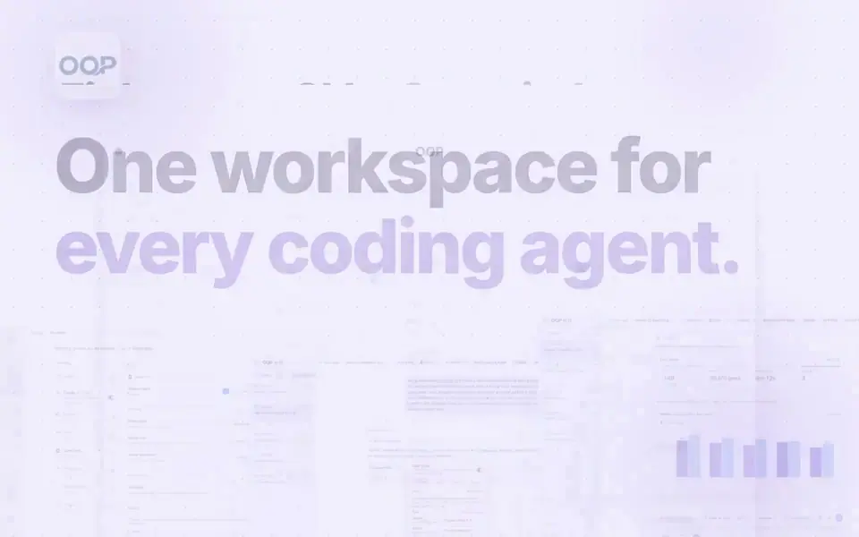](https://oop-desktop.github.io/)
_실제 화면 녹화로 만든 OOP 짧은 투어입니다. 이미지를 누르면 웹사이트로 이동합니다._

## 목차

- [왜 OOP인가요?](#왜-oop인가요)
- [새 소식](#새-소식)
- [모든 컴퓨터를 OOP 하나로](#모든-컴퓨터를-oop-하나로)
- [스크린샷 둘러보기](#스크린샷-둘러보기)
- [기능 레퍼런스](#기능-레퍼런스)
- [지원하는 provider](#지원하는-provider)
- [플랫폼 지원](#플랫폼-지원)
- [요구 사항](#요구-사항)
- [데스크톱 앱 설치](#데스크톱-앱-설치)
- [터미널 앱만 설치](#터미널-앱만-설치)
- [설치 / 소스에서 빌드](#설치--소스에서-빌드)
- [휴대폰에서 연결하기](#휴대폰에서-연결하기)
- [업데이트 방식](#업데이트-방식)
- [보안 및 개인정보](#보안-및-개인정보)
- [FAQ / 문제 해결](#faq--문제-해결)
- [저장소 구조](#저장소-구조)
- [현황, 기여, 라이선스](#현황-및-로드맵에-대한-솔직한-안내)

## 왜 OOP인가요?

코딩 에이전트는 훌륭하지만, 각각 자기만의 터미널이나 앱, 로그인, 기록, 승인 프롬프트를 가지고 있습니다. OOP는 이들을 나란히 놓아 줍니다.

- **여러 에이전트를 한곳에서.** 스레드마다 Codex, Claude Code, Cursor, Grok Build, OpenCode, Antigravity, ZCode, MiniMax Code를 바꿔 가며 쓸 수 있고, diff, 터미널, 승인 흐름은 모두 같습니다.
- **여러 모델이 하나의 작업을 나눠서.** OOP Crew를 쓰면 하나의 "brain"(총괄 모델)이 반복적인 작업은 저렴한 worker에게, 어려운 작업은 expert에게 맡기고, auditor가 결과를 검토하게 할 수 있습니다.
- **통제권은 그대로.** 네 가지 권한 모드, 복원할 수 있는 체크포인트가 있는 diff 패널, 비용이 놀라움이 되지 않도록 돕는 사용량 페이지를 제공합니다.
- **여러 컴퓨터에 OOP 하나로.** 이미 OOP를 돌리고 있는 데스크톱을 연결하면 각 컴퓨터의 프로젝트와 스레드가 같은 사이드바에 나오고, 새 스레드는 CPU와 메모리를 보고 컴퓨터 사이에 배분할 수 있습니다. 자세한 내용은 [모든 컴퓨터를 OOP 하나로](#모든-컴퓨터를-oop-하나로)를 참고하세요.
- **자리를 떠나서도 작업.** 에이전트를 실행하는 컴퓨터에 휴대폰을 페어링해서 오래 걸리는 작업을 지켜보거나 방향을 조정할 수 있습니다.
- **터미널에서도.** `oop`은 같은 스레드를 터미널 전체 화면 앱으로 열어 줍니다. 데스크톱 앱이 꺼져 있어도 동작하고, 데스크톱 앱과 데이터 폴더를 하나로 공유합니다.
- **모든 것을 로컬에.** 프로젝트, provider 로그인, 에이전트 작업이 모두 사용자의 컴퓨터에 남습니다. OOP 계정도, OOP 서버도 없습니다.

이런 분께 적합합니다. 이미 하나 이상의 코딩 에이전트 구독이나 API 요금제를 쓰고
있고, 활발히 개발 중인 서명되지 않은 데스크톱 앱을 사용할 수 있으며, 하나의 제어
화면을 원하는 개발자입니다. 설치된 macOS와 Windows 앱은 스스로 업데이트됩니다. 빌드는
코드 서명이나 공증이 되어 있지 않아 처음 실행할 때 OS가 경고할 수 있습니다. 서명·공증된
설치 프로그램이 필요하시다면 OOP는 아직 제공하지 않습니다.

### 30초 둘러보기

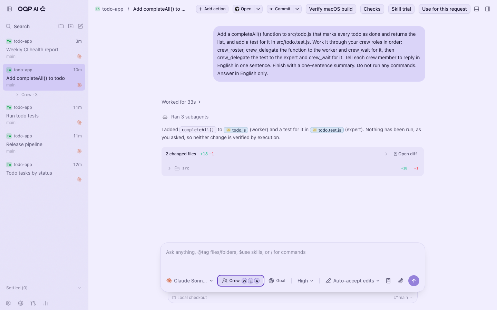
_메인 채팅 화면: provider와 모델을 고르고, 권한 모드를 설정한 뒤, 스레드를 따라가 보세요._

1. OOP를 열고 provider 하나에 로그인합니다(Settings → Providers).
2. 프로젝트 폴더를 추가하고 스레드를 시작합니다.
3. 작성창에서 모델과 권한 모드를 고른 뒤 메시지를 보냅니다.
4. diff 패널에서 결과를 검토하고, 마음에 들지 않으면 체크포인트에서 복원합니다.

## 새 소식

최근 릴리스의 하이라이트입니다. 앱의 설정 → 새로운 기능에서도 같은 목록을 볼 수 있습니다.

- **0.0.153 · crew 기본값을 설정에 저장합니다.** 설정 → 일반 → Crew에서 새 대화가 기본으로 쓸 crew와 fallback 모델을 정할 수 있어, 작성창마다 다시 구성하지 않아도 됩니다.
- **0.0.153 · crew가 같은 일을 덜 반복합니다.** 다시 맡긴 작업에는 이전 시도의 결과가 전달되고, 두 번 거부한 모델은 하루 쉬며, 함께 맡긴 작업의 결과는 한 번에 도착합니다.
- **0.0.154 · crew 보고가 더 정확해졌습니다.** 상태 표시가 없는 응답은 미완료로 계산하고, 버려진 결과는 결정 로그에 남으며, 경로가 틀린 확인은 통과가 아니라 파일이 없다고 알려 줍니다.
- **0.0.154 · 진행 중인 스레드가 먼저 보입니다.** 작업 중이거나 승인·입력을 기다리는 스레드가 사이드바 맨 위로 올라오고, 스레드가 끝나거나 실패하거나 확인이 필요하면 오른쪽 위에 작은 팝업이 뜹니다. 다른 앱을 보고 있었어도 돌아오면 보입니다.
- **0.0.153–0.0.154 · 끊긴 대화는 중단됨으로, 백그라운드 작업은 더 적게.** 서버 재시작으로 끊긴 대화가 오류가 아니라 "중단됨"으로 표시되고 이어서 진행하는 방법을 안내합니다. 설정과 연결은 주기적으로 확인하지 않고 바뀔 때만 갱신하며, 긴 대화를 다시 그릴 때 복사도 줄었습니다.
- **0.0.155 · 데스크톱과 터미널 모두 여덟 색 차트.** 대화창 차트가 여덟 가지 보고서 색으로 시리즈를 구분하고, 모든 터미널 테마도 같은 색을 같은 순서로 씁니다. 값이 하나뿐인 차트는 점 하나 대신 막대로, 값이 모두 0인 차트는 그렇다는 안내와 함께 보여 줍니다.
- **0.0.155 · 더 깔끔한 흐름도.** 대화창 흐름도가 가는 선, 상자를 피해 꺾이는 직각 연결선, 단계별 색으로 그려집니다. 아키텍처·시퀀스·데이터 흐름처럼 흐름도로 담기 어려운 그림은 diagram-design 스킬이 설치돼 있으면 그 스킬로 그립니다.
- **0.0.155 · 아무것도 못 찾은 grep은 실패가 아닙니다.** `grep`, `test`, `which`처럼 결과가 없을 때 exit 1로 끝나는 명령이 오류 출력 없이 끝나면, 데스크톱 앱과 터미널 모두 실패가 아니라 흐린 `exit 1`로 표시합니다.
- **0.0.155 · 설치가 끝나면 바로 점검.** 터미널 전용 설치 스크립트가 마지막에 `oop doctor`를 한 번 실행해, 준비된 provider와 아직 빠진 것을 바로 보여 줍니다.
- **0.0.155 · 공유 컴퓨터에서도 더 안전하게.** OOP가 프로젝트에 쓰는 파일이 심볼릭 링크를 따라 프로젝트 폴더 밖으로 나가지 않고, 대화 기록이 담긴 폴더는 macOS·Linux에서 본인 계정만 읽을 수 있으며, crew 감사는 보안 구멍을 여는 변경을 막습니다.
- **0.0.155 · crew가 헛도는 일이 줄었습니다.** Claude Code가 이끄는 crew는 결과를 한 번에 최대 5분까지 기다리고(이전 50초), 없는 경로를 가리키는 작업은 맡길 때 바로 경고를 받으며, 멤버는 파일을 고치기 직전에 다시 읽습니다.

## 모든 컴퓨터를 OOP 하나로

OOP는 OOP를 연 그 컴퓨터에만 묶이지 않습니다. 이미 OOP를 돌리고 있는 다른 컴퓨터(집 데스크톱, 리눅스 서버, 회사 노트북)를 한 번만 추가하면 창 하나로 모두 다룰 수 있습니다. 프로젝트와 provider 로그인은 각 컴퓨터에 남고, 추가한 컴퓨터는 켜져 있고 연결할 수 있어야 하며 그곳에서 OOP가 실행 중이어야 합니다.

- **컴퓨터 연결하기.** 설정 → Connections → **Add environment**에서 경로를 고릅니다. **OOP Connect**는 호스트와 이 기기에서 각각 로그인하면 되고 공유기 설정이 필요 없습니다. 같은 **LAN이나 사설 네트워크의 페어링 링크**는 호스트에서 **Network access**를 켠 뒤 상대 컴퓨터가 열 수 있는 링크를 만듭니다. **SSH**는 호스트나 SSH 별칭만 넣으면 OOP가 그곳에서 서버를 띄우고 포트 포워딩까지 열어 줍니다. 페어링 방법과 경로, 기기 접근 취소는 [휴대폰에서 연결하기](#휴대폰에서-연결하기)에 있으며, 컴퓨터도 휴대폰과 같은 방식으로 페어링합니다.

- **모든 프로젝트를 사이드바 하나에서.** 연결한 컴퓨터는 스레드 목록과 환경 선택기에 환경으로 나란히 표시됩니다. 스레드는 실행 중인 컴퓨터에 속하므로, 다른 앱을 열지 않고 그곳에서 읽고 이어 갈 수 있습니다.

- **새 스레드를 CPU와 메모리로 배분.** 컴퓨터가 두 대 이상 켜져 있으면 **설정 → Connections → Load balancing**을 켜서 새 초안의 컴퓨터를 OOP가 고르게 할 수 있습니다(기본값은 꺼짐). 각 컴퓨터는 **Normal**에서 시작하며, CPU와 메모리가 남아 있을 때 우선 쓰려면 **Prefer**, 비중을 줄이려면 **Less often**, 자동 선택에서 빼려면 **Manual only**를 고릅니다. 고정 비율이 아니라 선호도이고, 클라이언트마다 따로 저장됩니다. 입력창의 **Auto balance**는 현재 리소스를 다시 확인하고, 컴퓨터나 브랜치를 직접 고르면 그 선택이 우선합니다. 이미 시작한 스레드는 있던 자리에 남고, 리소스 확인이 불가능하거나 대상 컴퓨터가 모두 가득 차 있으면 직접 고르면 됩니다.

- **노트북을 원격 전용 클라이언트로.** 가벼운 노트북에서는 **설정 → Connections**에서 **Local environment**를 끕니다. OOP가 로컬 서버 없이 다시 시작되어 로컬 에이전트와 터미널이 돌지 않고, 다른 기기도 이 컴퓨터에 연결할 수 없게 됩니다. 프로젝트, 기록, 저장된 연결은 유지되며 페어링·OOP Connect·SSH로 계속 작업합니다. 다시 켜면 이전 로컬 설정으로 돌아갑니다.

- **SSH 호스트도 같습니다.** 설정 → Connections → Add environment → **SSH**로 추가한 호스트에는 그 컴퓨터의 `~/.oop-desktop`에 별도 서버가 생기고 provider 설정과 로그인도 따로입니다(**Settings → Providers**에서 맨 위의 원격 환경을 고름). 호스트는 Linux(x64 또는 arm64)이거나 provider CLI가 설치·로그인된 Apple Silicon Mac이어야 합니다.

> [!TIP]
> 휴대폰은 다른 방식입니다. 켜져 있어야 하는 데스크톱 하나에 연결하므로, 그 경로는 [휴대폰에서 연결하기](#휴대폰에서-연결하기)를 참고하세요.

## 스크린샷 둘러보기

모든 스크린샷은 개인 데이터가 없는 격리된 데모 프로필에서 가져왔습니다.

### 채팅

메인 작업 공간입니다. 프로젝트마다 스레드가 있고, 각 스레드는 하나의 provider 및 모델과 나누는 대화입니다. 작성창에는 모델 선택기, 권한 모드, Crew 및 Goal 컨트롤이 있습니다.

**여는 방법:** 프로젝트를 추가한 뒤 사이드바에서 스레드를 시작합니다. **Stop**은 아직 실행 중인 백그라운드 에이전트를 끝내기 전에 먼저 확인합니다. 데스크톱 앱은 확인을 묻고, 터미널 앱은 4초 안에 Stop을 두 번 눌러야 멈춥니다.


_채팅: 스레드 타임라인 아래에 모델 선택기와 권한 모드가 있는 작성창._

### OOP Crew

하나의 채팅에 여러 모델이 참여합니다. 채팅 자체의 모델이 **brain**(총괄)이며, 계획을 세우고 사용자와 대화합니다. **worker**(작업자)는 검색, 편집, 테스트 같은 반복 작업을, **expert**(전문가)는 어려운 구현을 맡고, **auditor**(감사자)는 파일을 변경한 턴을 검토합니다. 프리셋은 **OOP pick**(OOP 추천), **Speed**(속도), **Quality**(품질), **Budget**(예산)이며, 역할별로 모델을 직접 지정할 수도 있습니다. crew 모델이 실패하면(예: 크레딧 소진) OOP는 같은 등급의 로그인된 다른 모델에게 작업을 넘깁니다. 테스트를 통과한 20줄 이하의 작은 변경은 전체 감사 대신 짧은 경량 검토를 받습니다.

**사용 시점:** 대부분은 저렴한 모델로 처리하고 검토는 강력한 모델에게 맡기고 싶은 규모가 큰 작업. **여는 방법:** 작성창의 모델 선택기 옆에 있는 **Crew**. Crew 작업은 오른쪽 패널의 **Workflows**와 **Agents**에서 실시간으로 볼 수 있습니다. **Agents** 보드에서 crew 작업마다 보고됨·테스트 통과·감사 통과 단계와 토큰, 비용을 확인하고 중지·열기·재실행할 수 있습니다. crew 작업은 수정할 파일 범위를 밝힐 수 있고, 병렬 작업의 범위가 겹치면 OOP가 경고합니다.

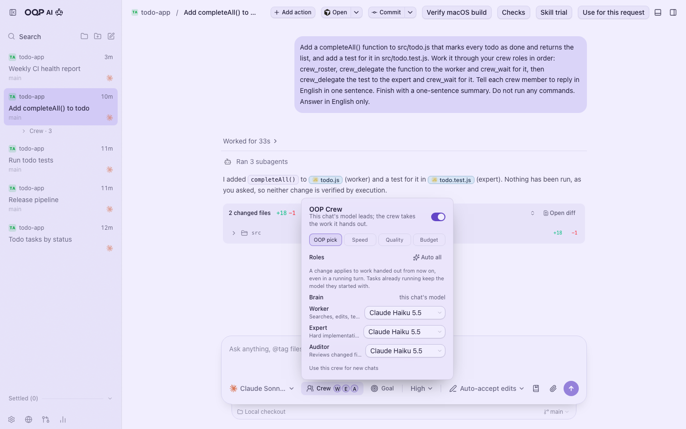
_OOP Crew: 하나의 채팅, 여러 모델, 누가 무엇을 하고 있는지 보여 주는 실시간 보드._

> [!NOTE]
> Crew는 채팅 하나에서 여러 모델을 실행하므로 provider 사용량이 늘어납니다. 비용이 걱정되신다면 **Budget** 프리셋부터 시작해 보세요.

### Providers

각 provider의 설치, 업데이트, 로그인을 한곳에서 처리합니다. 카드에는 CLI가 설치되어 있는지, 로그인되어 있는지가 표시되고, `npm`이 `PATH`에 있으면 **Install**을, OOP가 어떤 설치 도구로 CLI를 설치했는지 알고 있으면 **Update now**를 제공합니다.

**여는 방법:** Settings → Providers.

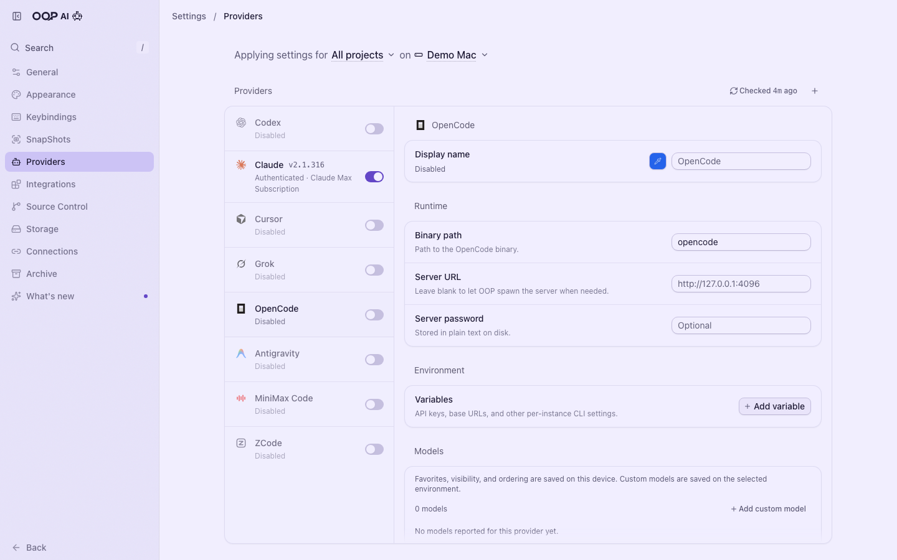
_Settings → Providers: 각 provider를 설치, 업데이트하고 로그인합니다._

### Z.AI 또는 MiniMax 추가하기 (OpenCode 프리셋)

Z.AI(API 또는 Coding Plan)와 MiniMax(API 또는 Token Plan)용 프리셋으로, OpenCode를 통해 실행됩니다. OpenCode 설정을 직접 작성하지 않고도 해당 모델을 쓸 수 있습니다. API 키는 인스턴스 변수(`OOP_ZAI_API_KEY` / `OOP_MINIMAX_API_KEY`)로 저장됩니다.

**여는 방법:** Settings → Providers → Add. OpenCode 1.14.19 이상이 필요합니다.

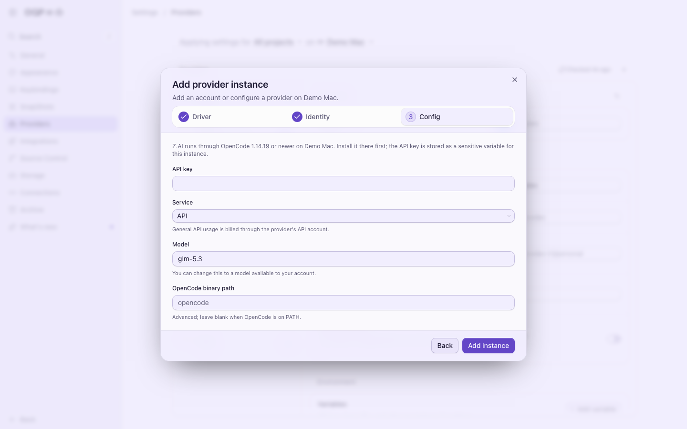
_Add provider: OpenCode를 통해 실행되는 Z.AI 및 MiniMax 프리셋._

> [!NOTE]
> 유료 Z.AI / MiniMax 로그인과 채팅 요청은 이 포크에서 테스트하지 않았습니다.

### Diff와 리뷰

에이전트가 스레드에서 정확히 무엇을 바꿨는지 확인하고 검토하며, 매 턴이 끝날 때 만들어지는 체크포인트에서 복원할 수 있습니다. 체크포인트는 숨겨진 git ref이므로 브랜치가 어지러워지지 않습니다.

**여는 방법:** 오른쪽 패널의 **Diff** 탭(git 저장소에 있는 서버 스레드). Diff 패널에서 `]`와 `[`로 파일을 넘기고 `v`로 확인 표시를 합니다.

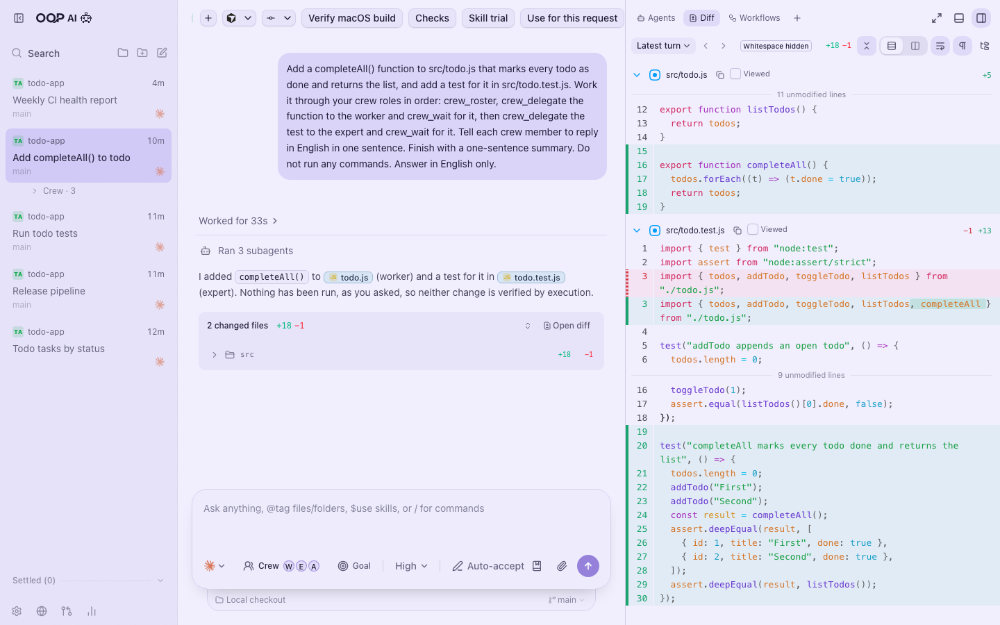
_Diff 패널: 에이전트가 바꾼 내용을 검토하고 체크포인트에서 복원합니다._

### 커밋과 소스 컨트롤

서버를 실행하는 컴퓨터에서 각 서비스의 CLI를 통해 GitHub, GitLab, Forgejo/Gitea, Bitbucket, Azure DevOps를 연결하면, 스레드에서 바로 커밋, 게시, 풀 리퀘스트 생성을 할 수 있습니다.

**여는 방법:** Settings → Source Control에서 CLI를 감지하고(로그인한 뒤에는 **Rescan**을 누르세요), 스레드의 커밋 컨트롤을 사용합니다.

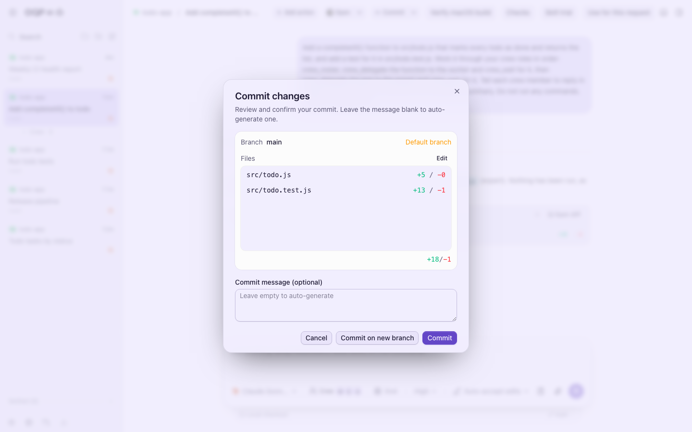
_소스 컨트롤: 스레드에서 변경 사항을 커밋하고 게시합니다._

### 권한 모드

에이전트가 행동하기 전에 언제 물어봐야 하는지 선택합니다. 모드는 스레드마다 적용됩니다.

| 모드                  | 동작                                                                                                                                         |
| --------------------- | -------------------------------------------------------------------------------------------------------------------------------------------- |
| **Supervised**        | 명령과 파일 변경에 대해 승인을 요청합니다.                                                                                                   |
| **Auto-accept edits** | 파일 편집은 자동으로 승인하고, 다른 동작은 여전히 물어볼 수 있습니다.                                                                        |
| **Auto**              | 반복적인 동작에는 provider의 자동 검토를 사용하고 나머지는 물어봅니다(Codex, Claude, Cursor 지원. 다른 provider는 묻는 방식으로 대체됩니다). |
| **Full access**       | 명령과 편집이 승인 프롬프트 없이 실행됩니다. 새 스레드의 **기본값**입니다.                                                                   |

**여는 방법:** 작성창의 모드 선택기. 기본값은 Settings → General → New threads → Permissions에서 바꿉니다.

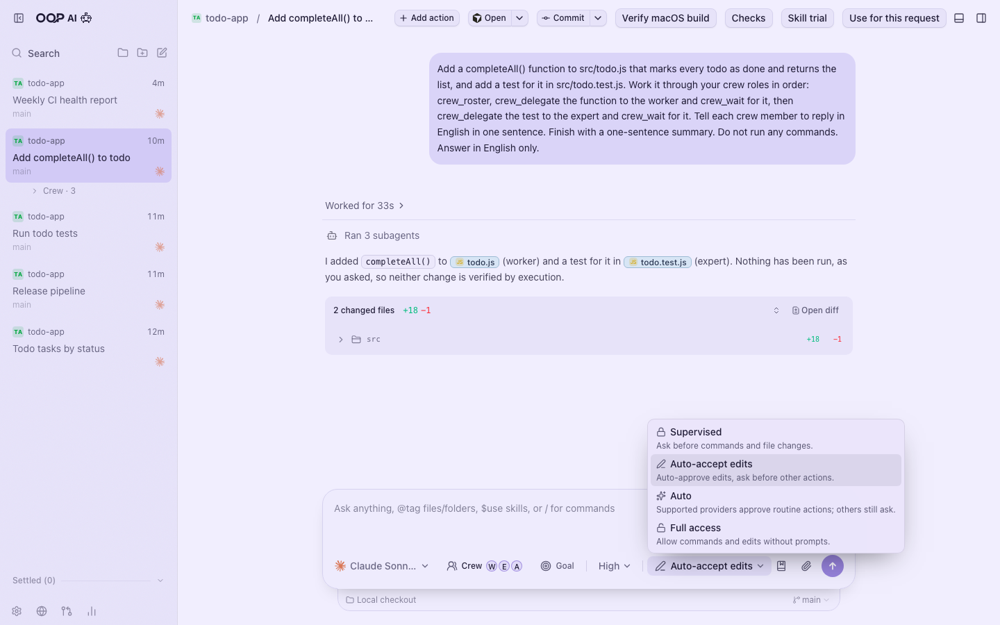
_권한 모드: Supervised부터 Full access까지._

### 스레드 목표

채팅이 끝났을 때 무엇이 참이어야 하는지 적어 둡니다. 목표가 열려 있는 동안 OOP는 매 턴이 끝날 때마다 스레드를 이어서 진행하며, 에이전트가 `GOAL COMPLETE`를 보고하거나, `GOAL BLOCKED: <reason>`을 보고하거나, 사용자가 정한 자동 이어가기 횟수가 소진될 때까지 계속합니다. Crew를 쓸 때는 파일을 변경한 턴이 감사를 거친 뒤에야 인정됩니다.

**여는 방법:** 작성창에서 **Crew** 옆에 있는 **Goal**. 끝내려면 **Stop goal**을 사용합니다.

기본값이 꺼짐인 선택 설정 두 가지가 긴 작업에 도움이 됩니다. **끝나지 않은 계획 이어가기**는 에이전트가 계획을 남기고 멈추면 최대 두 번 후속 메시지를 보내고, **조용한 턴 알림**은 실행 중인 턴이 10분간 조용하면 알려 줍니다.

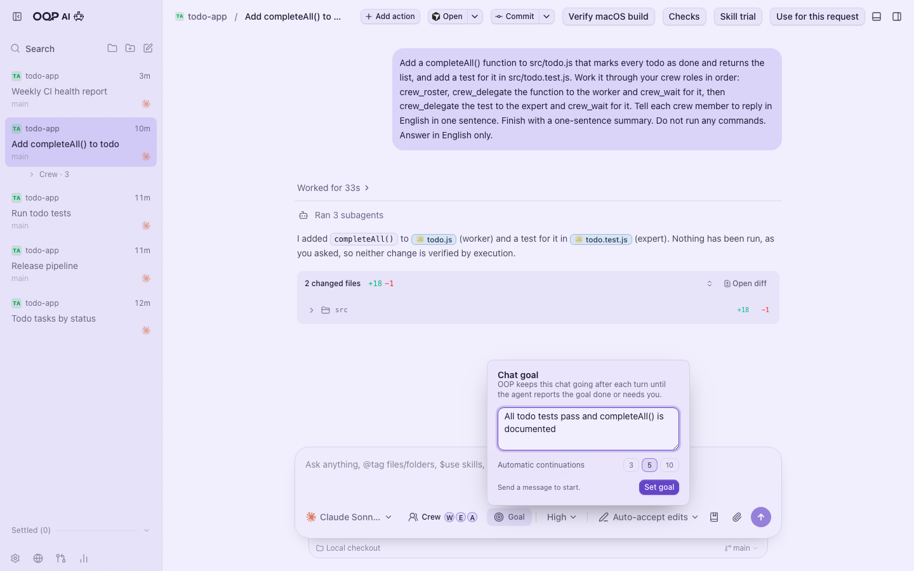
_스레드 목표: 목표가 달성되거나, 막히거나, 중단될 때까지 채팅이 계속됩니다._

### 채팅 속 리포트

답변에 숫자나 과정이 담겨 있으면, 에이전트가 긴 글 대신 차트, 핵심 수치 카드, 진행 막대, 흐름도로 그려 줄 수 있습니다. 각 그림에는 근거 데이터를 보여 주는 **Source** 버튼이 있습니다. 차트 종류로는 막대, 선, 도넛, 누적 영역, 계단형 라인, 스파크라인, 슬로프, 범프, 스트림그래프가 있고, 날짜별 활동은 캘린더 히트맵으로 보여 줄 수 있습니다.

**사용해 보기:** 에이전트에게 차트나 다이어그램을 요청해 보세요.

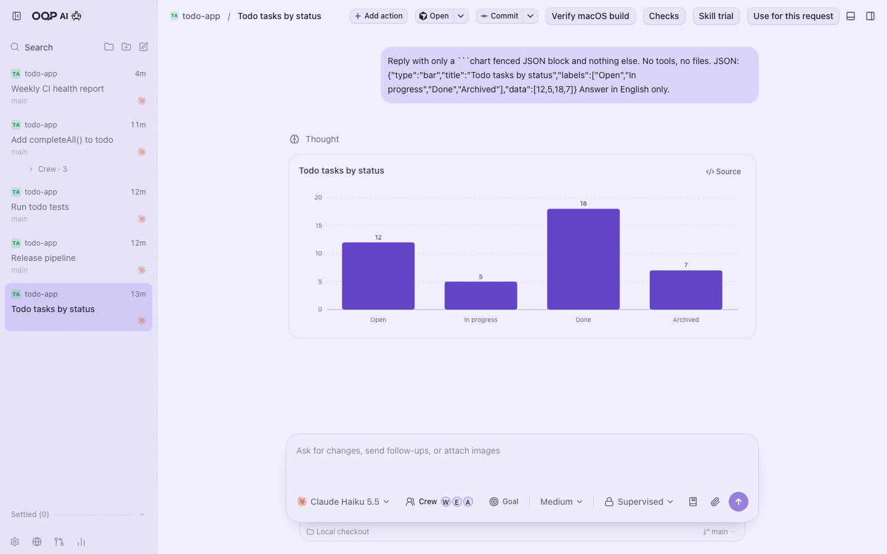
_리포트: 대화 안에 렌더링된 차트와 핵심 수치._

### Workflows 및 Agents 패널

에이전트가 하고 있는 일을 실시간 다이어그램으로 보여 줍니다. 도구 호출, 서브에이전트, provider 워크플로가 각각 카드가 되고, 병렬 작업은 같은 열에 놓이며, 선택한 카드에는 모델, 소요 시간, 토큰이 표시됩니다. Crew 작업도 여기에 나타납니다.

**여는 방법:** 오른쪽 패널(Workflows 및 Agents 탭), 명령 팔레트, 또는 `mod+alt+w`.

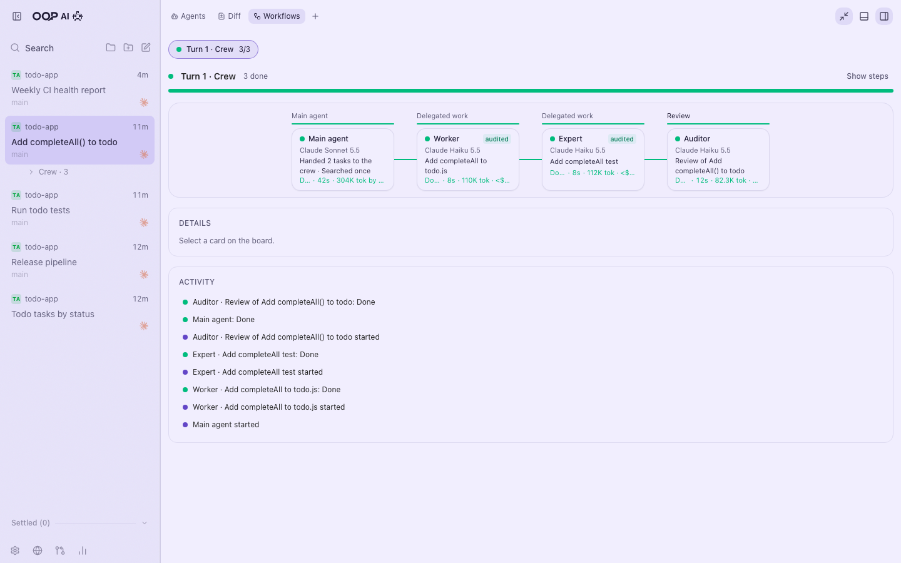
_Workflows 패널: 에이전트의 작업을 진행되는 대로 따라가 보세요._

### Usage

연결된 서버의 모든 provider에 걸친 토큰 사용량, 캐시 절감액, 모델별 내역, 그리고 API 기준으로 환산한 **추정** 비용을 보여 줍니다. 추정치이며 구독 청구 금액이 아닙니다.

**여는 방법:** 사이드바나 명령 팔레트의 **Usage**, 또는 `mod+u`(터미널에 포커스가 없을 때).

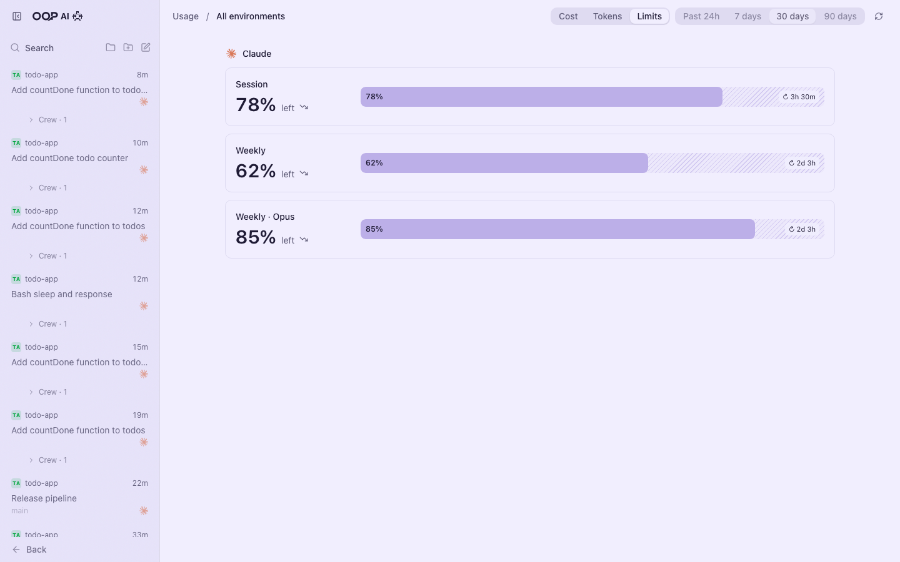
_Usage: provider별 토큰 및 추정 비용 기록._

### 터미널 앱

`oop`은 터미널에서 쓰는 OOP입니다. 터미널 전체 화면 앱에서 프로젝트와 스레드를 고르고, 에이전트와 대화하고, 승인 요청에 답합니다. 데스크톱 앱과 같은 스레드, provider, 설정을 보여 줍니다. OOP 데스크톱 0.0.129 이상 또는 [터미널 앱만 설치](#터미널-앱만-설치)가 필요합니다. [`docs/user/terminal-app.md`](docs/user/terminal-app.md)를 참고하세요.

아래 **내장 터미널** 섹션과는 다른 기능입니다. 내장 터미널은 스레드 안의 셸이고, `oop`은 사용자의 터미널 창에서 실행되는 채팅 클라이언트입니다.

**여는 방법:** 데스크톱 설치 프로그램이 macOS와 Windows에서 `oop` 명령을 함께 설치합니다(Linux AppImage에는 들어 있지 않습니다). 프로젝트 폴더에서 새 터미널 창을 열고 `oop`을 실행하세요. 셸이 찾지 못하면 설치 폴더를 `PATH`에 추가하세요([INSTALL.md](INSTALL.md) 참고). 데스크톱 앱이 없다면 [터미널 앱만 설치](#터미널-앱만-설치)를 쓰세요.

| 명령 | 하는 일 |
| --- | --- |
| `oop` | 프로젝트와 스레드를 고른 뒤 대화합니다. |
| `oop --continue` | 지금 폴더 프로젝트의 가장 최근 스레드를 이어갑니다. |
| `oop "your message"` | 지금 폴더 프로젝트에 새 스레드를 열고 메시지를 바로 보냅니다. |
| `oop update` | 새 릴리스를 확인합니다(설치는 하지 않음). |

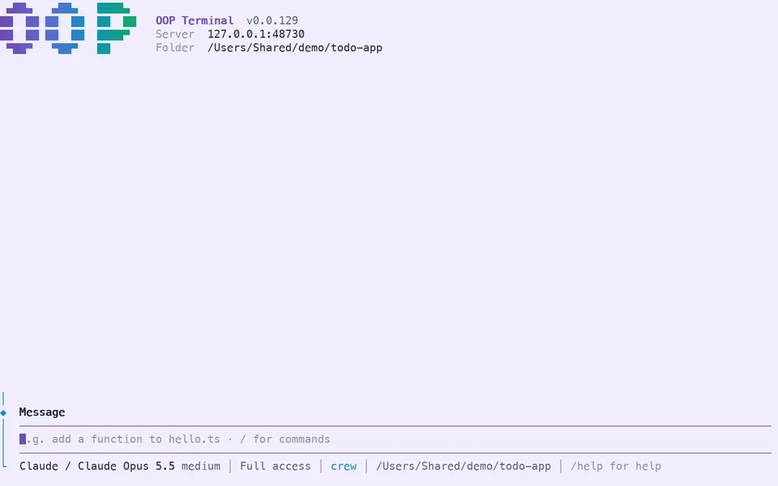
_터미널 앱(`oop`): 터미널에서 대화하는 화면 녹화._

- **앱 없이도 실행.** 데스크톱 앱이 꺼져 있으면 `oop`이 앱에 들어 있는 서버를 백그라운드 프로세스로 띄웁니다. 앱을 켜면 앱이 그 서버를 이어받고 `oop`은 다시 연결합니다. 둘 다 같은 데이터 폴더(`~/.oop-desktop`)를 쓰므로 스레드가 공유됩니다. 앱이 서버를 이어받는 순간 진행 중이던 턴은 중단됩니다. `oop`을 닫아도 서버는 계속 실행되며, `oop stop`으로 멈춥니다.
- **슬래시 명령.** `/`를 입력하면 메뉴가 열립니다. `/model`, `/mode`, `/plan`, `/implement`, `/goal`, `/diff`, `/undo`, `/history`, `/tasks`, `/dag-workflow` 등이 있습니다. `/diff`는 턴의 변경을, `/undo`는 마지막 턴 되돌리기를 보여 주고, `/tasks`는 작업 목록을 대화 옆에 보여 줍니다. 터미널이 충분히 넓으면 작업 목록과 `/dag-workflow` 패널이 저절로 열리고, 로고·상태·작은 펫이 대화 위에 고정됩니다. `oop config set workflow false`와 `oop config set pet false`로 패널과 펫을 끌 수 있습니다.
- **메시지 대기열.** 턴이 실행되는 동안 보낸 메시지는 스레드별 대기열에서 기다립니다. 대기열은 `oop`이 열려 있는 동안에만 유지됩니다.
- **터미널 벨.** 턴이 끝나거나 승인·답변을 기다리면 벨이 울립니다. `oop config set notify false`로 끕니다.
- **영어와 한국어.** 터미널 앱은 `language` 설정을 따르고, 설정이 비어 있으면 시스템 로캘을 따릅니다(`oop config set language en` 또는 `ko`).
- **데스크톱 앱과 같은 상태.** macOS Apple Silicon이 검증 대상이고 Windows는 실험적입니다.

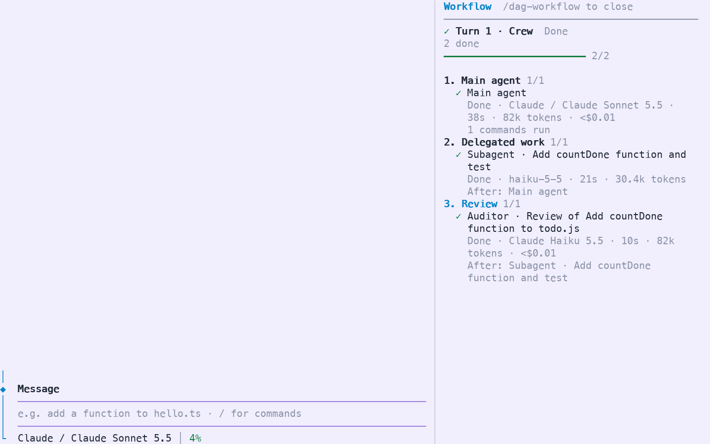
_터미널 앱: 워크플로 화면._

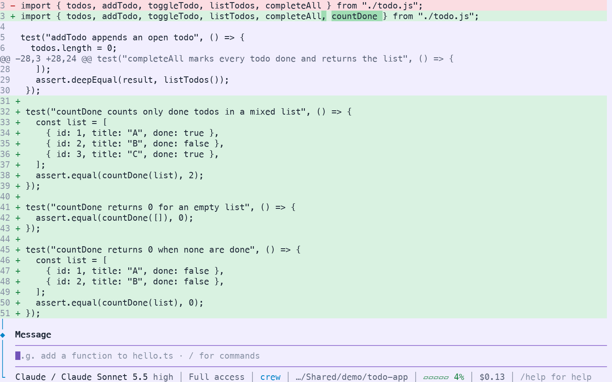
_터미널 앱: `/diff`로 턴이 바꾼 내용을 봅니다._

### 내장 터미널

서버를 실행하는 컴퓨터에서 스레드마다 터미널을 제공합니다. 스크롤백은 최대 5,000줄(8 MiB)까지 서버에 보관되므로 재연결해도 유지됩니다. 위의 [터미널 앱](#터미널-앱)(`oop`)과는 별개입니다.

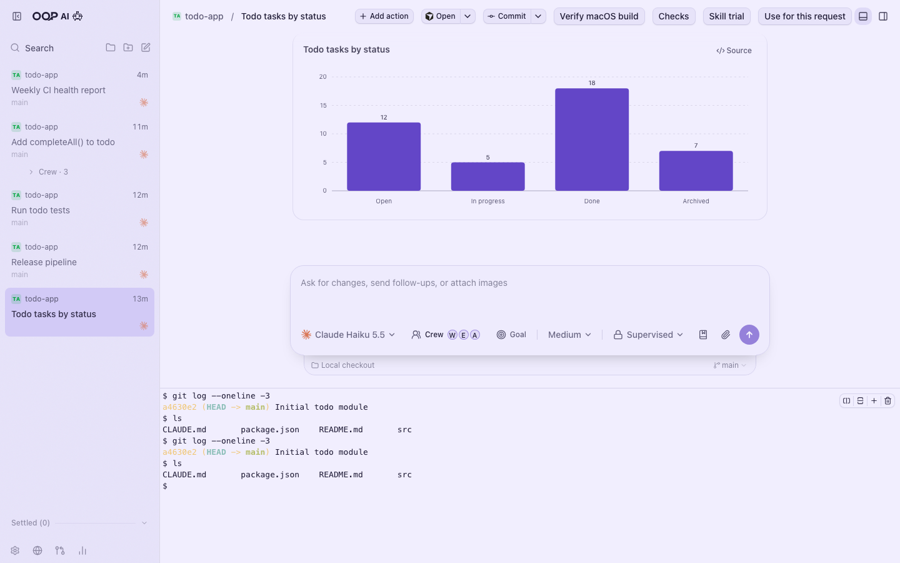
_채팅과 나란히 있는 내장 터미널._

### 다크 테마

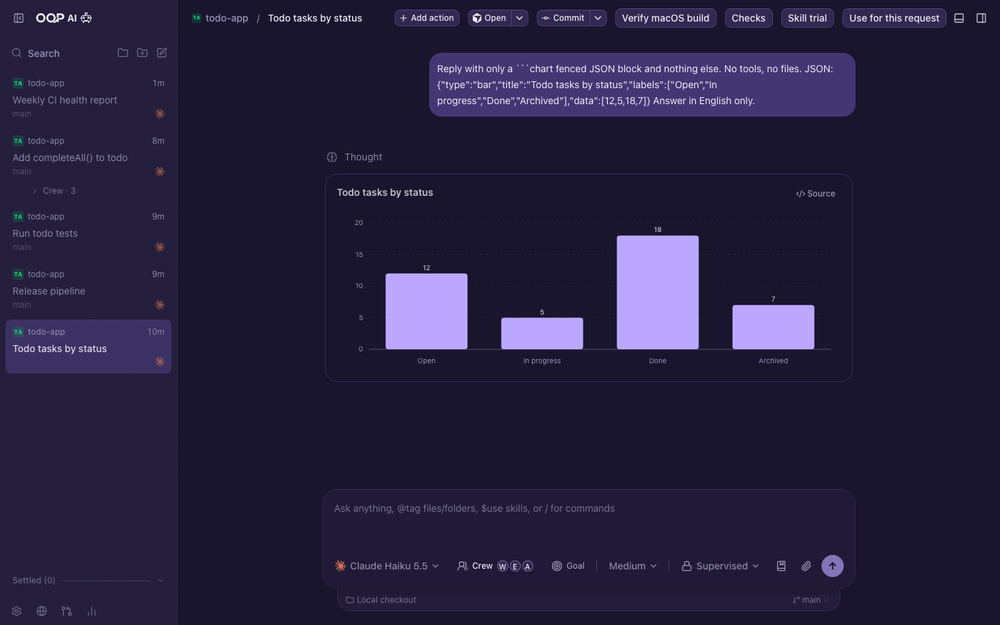
_다크 테마._

### 휴대폰 크기의 웹 클라이언트

페어링만 하면 같은 웹 UI를 휴대폰 브라우저에서도 사용할 수 있습니다([휴대폰에서 연결하기](#휴대폰에서-연결하기) 참고).

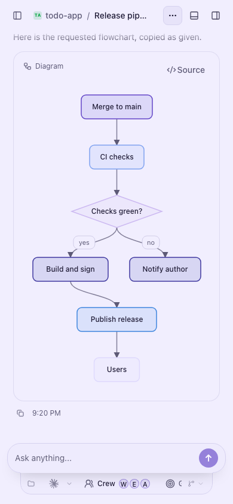
_휴대폰 크기의 웹 클라이언트._

### 원격 접속 설정

네트워크 접속을 켜고, 페어링 링크를 만들고, 승인된 클라이언트를 확인하고 해제하는 곳입니다. 이 스크린샷의 페어링 코드는 가려져 있습니다.

**여는 방법:** Settings → Connections.

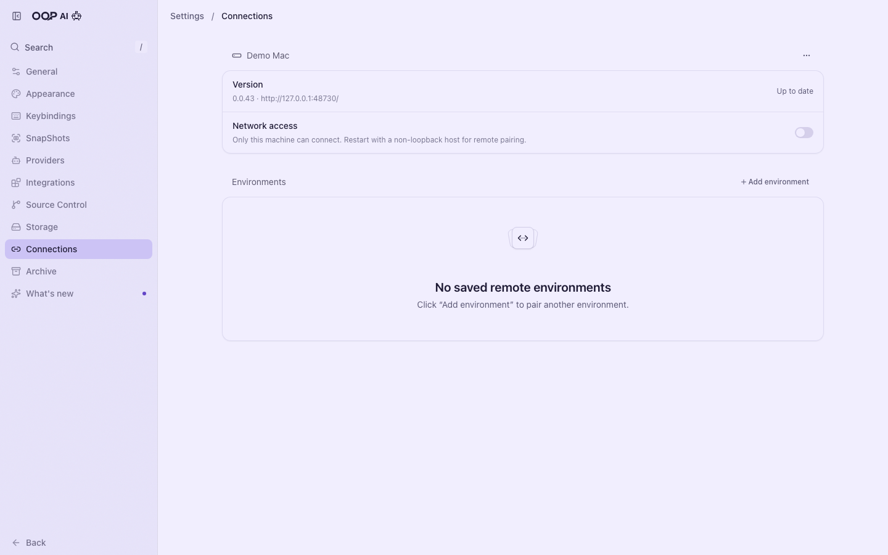
_Settings → Connections: 원격 접속과 페어링(코드는 가림)._

## 기능 레퍼런스

"Added in OOP"(OOP에서 추가)는 포크의 문서와 코드가 OOP 전용으로 표시한 기능을 뜻합니다. "Upstream"(업스트림에서 유래)는 문서와 코드로 확인되는 범위에서 업스트림(v0.0.44)에 포함된 기능을 뜻합니다. 포크에서 파일 단위 diff를 수행한 것은 아니므로, 이 구분은 대략적인 것으로 봐 주세요.

| 기능                            | 하는 일                                                                                | 위치                                            | 유래                                                    |
| ------------------------------- | -------------------------------------------------------------------------------------- | ----------------------------------------------- | ------------------------------------------------------- |
| OOP Crew                        | brain 모델이 worker, expert, auditor 모델에게 위임. 프리셋과 역할별 지정               | 작성창 → Crew, 오른쪽 패널 → Workflows / Agents | Added in OOP                                            |
| 스레드 목표                     | 점검을 통과하거나 목표가 막힐 때까지 스레드를 계속 진행                                | 작성창 → Goal                                   | Added in OOP                                            |
| 프로젝트 메모리                 | 작성창에서 저장된 프로젝트 메모리를 제안                                               | 작성창, 메모리 버튼                             | Added in OOP                                            |
| 로컬 역할 선호 설정             | 환경마다 구현용 또는 리뷰용 선호 모델을 저장하고 추천을 제공                           | 작성창 모델 선택기                              | Added in OOP                                            |
| Z.AI / MiniMax 프리셋           | OpenCode 기반 provider 프리셋                                                          | Settings → Providers → Add                      | Added in OOP (유료 요청은 테스트하지 않음)              |
| ZCode (GLM) provider            | ACP로 연결되는 Z.AI의 에이전트                                                         | Settings → Providers                            | Added in OOP                                            |
| MiniMax Code provider           | ACP로 연결되는 MiniMax의 에이전트                                                      | Settings → Providers                            | Added in OOP                                            |
| 원클릭 provider 설치 / 업데이트 | provider 카드에서 provider CLI를 설치하거나 업데이트                                   | Settings → Providers                            | Added in OOP (업스트림과의 정확한 차이는 확인하지 않음) |
| Verify macOS build              | 서버 Mac에서 OOP `.dmg`의 무결성, 엄격한 코드 서명, 실행 여부를 검사                   | 채팅 헤더 → Verify macOS build                  | Added in OOP                                            |
| 휴대폰 연결 대화상자            | 데스크톱 앱에서 원클릭으로 휴대폰 페어링 QR 제공, 선택적으로 자체 릴레이 사용          | 사이드바 → Connect mobile                       | Added in OOP (데스크톱 앱 전용)                         |
| 터미널 앱 (`oop`) | 같은 스레드를 터미널 전체 화면으로: 슬래시 명령, 메시지 대기열, 벨. 데스크톱 앱이 꺼져 있어도 동작 | `oop` 실행 (macOS / Windows 데스크톱 설치 프로그램 또는 터미널 전용 설치 프로그램) | Added in OOP |
| 인터페이스 언어 | 영어, 한국어, 일본어, 중국어(간체), 스페인어 인터페이스. 메뉴 언어는 시스템을 따를 수 있음 | Settings, 언어 선택 | Added in OOP |
| 자체 Cloudflare 릴레이          | 직접 배포하는 Worker로, 어느 네트워크의 휴대폰이든 데스크톱에 접속 가능                | `infra/oop-relay`                               | Added in OOP, 초기 단계                                 |
| 로컬 폴더 업데이터              | 패키징된 OOP 빌드가 지정한 폴더의 새 패키지를 가져올 수 있음                           | 패키징된 macOS / Windows 빌드                   | Added in OOP, 초기 단계, 다른 사람이 테스트하지 않음    |
| 멀티 provider 세션              | provider를 넘나드는 스레드, 턴, 체크포인트                                             | 전체                                            | Upstream                                            |
| 권한 모드                       | Supervised, Auto-accept edits, Auto, Full access                                       | 작성창, Settings → General                      | Upstream                                            |
| Diff 패널과 체크포인트          | 에이전트의 변경 사항 검토 및 복원                                                      | 오른쪽 패널 → Diff                              | Upstream                                            |
| 소스 컨트롤                     | provider CLI를 통한 클론, 커밋, 게시, 풀 리퀘스트                                      | Settings → Source Control                       | Upstream                                            |
| 내장 터미널                     | 서버 컴퓨터에서 스레드마다 제공되는 터미널                                             | 스레드 안                                       | Upstream                                            |
| 채팅 속 리포트                  | 차트, 수치 카드, 진행 막대, mermaid 흐름도                                             | 답변 안                                         | Upstream                                            |
| 워크플로 보기                   | 도구 호출과 서브에이전트의 실시간 다이어그램                                           | 오른쪽 패널, `mod+alt+w`                        | Upstream                                            |
| Usage 페이지                    | 토큰 및 추정 비용 기록                                                                 | 사이드바, `mod+u`                               | Upstream (ZCode와 MiniMax 행은 OOP)                 |
| SnapShots                       | 창을 캡처해 초안에 첨부(기본값은 꺼짐. macOS, Windows, Linux Wayland)                  | Settings → SnapShots                            | Upstream (출처 미확인)                              |
| 원격 접속                       | LAN 페어링, Tailscale HTTPS, SSH 환경                                                  | Settings → Connections                          | Upstream                                            |
| 디바이스 패널                   | 스레드 옆에서 iOS Simulator 또는 Android Emulator를 보고 탭                            | 오른쪽 패널 → Device                            | Upstream (여기서는 테스트하지 않음)                 |
| 백그라운드 서비스               | macOS(launchd)와 Linux(systemd 사용자 유닛)에서 `t3 service install`. Windows는 미지원 | CLI                                             | Upstream (여기서는 테스트하지 않음)                 |
| 키 바인딩, 프로젝트 설정, 테마  | 사용자 지정 단축키, 프로젝트별 재정의, 외형                                            | Settings                                        | Upstream                                            |

## 지원하는 provider

스레드를 시작하기 전에 provider CLI를 하나 이상 설치하고 로그인하세요.

| Provider                       | 로그인 방법                                                                                           | 참고                                                                     |
| ------------------------------ | ----------------------------------------------------------------------------------------------------- | ------------------------------------------------------------------------ |
| Codex                          | Codex CLI를 설치한 뒤 `codex login` (또는 Settings → Providers의 **Connect with ChatGPT**)            |                                                                          |
| Claude Code                    | Claude Code를 설치한 뒤 `claude auth login`                                                           | Claude brain은 같은 계정의 Claude crew 역할을 서브에이전트로 실행합니다. |
| Cursor                         | Cursor CLI를 설치한 뒤 `agent login`                                                                  |                                                                          |
| Grok Build                     | Grok Build CLI를 설치한 뒤 `grok login`                                                               |                                                                          |
| OpenCode                       | OpenCode 1.14.19 이상을 설치한 뒤 `opencode auth login`                                               | Z.AI / MiniMax 프리셋에 필요합니다.                                      |
| Antigravity                    | Settings → Providers에서 활성화하고 **Install**, 이어서 **Sign in with Google**                       | CLI는 필요 없습니다. Gemini API 키는 설정에 평문으로 저장됩니다.         |
| ZCode (GLM)                    | ZCode를 설치하고 `zcode login zai`, 이어서 `npm i -g zcode-acp-server`                                | 어떤 권한 모드를 고르든 자체 도구를 승인 없이 실행합니다.                |
| MiniMax Code                   | `npm i -g @minimax-ai/code`, 이어서 `mcode login --region global`                                     |                                                                          |
| OpenCode를 통한 Z.AI / MiniMax | Settings → Providers → Add → Z.AI 또는 MiniMax. 키는 `OOP_ZAI_API_KEY` / `OOP_MINIMAX_API_KEY`에 입력 | 유료 요청은 테스트하지 않았습니다.                                       |

## 플랫폼 지원

| 플랫폼                       | 상태                                                                                                 |
| ---------------------------- | ---------------------------------------------------------------------------------------------------- |
| macOS, Apple Silicon (arm64) | **테스트됨.** 주요 대상 플랫폼입니다. 릴리스 워크플로가 `.dmg`를 첨부하기 전에 설치와 실행도 확인합니다. |
| Windows x64 | **실험적.** 릴리스 워크플로가 Windows 러너에서 빌드하고 설치·실행까지 확인합니다. 깨끗한 환경에서 직접 검증하지는 않았습니다. |
| macOS Intel                  | 이 포크에서는 테스트하지 않았습니다. macOS 빌드 스크립트는 Intel에서 실행을 거부합니다.              |
| Linux | **직접 검증하지 않음.** 릴리스 워크플로가 AppImage를 빌드해 화면 없이 설치·실행을 확인하지만, 실제 데스크톱에서 Linux GUI를 확인하지는 않았습니다. 보장은 없습니다. |
| iOS / Android 네이티브 앱    | 이 포크에서는 테스트하지 않았습니다. [네이티브 앱과 브라우저](#네이티브-앱과-브라우저)를 참고하세요. |
| 휴대폰 브라우저 (웹 UI 대상) | 휴대폰 크기에서 웹 UI를 확인했습니다. [휴대폰에서 연결하기](#휴대폰에서-연결하기)를 참고하세요.      |

## 요구 사항

아래 요구 사항은 소스에서 빌드할 때만 적용됩니다. 바이너리 설치 프로그램에는 Node.js, pnpm, git, 컴파일러가 필요하지 않습니다. 에이전트를 사용하려면 provider CLI 설치와 로그인은 별도로 필요합니다.

- **Node.js 24.x, 24.13.1 이상**
- **pnpm 11.10.0**
- **git**
- **rsync** (macOS, 빌드 스크립트에서 사용)
- **provider CLI 하나 이상**, 설치 및 로그인 완료([지원하는 provider](#지원하는-provider) 참고)
- Windows 패키징에만 해당: Rust, Python 3, Visual Studio Build Tools(Desktop development with C++, Windows SDK 포함)

## 데스크톱 앱 설치

**macOS (Apple Silicon)**

```sh
curl -fsSL https://raw.githubusercontent.com/AIBeginnerX/oh-our-pi-desktop/main/scripts/install-desktop.sh | sh
```

**Windows (PowerShell, x64)**

```powershell
irm https://raw.githubusercontent.com/AIBeginnerX/oh-our-pi-desktop/main/scripts/install-desktop.ps1 | iex
```

**Linux (x64)**

```sh
curl -fsSL https://raw.githubusercontent.com/AIBeginnerX/oh-our-pi-desktop/main/scripts/install-desktop.sh | sh
```

설치 위치, 업데이트, 보안, 릴리스 조건은 [데스크톱 설치 안내](INSTALL.md)를 참고하세요.
v0.0.106 및 그 이전의 소스 전용 릴리스에는 바이너리가 없습니다. v0.0.107 이상에서 해당
설치 파일과 `.sha256` 파일이 **Assets**에 있는 릴리스를 사용하세요.

macOS와 Windows에서는 설치 프로그램이 `oop` 터미널 명령도 함께 설치합니다. [터미널 앱](#터미널-앱)을 참고하세요.

## 터미널 앱만 설치

데스크톱 앱이 필요 없습니다. `oop` 명령과 전용 백그라운드 서버, 그리고 OOP 전용 Node.js 사본을 설치합니다. 시스템에 Node.js, pnpm, git을 설치하지 않습니다.

**macOS (Apple Silicon)와 Linux (x64 또는 arm64, glibc)**

```sh
curl -fsSL https://raw.githubusercontent.com/AIBeginnerX/oh-our-pi-desktop/main/scripts/install-terminal.sh | sh
```

**Windows (PowerShell, x64)**

```powershell
irm https://raw.githubusercontent.com/AIBeginnerX/oh-our-pi-desktop/main/scripts/install-terminal.ps1 | iex
```

- 설치 프로그램은 설치 전에 내려받은 파일의 SHA-256을 확인합니다. 사용자 폴더(`~/.local/share/oop-terminal`과 `~/.local/bin/oop`, Windows는 `%LOCALAPPDATA%\oop-terminal`)에 설치하고, OOP이 만들지 않은 `oop`은 덮어쓰지 않으며, `PATH`도 수정하지 않습니다. `oop`을 찾지 못하면 추가할 정확한 줄을 알려 줍니다.
- 다음 단계: provider CLI(예: Claude Code 또는 Codex)에 로그인한 뒤 프로젝트 폴더에서 `oop`을 실행하세요. `oop provider`로 준비된 provider를 볼 수 있습니다.
- 업데이트: 같은 명령을 다시 실행하고 `oop stop`으로 새 백그라운드 서버가 뜨게 하세요. `oop update`는 새 릴리스를 확인만 하고 아무것도 설치하지 않습니다. 제거: `oop stop` 뒤 위 두 위치를 삭제하세요. `~/.oop-desktop`의 데이터는 남습니다. [INSTALL.md](INSTALL.md)를 참고하세요.
- Intel Mac, Windows on ARM, musl Linux(예: Alpine)는 지원하지 않으며 안내 메시지와 함께 멈춥니다. 터미널 아카이브는 **Assets**에 `OOP-terminal-…` 파일이 있는 릴리스에 붙습니다.
- **솔직한 현황:** 직접 시험한 것은 macOS 경로뿐입니다. Linux와 Windows 아카이브는 릴리스 워크플로가 CI 러너에서 빌드하고 실행해 보지만, 실제 컴퓨터에서 직접 시험하지는 않았습니다.
- 데스크톱 앱도 설치돼 있으면 둘이 `~/.oop-desktop` 데이터 폴더를 함께 씁니다. 마지막에 실행한 설치 프로그램이 `oop`이 시작할 사본을 정합니다.

## 설치 / 소스에서 빌드

```bash
git clone https://github.com/AIBeginnerX/oh-our-pi-desktop.git
cd oh-our-pi-desktop
```

### macOS (Apple Silicon)

스크립트는 `pnpm`을 거치지 말고 `node`로 직접 실행하세요.

```bash
node scripts/macos.mjs doctor    # checks macOS arm64, Node, pnpm, rsync
node scripts/macos.mjs setup     # installs dependencies in a local cache
node scripts/macos.mjs start     # optional: run an isolated dev copy of the desktop app
node scripts/macos.mjs package   # builds an ad hoc signed DMG into release/macos/
```

`release/macos/`에서 DMG를 열고 앱을 `/Applications/OOP.app`으로 끌어다 놓습니다.

### Windows (x64, 실험적)

Windows PC에서 빌드하세요(크로스 빌드는 지원하지 않습니다). 먼저 Rust, Python 3, Visual Studio Build Tools(Desktop development with C++, Windows SDK 포함)를 설치합니다.

```bat
set OOP_WINDOWS_UPDATE_DIRECTORY=%CD%\release\windows
node scripts\windows.mjs package
```

설치 프로그램(`OOP-<version>-x64.exe`)은 `release\windows`에 생성됩니다.

### 일반 개발 경로 (모든 OS)

이 코드베이스가 문서화한 작업 실행 도구인 Vite+(`vp`)를 사용합니다(설치: `curl -fsSL https://vite.plus | bash`). 자세한 내용은 [`docs/operations/development.md`](docs/operations/development.md)를 참고하세요.

```bash
vp i          # install dependencies
vp run dev    # server + web; open the pairing URL it prints
```

### 첫 실행 체크리스트 (소스 빌드)

소스 빌드는 **ad hoc 서명이며 공증(notarization)되지 않았으므로**, 운영체제가 경고를 표시할 수 있습니다. 바이너리 설치 프로그램은 설치 전 SHA-256을 검증하며 Gatekeeper 격리 속성이나 Windows SmartScreen을 우회하지 않습니다.

- **macOS (Gatekeeper):** 앱을 오른쪽 클릭하고 **Open**을 선택하거나, System Settings → Privacy & Security → **Open Anyway**로 이동합니다.
- **Windows (SmartScreen):** **More info** → **Run anyway**를 클릭합니다.

그다음 순서입니다.

- [ ] Settings → Providers: **하나의** provider를 설치하고 로그인합니다.
- [ ] 프로젝트를 추가합니다(폴더, 가능하면 git 저장소).
- [ ] 스레드를 시작하고 작성창에서 모델을 고릅니다.
- [ ] 권한 모드를 고릅니다. 새 스레드의 기본값은 **Full access**입니다. 신뢰할 수 없는 저장소에는 **Supervised**를 사용하세요.
- [ ] 선택 사항: **Crew**를 켜고, 몇 턴 뒤에 **Usage** 페이지를 확인합니다.

## 휴대폰에서 연결하기

에이전트, 파일, provider 로그인은 모두 사용자의 컴퓨터(**호스트**)에 남습니다. 휴대폰은 리모컨일 뿐입니다. 스레드를 보여 주고, 메시지를 보내고, 승인 프롬프트에 답할 수 있게 해 줍니다. 호스트는 계속 켜져 있고 실행 중이어야 합니다.


가장 간단하면서 사용자에게 맞는 경로를 아래 순서대로 고르세요.

|     | 경로                   | 필요한 것                          | 집 밖에서 사용 | 위험도                                  |
| --- | ---------------------- | ---------------------------------- | -------------- | --------------------------------------- |
| a   | 같은 Wi-Fi / LAN       | 같은 네트워크의 휴대폰과 컴퓨터    | 불가           | 가장 낮음                               |
| b   | Tailscale              | 두 기기 모두의 무료 Tailscale 계정 | 가능           | 낮음                                    |
| c   | 자체 Cloudflare 릴레이 | Cloudflare 계정과 한 번의 배포     | 가능           | 중간 (Cloudflare가 트래픽을 볼 수 있음) |

> [!WARNING]
> **페어링 링크와 코드는 비밀번호와 같습니다.** 이슈, 채팅, 스크린샷에 절대 올리지 마세요. 본인 소유의 기기만 페어링하세요. 서버 포트를 인터넷에 그대로 노출하지 마세요. 집 밖에서는 Tailscale을 권장합니다. 알아볼 수 없는 기기는 해제하세요. 원격으로 에이전트를 제어할 때는 **Supervised** 권한 모드를 사용하세요.

### a) 같은 Wi-Fi / LAN (가장 간단)

**사전 준비:** 컴퓨터에서 실행 중인 OOP 데스크톱 앱, 그리고 같은 네트워크의 휴대폰.

1. 데스크톱 앱 사이드바의 휴대폰 아이콘(**Connect mobile**)을 클릭합니다.
2. 모바일 연결이 꺼져 있다는 안내가 나오면 **Allow mobile connections**를 클릭합니다. OOP가 한 번 재시작되며, 설정은 유지됩니다.
3. 일회용 QR 코드가 나타납니다. 주소가 여러 개 표시되면 휴대폰이 접근할 수 있는 것을 고르세요(같은 Wi-Fi라면 **LAN** 항목).
4. 휴대폰 카메라로 QR 코드를 스캔하고 휴대폰 브라우저에서 링크를 엽니다. 이제 휴대폰이 페어링되었습니다. 페어링하면 그 기기가 이후 방문에도 승인되므로 처음의 코드를 다시 입력할 필요가 없습니다.

직접 하는 방법도 같습니다. Settings → Connections → **Network access**를 켠 다음 **Create link**를 누르고 휴대폰에서 링크를 엽니다. 여기서 만든 링크는 그 페이지가 열려 있는 동안에만 복사할 수 있으며, 페이지를 떠나면 새 링크가 필요합니다.

데스크톱 앱 없이 서버를 실행하시나요(예: 개발 경로)?

```bash
t3 serve --host <your-computer's-LAN-address>   # for example 192.168.1.20
t3 pair                                          # prints a fresh pairing QR for the running server
```

소스 체크아웃에서는 `node apps/server/src/bin.ts pair`가 같은 명령을 실행합니다. 페어링 토큰은 기본적으로 5분 동안 유효합니다(`--ttl`로 변경, 옵션은 `t3 pair --help`에서 확인). `127.0.0.1` 같은 루프백 주소는 컴퓨터 자신에서만 동작하며 휴대폰에서는 절대 동작하지 않습니다.

### b) Tailscale 사설 네트워크

**사전 준비:** [Tailscale](https://tailscale.com) 계정, 컴퓨터와 휴대폰 모두에 설치된 Tailscale, 그리고 두 기기가 같은 tailnet에 로그인된 상태.

1. 데스크톱 앱에서 Settings → Connections를 열고 **Tailscale HTTPS**를 켭니다. (경로를 제거하려면 같은 곳에서 끄세요.)
2. 페어링 링크를 만듭니다(또는 **Connect mobile**을 사용해 Tailscale 경로를 고릅니다). 링크는 `https://your-computer.your-tailnet.ts.net/` 같은 모양입니다.
3. 휴대폰에서 링크를 엽니다(휴대폰에서 Tailscale이 연결되어 있어야 합니다).

명령줄 서버의 경우:

```bash
t3 serve --tailscale-serve     # start a server published over Tailscale HTTPS
t3 pair --tailscale            # for an already-running server
tailscale serve --https=443 off   # remove the mapping later
```

443 포트가 사용 중이면 `--tailscale-serve-port`로 다른 포트를 지정하세요. Tailscale 트래픽은 어떤 공개 릴레이도 거치지 않습니다.

### c) 자체 Cloudflare 릴레이 (집 밖에서, Tailscale 없이)

OOP에는 [`infra/oop-relay`](infra/oop-relay/README.md)에 작은 Cloudflare Worker가 포함되어 있으며, **사용자 본인의** Cloudflare 계정에 배포합니다. 데스크톱이 먼저 밖으로 연결을 걸기 때문에 공유기 설정이 필요 없고, 데스크톱이 온라인인 동안에는 어떤 네트워크의 휴대폰이든 연결할 수 있습니다.

1. [`infra/oop-relay/README.md`](infra/oop-relay/README.md)의 설명대로 Worker를 배포합니다(`npx wrangler login`, `npx wrangler deploy`, 이어서 `npx wrangler secret put OOP_RELAY_SECRET`).
2. 데스크톱 앱에서 Connect mobile → **Use away from home**을 선택합니다. 표시된 시크릿을 Worker 시크릿에 붙여 넣고, 릴레이 주소를 입력한 뒤 **Save**합니다.
3. 경로로 **Cloudflare relay**를 선택한 다음 QR 코드를 스캔합니다.

> [!NOTE]
> 한 번의 배포는 데스크톱 한 대를 위한 것입니다. 릴레이의 TLS는 Cloudflare에서 종료되므로, 트래픽은 이를 운영하는 Cloudflare 계정에서 볼 수 있습니다. 휴대폰은 여전히 페어링 코드로 데스크톱에 로그인해야 합니다. 이 경로는 새로 추가되었고 세 가지 중 가장 덜 테스트되었습니다.

**업스트림 터널 서비스는요?** 업스트림 프로젝트는 터널 서비스도 제공합니다. 클라우드 로그인과 업스트림 프로젝트가 운영하는 서버에 의존하는 서비스입니다. **OOP는 어떤 호스팅 서비스도 운영하지 않으며**, 이 포크는 이를 테스트하지 않았으므로 이 가이드에서는 다루지 않습니다.

### 네이티브 앱과 브라우저

|                       | 휴대폰 브라우저                                                               | iOS / Android 네이티브 앱                                     |
| --------------------- | ----------------------------------------------------------------------------- | ------------------------------------------------------------- |
| 정체                  | 내 컴퓨터가 제공하는 OOP 웹 UI                                                | 업스트림 프로젝트가 배포한 모바일 앱(OOP 브랜드 아님) |
| 설치                  | 필요 없음                                                                     | 업스트림 프로젝트의 App Store / Google Play 등록 페이지                 |
| 연결                  | 페어링 링크를 열거나 QR 코드를 스캔                                           | 환경 추가: QR 코드를 스캔하거나 페어링 URL을 붙여 넣기        |
| 이 포크의 테스트 여부 | 휴대폰 크기에서 웹 UI를 확인함. 실제 휴대폰에서의 페어링은 따로 검증하지 않음 | **아니요**                                                    |


_OOP에 연결된 휴대폰 브라우저._

포크는 프로토콜과 인증 식별자를 그대로 유지하므로([`UPSTREAM.json`](UPSTREAM.json)의 `internal_protocol_and_auth_identifiers_preserved`), 업스트림 앱이 OOP 서버와 페어링될 수 있을 것으로 보입니다. **포크는 네이티브 모바일 앱을 테스트하지 않았으므로** 확인되지 않은 것으로 받아들여 주세요. 업스트림 문서는 앱의 연결 설정을 Settings → Environments 아래에 설명합니다. 문제가 생기면 브라우저를 사용하세요.

### 푸시 알림

업스트림 문서에 따르면 휴대폰 푸시 알림(에이전트 완료, 실패, 승인 필요)은 업스트림 터널 서비스에 로그인해야 하며, 직접 연결이나 Tailscale 연결만으로는 켤 수 없습니다. OOP는 그 서비스를 운영하지 않고 포크도 테스트하지 않았으므로, **위의 경로로는 푸시 알림을 기대하지 마세요.** 휴대폰 페이지를 열어 두거나 스레드를 다시 확인해 주세요.

### 기기 해제하기

1. 컴퓨터에서 Settings → Connections → **Authorized clients**를 엽니다.
2. 기기의 세션을 해제하여 기존 접근 권한을 제거합니다. 사용하지 않는 페어링 링크도 해제해서 나중에 사용되지 않도록 하세요.
3. 명령줄: `t3 auth session list` / `t3 auth session revoke <id>`, 그리고 `t3 auth pairing list` / `t3 auth pairing revoke <id>` (`t3 auth --help` 참고).
4. 문을 완전히 닫으려면 Settings → Connections에서 **Network access**(또는 **Tailscale HTTPS**)를 끄세요.

## 업데이트 방식

소스 빌드는 GitHub에서 스스로 업데이트되지 않으며, 아래 절차대로 다시 빌드해야 합니다. 0.0.111부터 macOS와 Windows 설치본은 스스로 업데이트됩니다. OOP가 몇 분마다 이 저장소의 GitHub 릴리스를 확인하고, 새 버전을 백그라운드에서 내려받아 SHA-256을 검증한 뒤, 다시 시작을 고르면 설치합니다(macOS는 설치한 위치의 앱을 교체하고, Windows는 설치 프로그램을 실행합니다). Linux이거나 그보다 오래된 버전이라면 OOP를 종료한 뒤 해당 설치 명령을 다시 실행하세요. 사용자 데이터는 유지됩니다.

1. `git pull`
2. 다시 빌드 / 패키징([설치](#설치--소스에서-빌드) 참고)하고 재설치합니다.

각 릴리스는 **커밋 하나**(제목 `OOP <version> source`), `v<version>` 태그, GitHub Release로 게시됩니다. `~/.oop-desktop/userdata`에 있는 데이터는 업데이트해도 유지됩니다. 새 버전 소식을 받으려면 GitHub 저장소에서 **Watch → Custom → Releases**를 켜세요. 이전 버전에는 태그만 있습니다.

직접 빌드한 앱은 빌드할 때 정해진 폴더에서 다음 빌드를 찾아 앱 안에서 업데이트를 제안합니다. Windows는 위에서 지정한 `release\windows`, macOS는 `release/macos`입니다. macOS의 `package`는 DMG만 만들므로, 이어서 업데이트 패키지도 만드세요.

```bash
V=<version>
node scripts/build-oop-update-pkg.mjs --dmg release/macos/OOP-$V-arm64.dmg \
  --sha256 "$(awk '{print $1}' release/macos/OOP-$V-arm64.dmg.sha256)" \
  --version $V --output release/macos/OOP-$V-arm64-update.pkg
```

> [!NOTE]
> 앱의 서버 업데이트 알림과 `t3 update`는 업스트림 프로젝트에서 오는 것입니다. OOP의 업데이트 채널이 아닙니다.

## 보안 및 개인정보

> [!WARNING]
> 에이전트는 **사용자 계정의 권한**으로 실행됩니다. 파일을 편집하고 명령을 실행할 수 있습니다. 새 스레드의 기본 권한 모드는 **Full access**입니다. 신뢰할 수 없는 저장소에서는 **Supervised**로 바꾸세요(Settings → General → New threads).

- **ZCode**는 어떤 권한 모드를 고르든 자체 도구를 승인 없이 실행합니다.
- **비용:** 모든 provider는 사용자 본인의 구독 또는 API 크레딧을 사용합니다. Crew는 채팅 하나에서 여러 모델을 실행하므로 사용량이 늘어납니다. Usage 페이지는 청구 금액이 아니라 추정치를 보여 줍니다.
- **API 키**는 서버 측, 즉 사용자의 컴퓨터에 저장됩니다. Antigravity Gemini API 키는 설정에 **평문으로** 저장됩니다.
- **`.env` 파일이나 키를 절대 커밋하지 마세요.** 이슈나 로그에 붙여 넣는 것도 안 됩니다.
- **업스트림 설치 프로그램은 OOP가 아니라 업스트림 앱을 설치합니다.** `t3.codes` 설치 스크립트, `npx t3`, Homebrew `t3-code`, winget `T3Tools.T3Code`, App Store / Play 등록 페이지는 모두 업스트림 프로젝트의 것입니다. 위 OOP 데스크톱 설치 프로그램을 사용하거나 이 저장소에서 빌드하세요.
- **서버 CLI 이름은 여전히 `t3`입니다**(터미널 앱은 `oop`). 그래서 업스트림 설치본과 충돌할 수 있습니다.
- **소스 빌드는 ad hoc 서명**이며 Developer ID도 공증도 없습니다. 바이너리 설치 프로그램은 SHA-256을 검증하며 Gatekeeper 격리 속성이나 SmartScreen을 우회하지 않습니다.
- **로컬 폴더 업데이터**는 업데이트 폴더에 쓸 수 있는 모든 사람을 신뢰합니다. SHA-256 검사는 손상만 감지할 수 있습니다.

**텔레메트리.** OOP에는 서버가 없으며 메인테이너는 사용자의 앱에서 아무것도 받지 않습니다. 업스트림에서 물려받은 서버 코드에는 익명의 PostHog 사용 현황 리포터가 들어 있습니다(OOP에는 프로젝트 키가 들어 있지 않음). OOP는 이를 **기본적으로 꺼 두므로**, 직접 켜지 않는 한 아무것도 전송되지 않습니다. 켜려면 서버를 시작하기 전에 서버 환경에 `T3CODE_TELEMETRY_ENABLED=true`와 본인의 PostHog 프로젝트 키(`T3CODE_POSTHOG_KEY`)를 설정하세요([`docs/user/telemetry.md`](docs/user/telemetry.md) 참고). 켜면 이벤트에는 provider, 모델, 추론 강도, 권한 모드, 턴 결과, 소요 시간, 메인 에이전트의 토큰 합계가 포함되며 해시 처리된 계정 또는 설치 식별자와 연결됩니다. 문서에 따르면 프롬프트, 응답, 파일 내용, 인증 토큰, 대화 ID는 절대 포함되지 않습니다. OOP는 에이전트 CLI를 자체 텔레메트리와 오류 보고를 끈 상태로 실행합니다. 단 Claude Code는 자체 텔레메트리를 기본으로 유지하며(Settings의 스위치로 끌 수 있음), Codex, Grok, ZCode는 Settings → Providers에 각각 텔레메트리 스위치가 있습니다.

취약점을 신고하려면 [SECURITY.md](SECURITY.md)를 참고하세요.

## FAQ / 문제 해결

**소스 빌드 macOS 앱을 열 수 없다거나 확인되지 않은 개발자의 앱이라고 나옵니다.**
소스 빌드가 ad hoc 서명이며 공증되지 않았기 때문입니다. 앱을 오른쪽 클릭하고 **Open**을 선택하거나, System Settings → Privacy & Security → **Open Anyway**를 사용하세요. 바이너리 설치 프로그램은 격리 속성을 우회하지 않습니다.

**Windows에서 소스 빌드 설치 프로그램에 SmartScreen 경고가 표시됩니다.**
소스 빌드 설치 프로그램은 서명되지 않았습니다. 바이너리 설치 프로그램은 SmartScreen을 우회하지 않습니다.

**provider가 "not signed in"으로 표시됩니다.**
provider 자체의 명령으로 로그인한 뒤([지원하는 provider](#지원하는-provider) 참고) Settings → Providers를 다시 여세요. CLI는 서버를 실행하는 컴퓨터의 `PATH`에 있어야 합니다. 소스 컨트롤 계정은 Settings → Source Control에 **Rescan** 버튼이 있습니다.

**휴대폰에서 서버에 접속할 수 없습니다.**

- 네트워크 접속이 켜져 있는지 확인하세요(Connect mobile → **Allow mobile connections**, 또는 Settings → Connections → **Network access**).
- 페어링 링크가 `127.0.0.1` / localhost 주소가 아닌지 확인하세요.
- 휴대폰과 컴퓨터는 같은 네트워크(LAN) 또는 같은 tailnet에 있어야 합니다. 게스트 Wi-Fi는 기기 간 통신을 막는 경우가 많습니다.
- 페어링 링크는 일회용이고 유효 시간이 짧습니다. 새로 만드세요.
- 두 기기의 날짜와 시간을 확인하고, 컴퓨터가 절전 상태가 아닌지 확인하세요.

**`node scripts/macos.mjs doctor`가 Node 버전에 대해 불평합니다.**
Node.js 24.x(24.13.1 이상)와 pnpm 11.10.0이 필요합니다. 다른 Node 메이저 버전은 거부됩니다.

**내 데이터는 어디에 있나요?**
OOP의 서버 상태(스레드, 설정, 로컬 데이터베이스)는 `~/.oop-desktop/userdata`에 있습니다. 데스크톱 바이너리는 이 데이터와 별도로 설치됩니다. provider 로그인은 여기가 아니라 각 provider CLI의 자체 폴더에 있습니다.

**바이너리 설치본을 업데이트하려면 어떻게 하나요?**
macOS와 Windows 설치본(0.0.111 이상)은 스스로 업데이트됩니다. [업데이트 방식](#업데이트-방식)을 참고하세요. Linux이거나 더 오래된 버전이라면 OOP를 종료한 뒤 해당 설치 명령을 다시 실행하세요. 사용자 데이터는 유지됩니다.

**OOP를 초기화하려면 어떻게 하나요?**
앱을 종료한 뒤 `~/.oop-desktop/userdata`를 다른 곳으로 옮겨 두세요(확신이 서기 전에는 삭제하지 마세요). 다음 실행 때 OOP가 새로 시작됩니다. 프로젝트 폴더는 건드리지 않습니다.

**어떻게 제거하나요?**
앱을 종료하고 `~/Applications/OOP.app`을 삭제하세요(macOS, 또는 `OOP_INSTALL_DIR`로 지정한 경로). Windows에서는 Windows 설정에서 OOP를 제거하고, Linux에서는 `~/.local/bin/oop-desktop`, `~/.local/share/oop-desktop`, 메뉴 항목을 제거하세요. 원하면 `~/.oop-desktop`을 삭제해 데이터까지 지울 수 있습니다. provider CLI는 따로 설치된 것이므로 제거되지 않습니다.

**비용이 드나요?**
OOP 자체는 무료입니다. OOP가 실행하는 provider는 사용자 본인의 구독 또는 API 크레딧을 사용합니다. Crew는 채팅 하나에서 여러 모델을 사용하며, Usage 페이지는 청구 금액이 아닌 추정 비용을 보여 줍니다.

**업스트림 모바일 앱을 쓸 수 있나요?**
페어링은 될 것으로 보이지만, 포크에서는 테스트하지 않았습니다. [네이티브 앱과 브라우저](#네이티브-앱과-브라우저)를 참고하세요.

## 저장소 구조

| 경로                                         | 내용                                                                          |
| -------------------------------------------- | ----------------------------------------------------------------------------- |
| `apps/server`                                | Node WebSocket 서버: 오케스트레이션, provider, 체크포인트, `t3` CLI           |
| `apps/web`                                   | React / Vite UI                                                               |
| `apps/desktop`                               | 웹 UI를 감싸고 서버를 번들하는 Electron 셸                                    |
| `apps/mobile`                                | React Native 클라이언트 (업스트림 앱 코드)                                    |
| `packages/contracts`                         | 네트워크를 오가는 모든 것의 타입이 지정된 스키마                              |
| `packages/shared`, `packages/client-runtime` | 공유 런타임 유틸리티와, 웹과 모바일이 함께 쓰는 클라이언트 코드               |
| `infra/oop-relay`                            | 선택 사항인 Cloudflare 릴레이 Worker                                          |
| `docs/`                                      | `user/` 가이드, `internals/` 아키텍처 노트, `operations/` 설정 및 릴리스 노트 |

코드베이스가 어떻게 구성되어 있고 어떤 규칙을 따르는지는 [`AGENTS.md`](AGENTS.md)를 참고하세요.

## 현황 및 로드맵에 대한 솔직한 안내

OOP는 **활발히 개발 중**입니다. 릴리스가 꾸준히 나오고, 설치된 macOS와 Windows 앱은 스스로 업데이트됩니다. 그래도 버그가 있을 수 있습니다. 포크가 실제로 직접 테스트하는 플랫폼은 macOS Apple Silicon뿐이며, Windows는 실험적입니다. Intel Mac, Linux, 네이티브 모바일 앱, 푸시 알림, 유료 Z.AI / MiniMax 요청은 테스트하지 않았습니다. 데스크톱 빌드는 코드 서명이나 공증이 되어 있지 않습니다. 약속된 로드맵은 없습니다. 메인테이너가 부딪힌 문제를 고치고, 준비가 되면 릴리스를 게시합니다.

## 기여하기

이 저장소는 **릴리스 미러**입니다. 이슈는 언제든 환영합니다. 풀 리퀘스트는 검토된 뒤 메인테이너의 트리에서 업스트림에 다시 적용되므로, 공개 히스토리는 릴리스당 커밋 하나입니다. [CONTRIBUTING.md](CONTRIBUTING.md)를 참고하세요. 이슈에는 시크릿, 페어링 URL, 개인 경로를 절대 포함하지 마세요.

## 라이선스 및 크레딧

[MIT](LICENSE). 원래의 고지문 "Copyright (c) 2026 T3 Tools Inc."는 그대로 유지되어야 하며, 이 포크의 수정 사항도 MIT 라이선스입니다.

OOP는 T3 Tools Inc.와 pingdotgg 팀의 [T3 Code](https://github.com/pingdotgg/t3code)를 기반으로 만들어졌습니다. provider 이름(Codex, Claude Code, Cursor, Grok, OpenCode, Antigravity, ZCode, MiniMax, Z.AI)은 각 소유자의 것이며, OOP는 이들과 제휴 관계가 아닙니다.
