# OoP (oh-our-pi)

**이미 쓰고 계신 코딩 에이전트를 하나의 데스크톱 앱에서 제어하고, 필요하면 여러 모델로 팀까지 꾸릴 수 있습니다.**

[English](README.md) | 한국어 | [简体中文](README.zh-CN.md) | [日本語](README.ja.md) | [Español](README.es.md)


OoP는 사용자의 컴퓨터에서 실행되며, 이미 설치해 둔 코딩 에이전트 CLI(Codex, Claude Code, Cursor, Grok Build, OpenCode, Antigravity, ZCode, MiniMax Code)를 감싸서 채팅 형태의 하나의 작업 공간으로 제공합니다. 데스크톱 앱, 브라우저, 휴대폰에서 사용할 수 있습니다. 호스팅 서비스가 **아닙니다**. 구독과 API 키는 직접 준비하셔야 하고, 코드는 사용자의 컴퓨터에만 남습니다.

OoP는 T3 Tools Inc.의 [T3 Code](https://github.com/pingdotgg/t3code)(MIT 라이선스)를 포크한 프로젝트이며, 업스트림 v0.0.44를 기반으로 합니다. 현재 OoP 버전은 [`OOP_RELEASE.json`](OOP_RELEASE.json)에서 확인할 수 있습니다. 기반 코드의 거의 전부가 T3 Code 팀의 작업물입니다. 진심으로 감사드립니다.

## 목차

- [왜 OoP인가요?](#왜-oop인가요)
- [스크린샷 둘러보기](#스크린샷-둘러보기)
- [기능 레퍼런스](#기능-레퍼런스)
- [지원하는 provider](#지원하는-provider)
- [플랫폼 지원](#플랫폼-지원)
- [요구 사항](#요구-사항)
- [설치 / 소스에서 빌드](#설치--소스에서-빌드)
- [휴대폰에서 연결하기](#휴대폰에서-연결하기)
- [업데이트 방식](#업데이트-방식)
- [보안 및 개인정보](#보안-및-개인정보)
- [FAQ / 문제 해결](#faq--문제-해결)
- [저장소 구조](#저장소-구조)
- [현황, 기여, 라이선스](#현황-및-로드맵에-대한-솔직한-안내)

## 왜 OoP인가요?

코딩 에이전트는 훌륭하지만, 각각 자기만의 터미널이나 앱, 로그인, 기록, 승인 프롬프트를 가지고 있습니다. OoP는 이들을 나란히 놓아 줍니다.

- **여러 에이전트를 한곳에서.** 스레드마다 Codex, Claude Code, Cursor, Grok Build, OpenCode, Antigravity, ZCode, MiniMax Code를 바꿔 가며 쓸 수 있고, diff, 터미널, 승인 흐름은 모두 같습니다.
- **여러 모델이 하나의 작업을 나눠서.** OOP Crew를 쓰면 하나의 "brain"(총괄 모델)이 반복적인 작업은 저렴한 worker에게, 어려운 작업은 expert에게 맡기고, auditor가 결과를 검토하게 할 수 있습니다.
- **통제권은 그대로.** 네 가지 권한 모드, 복원할 수 있는 체크포인트가 있는 diff 패널, 비용이 놀라움이 되지 않도록 돕는 사용량 페이지를 제공합니다.
- **자리를 떠나서도 작업.** 에이전트를 실행하는 컴퓨터에 휴대폰을 페어링해서 오래 걸리는 작업을 지켜보거나 방향을 조정할 수 있습니다.
- **모든 것을 로컬에.** 프로젝트, provider 로그인, 에이전트 작업이 모두 사용자의 컴퓨터에 남습니다. OoP 계정도, OoP 서버도 없습니다.

이런 분께 적합합니다. 이미 하나 이상의 코딩 에이전트 구독이나 API 요금제를 쓰고 있고, 소스에서 앱을 빌드하는 데 부담이 없으며, 하나의 제어 화면을 원하는 개발자입니다. 서명되고 자동 업데이트되는 완성형 제품을 원하신다면 현재로서는 업스트림 T3 Code가 더 잘 맞습니다.

### 30초 둘러보기

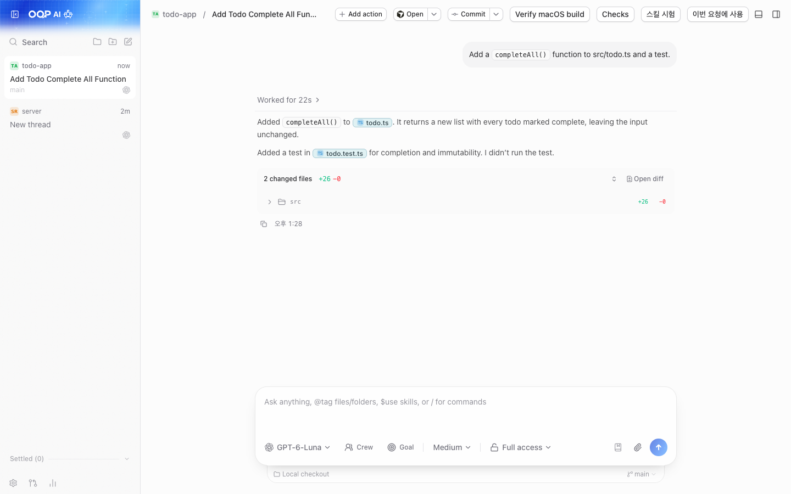
*메인 채팅 화면: provider와 모델을 고르고, 권한 모드를 설정한 뒤, 스레드를 따라가 보세요.*

1. OoP를 열고 provider 하나에 로그인합니다(Settings → Providers).
2. 프로젝트 폴더를 추가하고 스레드를 시작합니다.
3. 작성창에서 모델과 권한 모드를 고른 뒤 메시지를 보냅니다.
4. diff 패널에서 결과를 검토하고, 마음에 들지 않으면 체크포인트에서 복원합니다.

## 스크린샷 둘러보기

모든 스크린샷은 개인 데이터가 없는 격리된 데모 프로필에서 가져왔습니다.

### 채팅

메인 작업 공간입니다. 프로젝트마다 스레드가 있고, 각 스레드는 하나의 provider 및 모델과 나누는 대화입니다. 작성창에는 모델 선택기, 권한 모드, Crew 및 Goal 컨트롤이 있습니다.

**여는 방법:** 프로젝트를 추가한 뒤 사이드바에서 스레드를 시작합니다.


*채팅: 스레드 타임라인 아래에 모델 선택기와 권한 모드가 있는 작성창.*

### OOP Crew

하나의 채팅에 여러 모델이 참여합니다. 채팅 자체의 모델이 **brain**(총괄)이며, 계획을 세우고 사용자와 대화합니다. **worker**(작업자)는 검색, 편집, 테스트 같은 반복 작업을, **expert**(전문가)는 어려운 구현을 맡고, **auditor**(감사자)는 파일을 변경한 턴을 검토합니다. 프리셋은 **OOP pick**(OoP 추천), **Speed**(속도), **Quality**(품질), **Budget**(예산)이며, 역할별로 모델을 직접 지정할 수도 있습니다. crew 모델이 실패하면(예: 크레딧 소진) OoP는 같은 등급의 로그인된 다른 모델에게 작업을 넘깁니다. 테스트를 통과한 20줄 이하의 작은 변경은 감사하지 않습니다.

**사용 시점:** 대부분은 저렴한 모델로 처리하고 검토는 강력한 모델에게 맡기고 싶은 규모가 큰 작업. **여는 방법:** 작성창의 모델 선택기 옆에 있는 **Crew**. Crew 작업은 오른쪽 패널의 **Workflows**와 **Agents**에서 실시간으로 볼 수 있습니다.

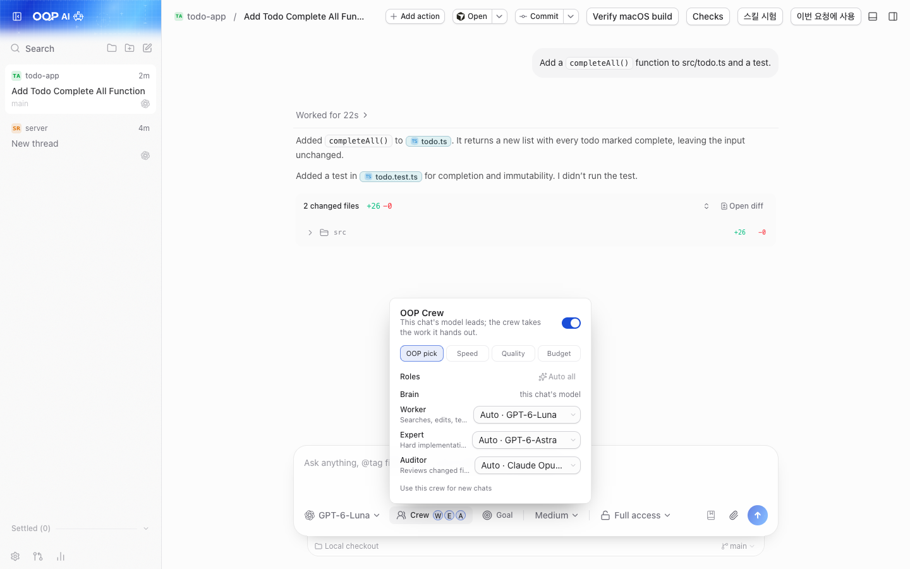
*OOP Crew: 하나의 채팅, 여러 모델, 누가 무엇을 하고 있는지 보여 주는 실시간 보드.*

> [!NOTE]
> Crew는 채팅 하나에서 여러 모델을 실행하므로 provider 사용량이 늘어납니다. 비용이 걱정되신다면 **Budget** 프리셋부터 시작해 보세요.

### Providers

각 provider의 설치, 업데이트, 로그인을 한곳에서 처리합니다. 카드에는 CLI가 설치되어 있는지, 로그인되어 있는지가 표시되고, `npm`이 `PATH`에 있으면 **Install**을, OoP가 어떤 설치 도구로 CLI를 설치했는지 알고 있으면 **Update now**를 제공합니다.

**여는 방법:** Settings → Providers.

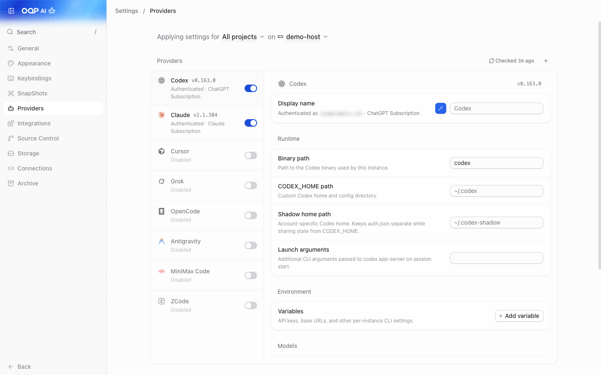
*Settings → Providers: 각 provider를 설치, 업데이트하고 로그인합니다.*

### Z.AI 또는 MiniMax 추가하기 (OpenCode 프리셋)

Z.AI(API 또는 Coding Plan)와 MiniMax(API 또는 Token Plan)용 프리셋으로, OpenCode를 통해 실행됩니다. OpenCode 설정을 직접 작성하지 않고도 해당 모델을 쓸 수 있습니다. API 키는 인스턴스 변수(`OOP_ZAI_API_KEY` / `OOP_MINIMAX_API_KEY`)로 저장됩니다.

**여는 방법:** Settings → Providers → Add. OpenCode 1.14.19 이상이 필요합니다.

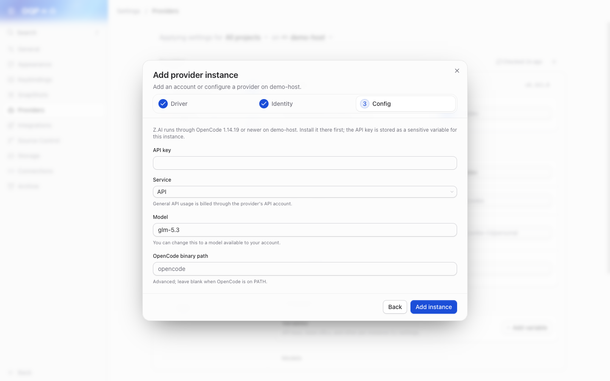
*Add provider: OpenCode를 통해 실행되는 Z.AI 및 MiniMax 프리셋.*

> [!NOTE]
> 유료 Z.AI / MiniMax 로그인과 채팅 요청은 이 포크에서 테스트하지 않았습니다.

### Diff와 리뷰

에이전트가 스레드에서 정확히 무엇을 바꿨는지 확인하고 검토하며, 매 턴이 끝날 때 만들어지는 체크포인트에서 복원할 수 있습니다. 체크포인트는 숨겨진 git ref이므로 브랜치가 어지러워지지 않습니다.

**여는 방법:** 오른쪽 패널의 **Diff** 탭(git 저장소에 있는 서버 스레드).

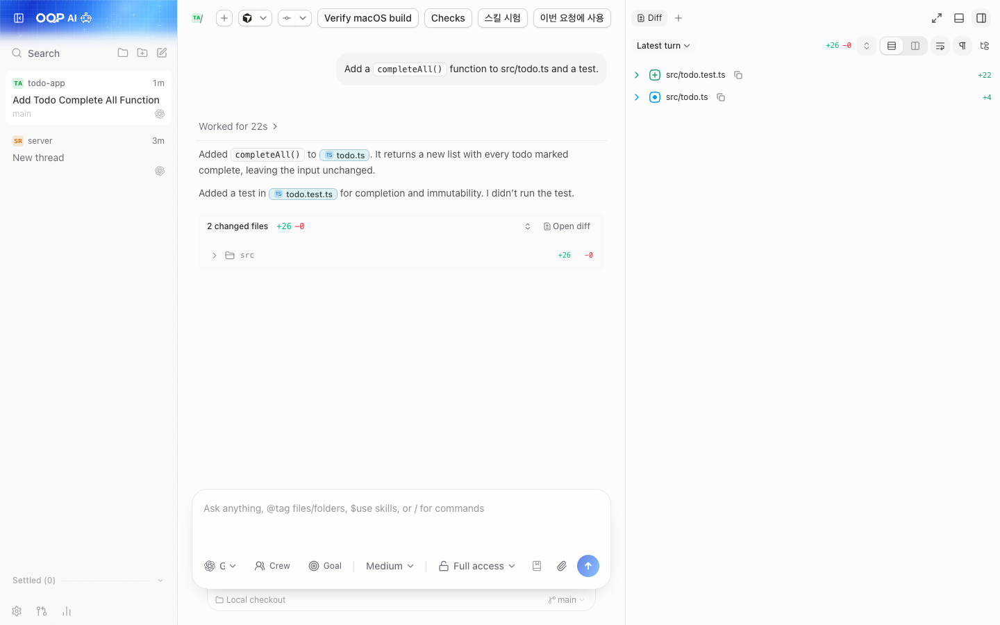
*Diff 패널: 에이전트가 바꾼 내용을 검토하고 체크포인트에서 복원합니다.*

### 커밋과 소스 컨트롤

서버를 실행하는 컴퓨터에서 각 서비스의 CLI를 통해 GitHub, GitLab, Forgejo/Gitea, Bitbucket, Azure DevOps를 연결하면, 스레드에서 바로 커밋, 게시, 풀 리퀘스트 생성을 할 수 있습니다.

**여는 방법:** Settings → Source Control에서 CLI를 감지하고(로그인한 뒤에는 **Rescan**을 누르세요), 스레드의 커밋 컨트롤을 사용합니다.

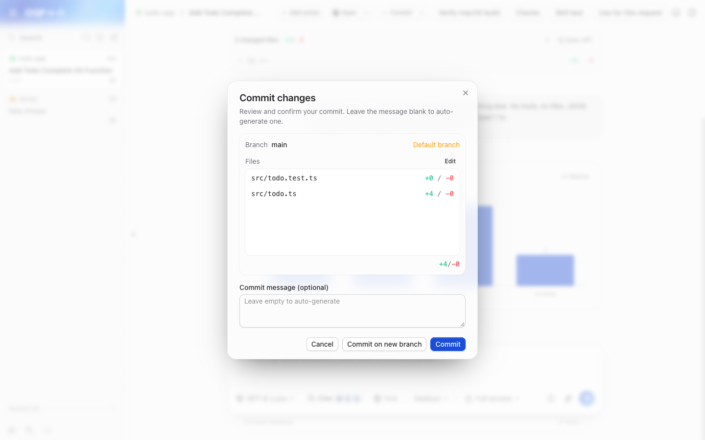
*소스 컨트롤: 스레드에서 변경 사항을 커밋하고 게시합니다.*

### 권한 모드

에이전트가 행동하기 전에 언제 물어봐야 하는지 선택합니다. 모드는 스레드마다 적용됩니다.

| 모드 | 동작 |
|---|---|
| **Supervised** | 명령과 파일 변경에 대해 승인을 요청합니다. |
| **Auto-accept edits** | 파일 편집은 자동으로 승인하고, 다른 동작은 여전히 물어볼 수 있습니다. |
| **Auto** | 반복적인 동작에는 provider의 자동 검토를 사용하고 나머지는 물어봅니다(Codex, Claude, Cursor 지원. 다른 provider는 묻는 방식으로 대체됩니다). |
| **Full access** | 명령과 편집이 승인 프롬프트 없이 실행됩니다. 새 스레드의 **기본값**입니다. |

**여는 방법:** 작성창의 모드 선택기. 기본값은 Settings → General → New threads → Permissions에서 바꿉니다.

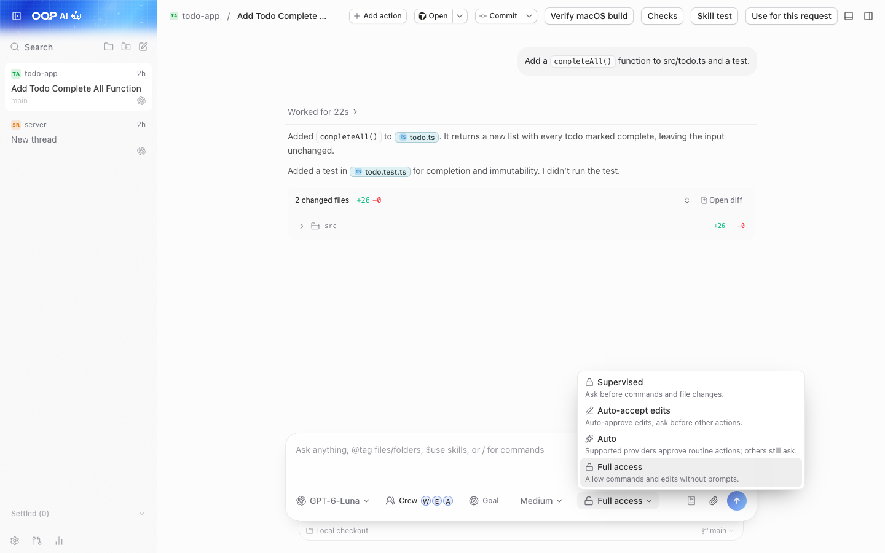
*권한 모드: Supervised부터 Full access까지.*

### 스레드 목표

채팅이 끝났을 때 무엇이 참이어야 하는지 적어 둡니다. 목표가 열려 있는 동안 OoP는 매 턴이 끝날 때마다 스레드를 이어서 진행하며, 에이전트가 `GOAL COMPLETE`를 보고하거나, `GOAL BLOCKED: <reason>`을 보고하거나, 사용자가 정한 자동 이어가기 횟수가 소진될 때까지 계속합니다. Crew를 쓸 때는 파일을 변경한 턴이 감사를 거친 뒤에야 인정됩니다.

**여는 방법:** 작성창에서 **Crew** 옆에 있는 **Goal**. 끝내려면 **Stop goal**을 사용합니다.

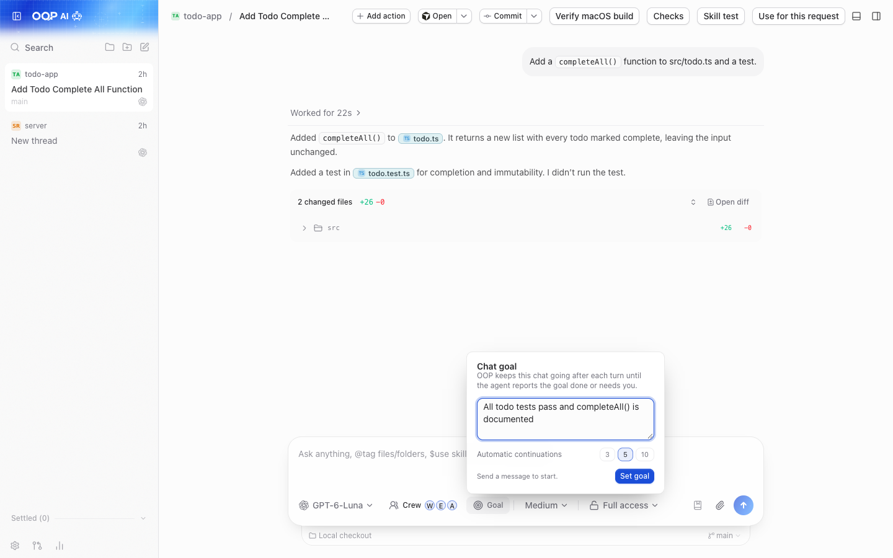
*스레드 목표: 목표가 달성되거나, 막히거나, 중단될 때까지 채팅이 계속됩니다.*

### 채팅 속 리포트

답변에 숫자나 과정이 담겨 있으면, 에이전트가 긴 글 대신 차트, 핵심 수치 카드, 진행 막대, 흐름도로 그려 줄 수 있습니다. 각 그림에는 근거 데이터를 보여 주는 **Source** 버튼이 있습니다.

**사용해 보기:** 에이전트에게 차트나 다이어그램을 요청해 보세요.

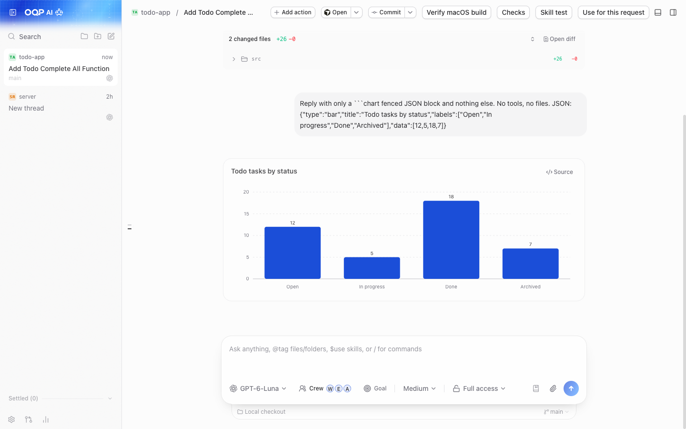
*리포트: 대화 안에 렌더링된 차트와 핵심 수치.*

### Workflows 및 Agents 패널

에이전트가 하고 있는 일을 실시간 다이어그램으로 보여 줍니다. 도구 호출, 서브에이전트, provider 워크플로가 각각 카드가 되고, 병렬 작업은 같은 열에 놓이며, 선택한 카드에는 모델, 소요 시간, 토큰이 표시됩니다. Crew 작업도 여기에 나타납니다.

**여는 방법:** 오른쪽 패널(Workflows 및 Agents 탭), 명령 팔레트, 또는 `mod+alt+w`.

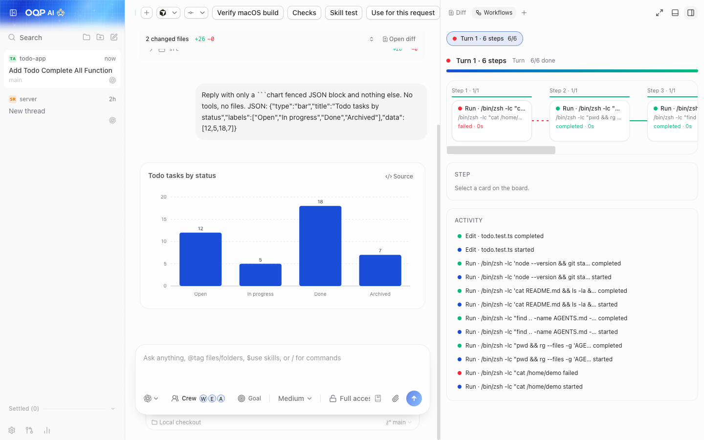
*Workflows 패널: 에이전트의 작업을 진행되는 대로 따라가 보세요.*

### Usage

연결된 서버의 모든 provider에 걸친 토큰 사용량, 캐시 절감액, 모델별 내역, 그리고 API 기준으로 환산한 **추정** 비용을 보여 줍니다. 추정치이며 구독 청구 금액이 아닙니다.

**여는 방법:** 사이드바나 명령 팔레트의 **Usage**, 또는 `mod+u`(터미널에 포커스가 없을 때).

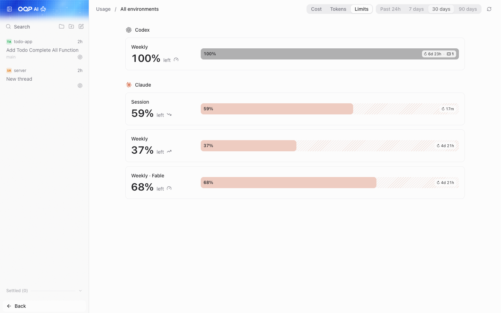
*Usage: provider별 토큰 및 추정 비용 기록.*

### 내장 터미널

서버를 실행하는 컴퓨터에서 스레드마다 터미널을 제공합니다. 스크롤백은 최대 5,000줄(8 MiB)까지 서버에 보관되므로 재연결해도 유지됩니다.

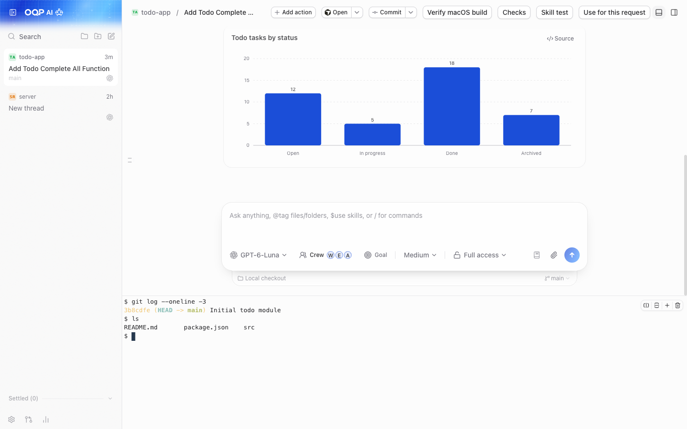
*채팅과 나란히 있는 내장 터미널.*

### 다크 테마

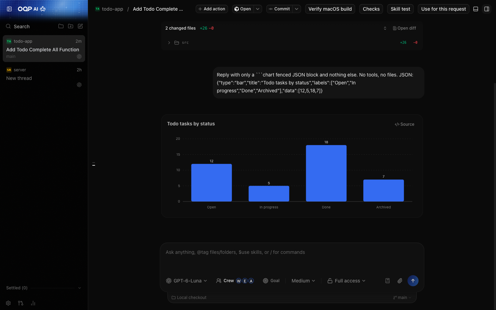
*다크 테마.*

### 휴대폰 크기의 웹 클라이언트

페어링만 하면 같은 웹 UI를 휴대폰 브라우저에서도 사용할 수 있습니다([휴대폰에서 연결하기](#휴대폰에서-연결하기) 참고).

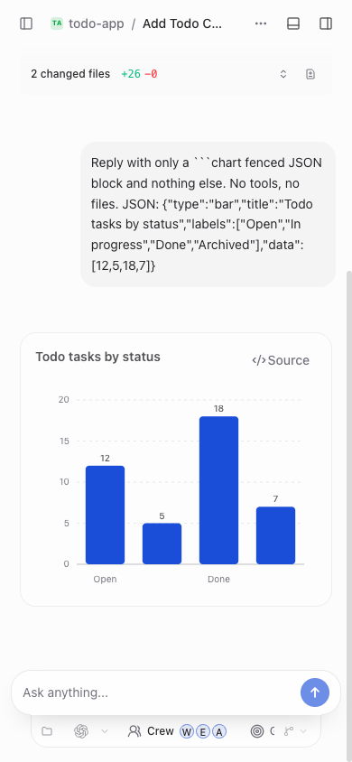
*휴대폰 크기의 웹 클라이언트.*

### 원격 접속 설정

네트워크 접속을 켜고, 페어링 링크를 만들고, 승인된 클라이언트를 확인하고 해제하는 곳입니다. 이 스크린샷의 페어링 코드는 가려져 있습니다.

**여는 방법:** Settings → Connections.

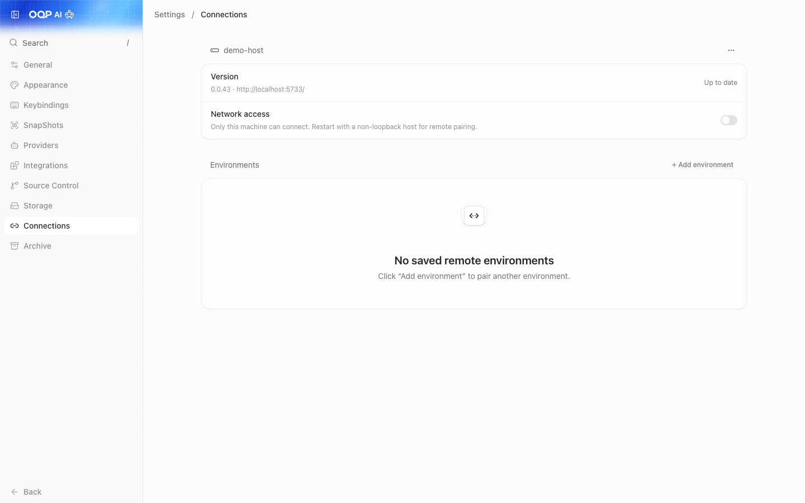
*Settings → Connections: 원격 접속과 페어링(코드는 가림).*

## 기능 레퍼런스

"Added in OoP"(OoP에서 추가)는 포크의 문서와 코드가 OoP 전용으로 표시한 기능을 뜻합니다. "From T3 Code"(T3 Code에서 유래)는 문서와 코드로 확인되는 범위에서 업스트림(v0.0.44)에 포함된 기능을 뜻합니다. 포크에서 파일 단위 diff를 수행한 것은 아니므로, 이 구분은 대략적인 것으로 봐 주세요.

| 기능 | 하는 일 | 위치 | 유래 |
|---|---|---|---|
| OOP Crew | brain 모델이 worker, expert, auditor 모델에게 위임. 프리셋과 역할별 지정 | 작성창 → Crew, 오른쪽 패널 → Workflows / Agents | Added in OoP |
| 스레드 목표 | 점검을 통과하거나 목표가 막힐 때까지 스레드를 계속 진행 | 작성창 → Goal | Added in OoP |
| 프로젝트 메모리 | 작성창에서 저장된 프로젝트 메모리를 제안 | 작성창, 메모리 버튼 | Added in OoP |
| 로컬 역할 선호 설정 | 환경마다 구현용 또는 리뷰용 선호 모델을 저장하고 추천을 제공 | 작성창 모델 선택기 | Added in OoP |
| Z.AI / MiniMax 프리셋 | OpenCode 기반 provider 프리셋 | Settings → Providers → Add | Added in OoP (유료 요청은 테스트하지 않음) |
| ZCode (GLM) provider | ACP로 연결되는 Z.AI의 에이전트 | Settings → Providers | Added in OoP |
| MiniMax Code provider | ACP로 연결되는 MiniMax의 에이전트 | Settings → Providers | Added in OoP |
| 원클릭 provider 설치 / 업데이트 | provider 카드에서 provider CLI를 설치하거나 업데이트 | Settings → Providers | Added in OoP (업스트림과의 정확한 차이는 확인하지 않음) |
| Verify macOS build | 서버 Mac에서 OoP `.dmg`의 무결성, 엄격한 코드 서명, 실행 여부를 검사 | 채팅 헤더 → Verify macOS build | Added in OoP |
| 휴대폰 연결 대화상자 | 데스크톱 앱에서 원클릭으로 휴대폰 페어링 QR 제공, 선택적으로 자체 릴레이 사용 | 사이드바 → Connect mobile | Added in OoP (데스크톱 앱 전용) |
| 자체 Cloudflare 릴레이 | 직접 배포하는 Worker로, 어느 네트워크의 휴대폰이든 데스크톱에 접속 가능 | `infra/oop-relay` | Added in OoP, 초기 단계 |
| 로컬 폴더 업데이터 | 패키징된 OoP 빌드가 지정한 폴더의 새 패키지를 가져올 수 있음 | 패키징된 macOS / Windows 빌드 | Added in OoP, 초기 단계, 다른 사람이 테스트하지 않음 |
| 멀티 provider 세션 | provider를 넘나드는 스레드, 턴, 체크포인트 | 전체 | From T3 Code |
| 권한 모드 | Supervised, Auto-accept edits, Auto, Full access | 작성창, Settings → General | From T3 Code |
| Diff 패널과 체크포인트 | 에이전트의 변경 사항 검토 및 복원 | 오른쪽 패널 → Diff | From T3 Code |
| 소스 컨트롤 | provider CLI를 통한 클론, 커밋, 게시, 풀 리퀘스트 | Settings → Source Control | From T3 Code |
| 내장 터미널 | 서버 컴퓨터에서 스레드마다 제공되는 터미널 | 스레드 안 | From T3 Code |
| 채팅 속 리포트 | 차트, 수치 카드, 진행 막대, mermaid 흐름도 | 답변 안 | From T3 Code |
| 워크플로 보기 | 도구 호출과 서브에이전트의 실시간 다이어그램 | 오른쪽 패널, `mod+alt+w` | From T3 Code |
| Usage 페이지 | 토큰 및 추정 비용 기록 | 사이드바, `mod+u` | From T3 Code (ZCode와 MiniMax 행은 OoP) |
| SnapShots | 창을 캡처해 초안에 첨부(기본값은 꺼짐. macOS, Windows, Linux Wayland) | Settings → SnapShots | From T3 Code (출처 미확인) |
| 원격 접속 | LAN 페어링, Tailscale HTTPS, SSH 환경 | Settings → Connections | From T3 Code |
| 디바이스 패널 | 스레드 옆에서 iOS Simulator 또는 Android Emulator를 보고 탭 | 오른쪽 패널 → Device | From T3 Code (여기서는 테스트하지 않음) |
| 백그라운드 서비스 | macOS(launchd)와 Linux(systemd 사용자 유닛)에서 `t3 service install`. Windows는 미지원 | CLI | From T3 Code (여기서는 테스트하지 않음) |
| 키 바인딩, 프로젝트 설정, 테마 | 사용자 지정 단축키, 프로젝트별 재정의, 외형 | Settings | From T3 Code |

## 지원하는 provider

스레드를 시작하기 전에 provider CLI를 하나 이상 설치하고 로그인하세요.

| Provider | 로그인 방법 | 참고 |
|---|---|---|
| Codex | Codex CLI를 설치한 뒤 `codex login` (또는 Settings → Providers의 **Connect with ChatGPT**) | |
| Claude Code | Claude Code를 설치한 뒤 `claude auth login` | Claude brain은 같은 계정의 Claude crew 역할을 서브에이전트로 실행합니다. |
| Cursor | Cursor CLI를 설치한 뒤 `agent login` | |
| Grok Build | Grok Build CLI를 설치한 뒤 `grok login` | |
| OpenCode | OpenCode 1.14.19 이상을 설치한 뒤 `opencode auth login` | Z.AI / MiniMax 프리셋에 필요합니다. |
| Antigravity | Settings → Providers에서 활성화하고 **Install**, 이어서 **Sign in with Google** | CLI는 필요 없습니다. Gemini API 키는 설정에 평문으로 저장됩니다. |
| ZCode (GLM) | ZCode를 설치하고 `zcode login zai`, 이어서 `npm i -g zcode-acp-server` | 어떤 권한 모드를 고르든 자체 도구를 승인 없이 실행합니다. |
| MiniMax Code | `npm i -g @minimax-ai/code`, 이어서 `mcode login --region global` | |
| OpenCode를 통한 Z.AI / MiniMax | Settings → Providers → Add → Z.AI 또는 MiniMax. 키는 `OOP_ZAI_API_KEY` / `OOP_MINIMAX_API_KEY`에 입력 | 유료 요청은 테스트하지 않았습니다. |

## 플랫폼 지원

| 플랫폼 | 상태 |
|---|---|
| macOS, Apple Silicon (arm64) | **테스트됨.** 주요 대상 플랫폼입니다. |
| Windows x64 | **실험적.** 메인테이너가 빌드했으며, 깨끗한 환경에서는 검증하지 않았습니다. |
| macOS Intel | 이 포크에서는 테스트하지 않았습니다. macOS 빌드 스크립트는 Intel에서 실행을 거부합니다. |
| Linux | 이 포크에서는 테스트하지 않았습니다. 업스트림 패키징 코드가 저장소에 있지만 보장은 없습니다. |
| iOS / Android 네이티브 앱 | 이 포크에서는 테스트하지 않았습니다. [네이티브 앱과 브라우저](#네이티브-앱과-브라우저)를 참고하세요. |
| 휴대폰 브라우저 (웹 UI 대상) | 휴대폰 크기에서 웹 UI를 확인했습니다. [휴대폰에서 연결하기](#휴대폰에서-연결하기)를 참고하세요. |

## 요구 사항

- **Node.js 24.x, 24.13.1 이상**
- **pnpm 11.10.0**
- **git**
- **rsync** (macOS, 빌드 스크립트에서 사용)
- **provider CLI 하나 이상**, 설치 및 로그인 완료([지원하는 provider](#지원하는-provider) 참고)
- Windows 패키징에만 해당: Rust, Python 3, Visual Studio Build Tools(Desktop development with C++, Windows SDK 포함)

## 설치 / 소스에서 빌드

```bash
git clone https://github.com/AIBeginnerX/oh-our-pi-desktop.git
cd oh-our-pi
```

### macOS (Apple Silicon)

스크립트는 `pnpm`을 거치지 말고 `node`로 직접 실행하세요.

```bash
node scripts/macos.mjs doctor    # checks macOS arm64, Node, pnpm, rsync
node scripts/macos.mjs setup     # installs dependencies in a local cache
node scripts/macos.mjs start     # optional: run an isolated dev copy of the desktop app
node scripts/macos.mjs package   # builds an ad hoc signed DMG into release/macos/
```

`release/macos/`에서 DMG를 열고 앱을 `/Applications/OoP.app`으로 끌어다 놓습니다.

### Windows (x64, 실험적)

Windows PC에서 빌드하세요(크로스 빌드는 지원하지 않습니다). 먼저 Rust, Python 3, Visual Studio Build Tools(Desktop development with C++, Windows SDK 포함)를 설치합니다.

```bat
set OOP_WINDOWS_UPDATE_DIRECTORY=%CD%\release\windows
node scripts\windows.mjs package
```

설치 프로그램(`OoP-<version>-x64.exe`)은 `release\windows`에 생성됩니다.

### 일반 개발 경로 (모든 OS)

이 코드베이스가 문서화한 작업 실행 도구인 Vite+(`vp`)를 사용합니다(설치: `curl -fsSL https://vite.plus | bash`). 자세한 내용은 [`docs/operations/development.md`](docs/operations/development.md)를 참고하세요.

```bash
vp i          # install dependencies
vp run dev    # server + web; open the pairing URL it prints
```

### 첫 실행 체크리스트

빌드는 **ad hoc 서명이며 공증(notarization)되지 않았으므로**, 운영체제가 처음 한 번 경고를 표시합니다.

- **macOS (Gatekeeper):** 앱을 오른쪽 클릭하고 **Open**을 선택하거나, System Settings → Privacy & Security → **Open Anyway**로 이동합니다.
- **Windows (SmartScreen):** **More info** → **Run anyway**를 클릭합니다.

그다음 순서입니다.

- [ ] Settings → Providers: **하나의** provider를 설치하고 로그인합니다.
- [ ] 프로젝트를 추가합니다(폴더, 가능하면 git 저장소).
- [ ] 스레드를 시작하고 작성창에서 모델을 고릅니다.
- [ ] 권한 모드를 고릅니다. 새 스레드의 기본값은 **Full access**입니다. 신뢰할 수 없는 저장소에는 **Supervised**를 사용하세요.
- [ ] 선택 사항: **Crew**를 켜고, 몇 턴 뒤에 **Usage** 페이지를 확인합니다.

## 휴대폰에서 연결하기

에이전트, 파일, provider 로그인은 모두 사용자의 컴퓨터(**호스트**)에 남습니다. 휴대폰은 리모컨일 뿐입니다. 스레드를 보여 주고, 메시지를 보내고, 승인 프롬프트에 답할 수 있게 해 줍니다. 호스트는 계속 켜져 있고 실행 중이어야 합니다.


가장 간단하면서 사용자에게 맞는 경로를 아래 순서대로 고르세요.

| | 경로 | 필요한 것 | 집 밖에서 사용 | 위험도 |
|---|---|---|---|---|
| a | 같은 Wi-Fi / LAN | 같은 네트워크의 휴대폰과 컴퓨터 | 불가 | 가장 낮음 |
| b | Tailscale | 두 기기 모두의 무료 Tailscale 계정 | 가능 | 낮음 |
| c | 자체 Cloudflare 릴레이 | Cloudflare 계정과 한 번의 배포 | 가능 | 중간 (Cloudflare가 트래픽을 볼 수 있음) |

> [!WARNING]
> **페어링 링크와 코드는 비밀번호와 같습니다.** 이슈, 채팅, 스크린샷에 절대 올리지 마세요. 본인 소유의 기기만 페어링하세요. 서버 포트를 인터넷에 그대로 노출하지 마세요. 집 밖에서는 Tailscale을 권장합니다. 알아볼 수 없는 기기는 해제하세요. 원격으로 에이전트를 제어할 때는 **Supervised** 권한 모드를 사용하세요.

### a) 같은 Wi-Fi / LAN (가장 간단)

**사전 준비:** 컴퓨터에서 실행 중인 OoP 데스크톱 앱, 그리고 같은 네트워크의 휴대폰.

1. 데스크톱 앱 사이드바의 휴대폰 아이콘(**Connect mobile**)을 클릭합니다.
2. 모바일 연결이 꺼져 있다는 안내가 나오면 **Allow mobile connections**를 클릭합니다. OoP가 한 번 재시작되며, 설정은 유지됩니다.
3. 일회용 QR 코드가 나타납니다. 주소가 여러 개 표시되면 휴대폰이 접근할 수 있는 것을 고르세요(같은 Wi-Fi라면 **LAN** 항목).
4. 휴대폰 카메라로 QR 코드를 스캔하고 휴대폰 브라우저에서 링크를 엽니다. 이제 휴대폰이 페어링되었습니다. 페어링하면 그 기기가 이후 방문에도 승인되므로 처음의 코드를 다시 입력할 필요가 없습니다.

직접 하는 방법도 같습니다. Settings → Connections → **Network access**를 켠 다음 **Create link**를 누르고 휴대폰에서 링크를 엽니다. 여기서 만든 링크는 그 페이지가 열려 있는 동안에만 복사할 수 있으며, 페이지를 떠나면 새 링크가 필요합니다.

데스크톱 앱 없이 서버를 실행하시나요(예: 개발 경로)?

```bash
t3 serve --host <your-computer's-LAN-address>   # for example 192.168.1.20
t3 pair                                          # prints a fresh pairing QR for the running server
```

소스 체크아웃에서는 `node apps/server/src/bin.ts pair`가 같은 명령을 실행합니다. 페어링 토큰은 기본적으로 5분 동안 유효합니다(`--ttl`로 변경, 옵션은 `t3 pair --help`에서 확인). `127.0.0.1` 같은 루프백 주소는 컴퓨터 자신에서만 동작하며 휴대폰에서는 절대 동작하지 않습니다.

### b) Tailscale 사설 네트워크

**사전 준비:** [Tailscale](https://tailscale.com) 계정, 컴퓨터와 휴대폰 모두에 설치된 Tailscale, 그리고 두 기기가 같은 tailnet에 로그인된 상태.

1. 데스크톱 앱에서 Settings → Connections를 열고 **Tailscale HTTPS**를 켭니다. (경로를 제거하려면 같은 곳에서 끄세요.)
2. 페어링 링크를 만듭니다(또는 **Connect mobile**을 사용해 Tailscale 경로를 고릅니다). 링크는 `https://your-computer.your-tailnet.ts.net/` 같은 모양입니다.
3. 휴대폰에서 링크를 엽니다(휴대폰에서 Tailscale이 연결되어 있어야 합니다).

명령줄 서버의 경우:

```bash
t3 serve --tailscale-serve     # start a server published over Tailscale HTTPS
t3 pair --tailscale            # for an already-running server
tailscale serve --https=443 off   # remove the mapping later
```

443 포트가 사용 중이면 `--tailscale-serve-port`로 다른 포트를 지정하세요. Tailscale 트래픽은 어떤 공개 릴레이도 거치지 않습니다.

### c) 자체 Cloudflare 릴레이 (집 밖에서, Tailscale 없이)

OoP에는 [`infra/oop-relay`](infra/oop-relay/README.md)에 작은 Cloudflare Worker가 포함되어 있으며, **사용자 본인의** Cloudflare 계정에 배포합니다. 데스크톱이 먼저 밖으로 연결을 걸기 때문에 공유기 설정이 필요 없고, 데스크톱이 온라인인 동안에는 어떤 네트워크의 휴대폰이든 연결할 수 있습니다.

1. [`infra/oop-relay/README.md`](infra/oop-relay/README.md)의 설명대로 Worker를 배포합니다(`npx wrangler login`, `npx wrangler deploy`, 이어서 `npx wrangler secret put OOP_RELAY_SECRET`).
2. 데스크톱 앱에서 Connect mobile → **Use away from home**을 선택합니다. 표시된 시크릿을 Worker 시크릿에 붙여 넣고, 릴레이 주소를 입력한 뒤 **Save**합니다.
3. 경로로 **Cloudflare relay**를 선택한 다음 QR 코드를 스캔합니다.

> [!NOTE]
> 한 번의 배포는 데스크톱 한 대를 위한 것입니다. 릴레이의 TLS는 Cloudflare에서 종료되므로, 트래픽은 이를 운영하는 Cloudflare 계정에서 볼 수 있습니다. 휴대폰은 여전히 페어링 코드로 데스크톱에 로그인해야 합니다. 이 경로는 새로 추가되었고 세 가지 중 가장 덜 테스트되었습니다.

**T3 Connect는요?** T3 Code는 "T3 Connect"라는 터널 서비스도 제공합니다. 클라우드 로그인과 업스트림 프로젝트가 운영하는 서버에 의존하는 서비스입니다. **OoP는 어떤 호스팅 서비스도 운영하지 않으며**, 이 포크는 T3 Connect를 테스트하지 않았으므로 이 가이드에서는 다루지 않습니다.

### 네이티브 앱과 브라우저

| | 휴대폰 브라우저 | iOS / Android 네이티브 앱 |
|---|---|---|
| 정체 | 내 컴퓨터가 제공하는 OoP 웹 UI | 업스트림 프로젝트가 배포한 T3 Code 모바일 앱(OoP 브랜드 아님) |
| 설치 | 필요 없음 | T3 Code의 App Store / Google Play 등록 페이지 |
| 연결 | 페어링 링크를 열거나 QR 코드를 스캔 | 환경 추가: QR 코드를 스캔하거나 페어링 URL을 붙여 넣기 |
| 이 포크의 테스트 여부 | 휴대폰 크기에서 웹 UI를 확인함. 실제 휴대폰에서의 페어링은 따로 검증하지 않음 | **아니요** |


*OoP에 연결된 휴대폰 브라우저.*

포크는 프로토콜과 인증 식별자를 그대로 유지하므로([`UPSTREAM.json`](UPSTREAM.json)의 `internal_protocol_and_auth_identifiers_preserved`), 업스트림 앱이 OoP 서버와 페어링될 수 있을 것으로 보입니다. **포크는 네이티브 모바일 앱을 테스트하지 않았으므로** 확인되지 않은 것으로 받아들여 주세요. 업스트림 문서는 앱의 연결 설정을 Settings → Environments 아래에 설명합니다. 문제가 생기면 브라우저를 사용하세요.

### 푸시 알림

업스트림 문서에 따르면 휴대폰 푸시 알림(에이전트 완료, 실패, 승인 필요)은 T3 Connect에 로그인해야 하며, 직접 연결이나 Tailscale 연결만으로는 켤 수 없습니다. OoP는 T3 Connect를 운영하지 않고 포크도 테스트하지 않았으므로, **위의 경로로는 푸시 알림을 기대하지 마세요.** 휴대폰 페이지를 열어 두거나 스레드를 다시 확인해 주세요.

### 기기 해제하기

1. 컴퓨터에서 Settings → Connections → **Authorized clients**를 엽니다.
2. 기기의 세션을 해제하여 기존 접근 권한을 제거합니다. 사용하지 않는 페어링 링크도 해제해서 나중에 사용되지 않도록 하세요.
3. 명령줄: `t3 auth session list` / `t3 auth session revoke <id>`, 그리고 `t3 auth pairing list` / `t3 auth pairing revoke <id>` (`t3 auth --help` 참고).
4. 문을 완전히 닫으려면 Settings → Connections에서 **Network access**(또는 **Tailscale HTTPS**)를 끄세요.

## 업데이트 방식

공개 자동 업데이트 서버는 없으며, OoP는 GitHub에서 스스로 업데이트하지 않습니다.

1. `git pull`
2. 다시 빌드 / 패키징([설치](#설치--소스에서-빌드) 참고)하고 재설치합니다.

각 릴리스는 **커밋 하나**(제목 `OoP <version> source`)와 `v<version>` 태그로 게시됩니다. `~/.oop-desktop/userdata`에 있는 데이터는 업데이트해도 유지됩니다. 새 버전 소식을 받으려면 GitHub 저장소에서 **Watch → Custom → Releases**를 사용하거나, 가끔 태그를 확인하세요.

> [!NOTE]
> 앱의 서버 업데이트 알림과 `t3 update`는 업스트림 T3 Code에서 오는 것입니다. OoP의 업데이트 채널이 아닙니다.

## 보안 및 개인정보

> [!WARNING]
> 에이전트는 **사용자 계정의 권한**으로 실행됩니다. 파일을 편집하고 명령을 실행할 수 있습니다. 새 스레드의 기본 권한 모드는 **Full access**입니다. 신뢰할 수 없는 저장소에서는 **Supervised**로 바꾸세요(Settings → General → New threads).

- **ZCode**는 어떤 권한 모드를 고르든 자체 도구를 승인 없이 실행합니다.
- **비용:** 모든 provider는 사용자 본인의 구독 또는 API 크레딧을 사용합니다. Crew는 채팅 하나에서 여러 모델을 실행하므로 사용량이 늘어납니다. Usage 페이지는 청구 금액이 아니라 추정치를 보여 줍니다.
- **API 키**는 서버 측, 즉 사용자의 컴퓨터에 저장됩니다. Antigravity Gemini API 키는 설정에 **평문으로** 저장됩니다.
- **`.env` 파일이나 키를 절대 커밋하지 마세요.** 이슈나 로그에 붙여 넣는 것도 안 됩니다.
- **업스트림 설치 프로그램은 OoP가 아니라 T3 Code를 설치합니다.** `t3.codes` 설치 스크립트, `npx t3`, Homebrew `t3-code`, winget `T3Tools.T3Code`, App Store / Play 등록 페이지는 모두 업스트림 프로젝트의 것입니다. OoP는 이 저장소에서 빌드하세요.
- **CLI 이름은 여전히 `t3`입니다.** 그래서 업스트림 설치본과 충돌할 수 있습니다.
- **빌드는 ad hoc 서명**이며 Developer ID도 공증도 없습니다. Gatekeeper 또는 SmartScreen 경고가 처음 한 번 나타나는 것이 정상입니다.
- **로컬 폴더 업데이터**는 업데이트 폴더에 쓸 수 있는 모든 사람을 신뢰합니다. SHA-256 검사는 손상만 감지할 수 있습니다.

**텔레메트리.** OoP에는 서버가 없으며 메인테이너는 사용자의 앱에서 아무것도 받지 않습니다. 업스트림에서 물려받은 서버 코드에는 익명의 PostHog 사용 현황 리포터가 들어 있습니다(업스트림 프로젝트의 키와 `us.i.posthog.com`을 사용). OoP는 이를 **기본적으로 꺼 두므로**, 직접 켜지 않는 한 아무것도 전송되지 않습니다. 켜려면 서버를 시작하기 전에 서버 환경에 `T3CODE_TELEMETRY_ENABLED=true`를 설정하세요([`docs/user/telemetry.md`](docs/user/telemetry.md) 참고). 켜면 이벤트에는 provider, 모델, 추론 강도, 권한 모드, 턴 결과, 소요 시간, 메인 에이전트의 토큰 합계가 포함되며 해시 처리된 계정 또는 설치 식별자와 연결됩니다. 문서에 따르면 프롬프트, 응답, 파일 내용, 인증 토큰, 대화 ID는 절대 포함되지 않습니다.

취약점을 신고하려면 [SECURITY.md](SECURITY.md)를 참고하세요.

## FAQ / 문제 해결

**macOS에서 앱을 열 수 없다거나 확인되지 않은 개발자의 앱이라고 나옵니다.**
빌드가 ad hoc 서명이며 공증되지 않았기 때문입니다. 앱을 오른쪽 클릭하고 **Open**을 선택하거나, System Settings → Privacy & Security → **Open Anyway**를 사용하세요.

**Windows에서 설치 프로그램에 SmartScreen 경고가 표시됩니다.**
설치 프로그램이 서명되지 않았습니다. **More info** → **Run anyway**를 클릭하세요.

**provider가 "not signed in"으로 표시됩니다.**
provider 자체의 명령으로 로그인한 뒤([지원하는 provider](#지원하는-provider) 참고) Settings → Providers를 다시 여세요. CLI는 서버를 실행하는 컴퓨터의 `PATH`에 있어야 합니다. 소스 컨트롤 계정은 Settings → Source Control에 **Rescan** 버튼이 있습니다.

**휴대폰에서 서버에 접속할 수 없습니다.**
- 네트워크 접속이 켜져 있는지 확인하세요(Connect mobile → **Allow mobile connections**, 또는 Settings → Connections → **Network access**).
- 페어링 링크가 `127.0.0.1` / localhost 주소가 아닌지 확인하세요.
- 휴대폰과 컴퓨터는 같은 네트워크(LAN) 또는 같은 tailnet에 있어야 합니다. 게스트 Wi-Fi는 기기 간 통신을 막는 경우가 많습니다.
- 페어링 링크는 일회용이고 유효 시간이 짧습니다. 새로 만드세요.
- 두 기기의 날짜와 시간을 확인하고, 컴퓨터가 절전 상태가 아닌지 확인하세요.

**`node scripts/macos.mjs doctor`가 Node 버전에 대해 불평합니다.**
Node.js 24.x(24.13.1 이상)와 pnpm 11.10.0이 필요합니다. 다른 Node 메이저 버전은 거부됩니다.

**내 데이터는 어디에 있나요?**
OoP의 서버 상태(스레드, 설정, 로컬 데이터베이스)는 `~/.oop-desktop/userdata`에 있습니다. provider 로그인은 여기가 아니라 각 provider CLI의 자체 폴더에 있습니다.

**OoP를 초기화하려면 어떻게 하나요?**
앱을 종료한 뒤 `~/.oop-desktop/userdata`를 다른 곳으로 옮겨 두세요(확신이 서기 전에는 삭제하지 마세요). 다음 실행 때 OoP가 새로 시작됩니다. 프로젝트 폴더는 건드리지 않습니다.

**어떻게 제거하나요?**
앱을 종료하고 `/Applications/OoP.app`을 삭제하세요(macOS). Windows에서는 Windows 설정에서 OoP를 제거하세요. 원하면 `~/.oop-desktop`을 삭제해 데이터까지 지울 수 있습니다. provider CLI는 따로 설치된 것이므로 제거되지 않습니다.

**비용이 드나요?**
OoP 자체는 무료입니다. OoP가 실행하는 provider는 사용자 본인의 구독 또는 API 크레딧을 사용합니다. Crew는 채팅 하나에서 여러 모델을 사용하며, Usage 페이지는 청구 금액이 아닌 추정 비용을 보여 줍니다.

**업스트림 T3 Code 모바일 앱을 쓸 수 있나요?**
페어링은 될 것으로 보이지만, 포크에서는 테스트하지 않았습니다. [네이티브 앱과 브라우저](#네이티브-앱과-브라우저)를 참고하세요.

## 저장소 구조

| 경로 | 내용 |
|---|---|
| `apps/server` | Node WebSocket 서버: 오케스트레이션, provider, 체크포인트, `t3` CLI |
| `apps/web` | React / Vite UI |
| `apps/desktop` | 웹 UI를 감싸고 서버를 번들하는 Electron 셸 |
| `apps/mobile` | React Native 클라이언트 (업스트림 앱 코드) |
| `packages/contracts` | 네트워크를 오가는 모든 것의 타입이 지정된 스키마 |
| `packages/shared`, `packages/client-runtime` | 공유 런타임 유틸리티와, 웹과 모바일이 함께 쓰는 클라이언트 코드 |
| `infra/oop-relay` | 선택 사항인 Cloudflare 릴레이 Worker |
| `docs/` | `user/` 가이드, `internals/` 아키텍처 노트, `operations/` 설정 및 릴리스 노트 |

코드베이스가 어떻게 구성되어 있고 어떤 규칙을 따르는지는 [`AGENTS.md`](AGENTS.md)를 참고하세요.

## 현황 및 로드맵에 대한 솔직한 안내

OoP는 **초기 단계**입니다. 버그가 있을 수 있습니다. 포크가 실제로 테스트하는 플랫폼은 macOS Apple Silicon뿐이며, Windows는 실험적입니다. Intel Mac, Linux, 네이티브 모바일 앱, 푸시 알림, 유료 Z.AI / MiniMax 요청은 테스트하지 않았습니다. 약속된 로드맵은 없습니다. 메인테이너가 부딪힌 문제를 고치고, 준비가 되면 릴리스를 게시합니다.

## 기여하기

이 저장소는 **릴리스 미러**입니다. 이슈는 언제든 환영합니다. 풀 리퀘스트는 검토된 뒤 메인테이너의 트리에서 업스트림에 다시 적용되므로, 공개 히스토리는 릴리스당 커밋 하나입니다. [CONTRIBUTING.md](CONTRIBUTING.md)를 참고하세요. 이슈에는 시크릿, 페어링 URL, 개인 경로를 절대 포함하지 마세요.

## 라이선스 및 크레딧

[MIT](LICENSE). 원래의 고지문 "Copyright (c) 2026 T3 Tools Inc."는 그대로 유지되어야 하며, 이 포크의 수정 사항도 MIT 라이선스입니다.

OoP는 T3 Tools Inc.와 pingdotgg 팀의 [T3 Code](https://github.com/pingdotgg/t3code)를 기반으로 만들어졌습니다. provider 이름(Codex, Claude Code, Cursor, Grok, OpenCode, Antigravity, ZCode, MiniMax, Z.AI)은 각 소유자의 것이며, OoP는 이들과 제휴 관계가 아닙니다.
