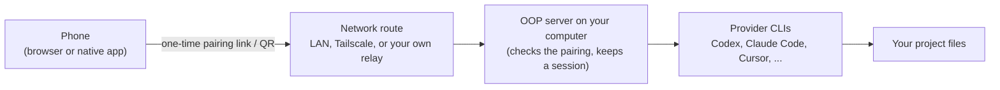

# OOP (oh-our-pi)

**One desktop app to control the coding agents you already use, with an optional multi-model team on top.**

English | [한국어](README.ko.md) | [简体中文](README.zh-CN.md) | [日本語](README.ja.md) | [Español](README.es.md)


OOP runs on your own computer, wraps the coding-agent CLIs you already have (Codex, Claude Code, Cursor, Grok Build, OpenCode, Antigravity, ZCode, MiniMax Code) and gives them one chat-style workspace. You use it from a desktop app, a browser, or your phone. It is **not** a hosted service: you bring your own subscriptions and API keys, and your code stays on your machine.

OOP is a fork of [T3 Code](https://github.com/pingdotgg/t3code) by T3 Tools Inc. (MIT licensed), based on upstream v0.0.44. The current OOP version is in [`OOP_RELEASE.json`](OOP_RELEASE.json). Big thanks to the T3 Code team: almost all of the foundation here is their work.

## Contents

- [Why OOP?](#why-oop)
- [Screenshot tour](#screenshot-tour)
- [Feature reference](#feature-reference)
- [Supported providers](#supported-providers)
- [Platform support](#platform-support)
- [Requirements](#requirements)
- [Install the desktop app](#install-the-desktop-app)
- [Install / build from source](#install--build-from-source)
- [Connect from your phone](#connect-from-your-phone)
- [How updates work](#how-updates-work)
- [Security and privacy](#security-and-privacy)
- [FAQ / Troubleshooting](#faq--troubleshooting)
- [Repo map](#repo-map)
- [Status, contributing, license](#status-and-roadmap-honesty)

## Why OOP?

Coding agents are good, but each one lives in its own terminal or app, with its own login, history and approval prompts. OOP puts them side by side.

- **One place for many agents.** Switch between Codex, Claude Code, Cursor, Grok Build, OpenCode, Antigravity, ZCode and MiniMax Code per thread, with the same diff, terminal and approval flow.
- **Let several models share a task.** OOP Crew lets one "brain" model hand routine work to cheaper workers, hard work to an expert, and have an auditor review the result.
- **Stay in control.** Four permission modes, a diff panel with checkpoints you can restore, and a usage page so costs do not surprise you.
- **Work away from the keyboard.** Pair your phone to the computer that runs the agents and keep an eye on (or steer) long tasks.
- **Keep it local.** Projects, provider logins and agent work stay on your machine. There is no OOP account and no OOP server.

Who it is for: developers who already pay for one or more coding-agent subscriptions or API plans,
accept an early unsigned desktop app, and want one control surface. If you want a polished, signed,
auto-updating product, the upstream project is the better fit today.

### 30-second tour


_Main chat view: pick a provider and model, set the permission mode, and follow the thread._

1. Open OOP and sign in to one provider (Settings → Providers).
2. Add a project folder and start a thread.
3. Pick a model and a permission mode in the composer, then send a message.
4. Review the result in the diff panel; restore from a checkpoint if you do not like it.

## Screenshot tour

All screenshots come from an isolated demo profile with no personal data.

### Chat

The main workspace. Each project has threads; each thread is a conversation with one provider and model. The composer holds the model picker, the permission mode and the Crew and Goal controls.

**Open it:** add a project, then start a thread from the sidebar.


_Chat: composer with model picker and permission mode below the thread timeline._

### OOP Crew

One chat, several models. The chat's own model is the **brain**; it plans and talks to you. A **worker** takes routine work (searches, edits, tests), an **expert** takes hard implementation, and an **auditor** reviews turns that changed files. Presets are **OOP pick**, **Speed**, **Quality** and **Budget**, and you can override the model per role. If a crew model fails (for example, out of credit), OOP hands the task to another signed-in model of the same level. Small, test-passing changes of 20 lines or fewer are not audited.

**When to use it:** larger tasks where you want cheap models for the bulk and a strong model for review. **Open it:** **Crew** next to the model picker in the composer. Crew work shows live under **Workflows** and **Agents** in the right panel.


_OOP Crew: one chat, several models, with a live board of who is doing what._

> [!NOTE]
> Crew runs several models per chat, so it multiplies provider usage. Start with the **Budget** preset if you are watching costs.

### Providers

Install, update and sign in to each provider in one place. The card shows whether the CLI is installed, whether it is signed in, and offers **Install** (when `npm` is on your `PATH`) or **Update now** when OOP knows which installer owns the CLI.

**Open it:** Settings → Providers.


_Settings → Providers: install, update and sign in to each provider._

### Add Z.AI or MiniMax (OpenCode presets)

Presets for Z.AI (API or Coding Plan) and MiniMax (API or Token Plan) that run through OpenCode, so you can use those models without hand-writing OpenCode config. The API key is stored as an instance variable (`OOP_ZAI_API_KEY` / `OOP_MINIMAX_API_KEY`).

**Open it:** Settings → Providers → Add. Needs OpenCode 1.14.19 or newer.


_Add provider: Z.AI and MiniMax presets that run through OpenCode._

> [!NOTE]
> Paid Z.AI / MiniMax sign-in and chat requests have not been tested by this fork.

### Diff and review

See exactly what the agent changed in a thread, review it, and restore from the checkpoint taken at the end of each turn. Checkpoints are hidden git refs, so they do not clutter your branches.

**Open it:** the **Diff** tab in the right panel (server threads in a git repository).


_Diff panel: review what the agent changed, and restore from checkpoints._

### Commit and source control

Connect GitHub, GitLab, Forgejo/Gitea, Bitbucket or Azure DevOps through their own CLIs on the machine that runs the server, then commit, publish and open pull requests from the thread.

**Open it:** Settings → Source Control to detect your CLIs (press **Rescan** after signing in), then the commit controls on the thread.


_Source control: commit changes and publish them from the thread._

### Permission modes

Choose when the agent must ask before it acts. The mode applies per thread.

| Mode                  | Behavior                                                                                                                                       |
| --------------------- | ---------------------------------------------------------------------------------------------------------------------------------------------- |
| **Supervised**        | Asks for approval for commands and file changes.                                                                                               |
| **Auto-accept edits** | Approves file edits automatically; other actions can still ask.                                                                                |
| **Auto**              | Uses the provider's automatic review for routine actions and asks about the rest (Codex, Claude, Cursor; other providers fall back to asking). |
| **Full access**       | Commands and edits run without approval prompts. This is the **default** for new threads.                                                      |

**Open it:** the mode selector in the composer. Change the default in Settings → General → New threads → Permissions.


_Permission modes: from Supervised to Full access._

### Thread goals

Describe what should be true when the chat is done. While the goal is open, OOP continues the thread after each finished turn until the agent reports `GOAL COMPLETE`, reports `GOAL BLOCKED: <reason>`, or the number of automatic continuations you chose runs out. With Crew, a turn that changed files only counts after its audit.

**Open it:** **Goal** next to **Crew** in the composer. Use **Stop goal** to end it.


_Thread goal: the chat keeps going until the goal is done, blocked or stopped._

### Reports in chat

When an answer carries numbers or a process, the agent can draw it as charts, key-figure cards, progress bars and flow diagrams instead of a wall of text. Each figure has a **Source** button showing the data behind it.

**Try it:** ask the agent for a chart or a diagram.


_Reports: charts and key figures rendered in the conversation._

### Workflows and agents panel

A live diagram of what the agent is doing: each tool call, subagent or provider workflow is a card, parallel work shares a column, and the card you select shows model, timing and tokens. Crew work appears here too.

**Open it:** the right panel (Workflows and Agents tabs), the command palette, or `mod+alt+w`.


_Workflows panel: follow the agent's work as it happens._

### Usage

Token use, cache savings, model breakdowns and **estimated** API-equivalent cost across all providers on the connected servers. These are estimates, not your subscription bill.

**Open it:** **Usage** in the sidebar or command palette, or `mod+u` (when the terminal is not focused).


_Usage: token and estimated cost history per provider._

### Built-in terminal

A terminal per thread on the machine that runs the server, with up to 5,000 lines (8 MiB) of scrollback kept on the server, so it survives reconnects.


_Built-in terminal alongside the chat._

### Dark theme


_Dark theme._

### Phone-size web client

The same web UI works in a phone browser once you pair it (see [Connect from your phone](#connect-from-your-phone)).


_The web client at phone size._

### Remote access settings

Where you turn on network access, create pairing links, see authorized clients and revoke them. Pairing codes in this screenshot are masked.

**Open it:** Settings → Connections.


_Settings → Connections: remote access and pairing (codes masked)._

## Feature reference

"Added in OOP" means the fork's docs and code mark it as OOP-specific. "Upstream" means it is part of upstream (v0.0.44) as far as the docs and code show; the fork has not done a file-level diff, so treat the split as approximate.

| Feature                               | What it does                                                                               | Where                                             | Origin                                              |
| ------------------------------------- | ------------------------------------------------------------------------------------------ | ------------------------------------------------- | --------------------------------------------------- |
| OOP Crew                              | Brain model delegates to worker, expert and auditor models; presets and per-role overrides | Composer → Crew; right panel → Workflows / Agents | Added in OOP                                        |
| Thread goals                          | Keeps a thread going until checks pass or the goal is blocked                              | Composer → Goal                                   | Added in OOP                                        |
| Project memories                      | Suggests saved project memories from the composer                                          | Composer, memory button                           | Added in OOP                                        |
| Local role preferences                | Save a preferred model for implementation or review per environment, with recommendations  | Composer model picker                             | Added in OOP                                        |
| Z.AI / MiniMax presets                | OpenCode-based provider presets                                                            | Settings → Providers → Add                        | Added in OOP (paid requests untested)               |
| ZCode (GLM) provider                  | Z.AI's agent over ACP                                                                      | Settings → Providers                              | Added in OOP                                        |
| MiniMax Code provider                 | MiniMax's agent over ACP                                                                   | Settings → Providers                              | Added in OOP                                        |
| One-click provider install / update   | Install or update provider CLIs from the provider card                                     | Settings → Providers                              | Added in OOP (exact delta from upstream unverified) |
| Verify macOS build                    | Checks an OOP `.dmg` for integrity, strict code signature and startup on the server Mac    | Chat header → Verify macOS build                  | Added in OOP                                        |
| Phone connect dialog                  | One-click phone pairing QR for the desktop app, optional own relay                         | Sidebar → Connect mobile                          | Added in OOP (desktop app only)                     |
| Own Cloudflare relay                  | A Worker you deploy yourself so a phone can reach your desktop from any network            | `infra/oop-relay`                                 | Added in OOP, early                                 |
| Local-folder updater                  | Packaged OOP builds can pick up newer packages from a folder you point them at             | Packaged macOS / Windows builds                   | Added in OOP, early, untested by others             |
| Multi-provider sessions               | Threads, turns, checkpoints across providers                                               | Everywhere                                        | Upstream                                        |
| Permission modes                      | Supervised, Auto-accept edits, Auto, Full access                                           | Composer; Settings → General                      | Upstream                                        |
| Diff panel and checkpoints            | Review and restore agent changes                                                           | Right panel → Diff                                | Upstream                                        |
| Source control                        | Clone, commit, publish, pull requests via provider CLIs                                    | Settings → Source Control                         | Upstream                                        |
| Built-in terminal                     | Terminal per thread on the server machine                                                  | Inside a thread                                   | Upstream                                        |
| Reports in chat                       | Charts, stat cards, progress bars, mermaid flows                                           | In replies                                        | Upstream                                        |
| Workflow view                         | Live diagram of tool calls and subagents                                                   | Right panel, `mod+alt+w`                          | Upstream                                        |
| Usage page                            | Token and estimated cost history                                                           | Sidebar, `mod+u`                                  | Upstream (ZCode and MiniMax rows are OOP)       |
| SnapShots                             | Capture a window into your draft (off by default; macOS, Windows, Linux Wayland)           | Settings → SnapShots                              | Upstream (attribution unverified)               |
| Remote access                         | LAN pairing, Tailscale HTTPS, SSH environments                                             | Settings → Connections                            | Upstream                                        |
| Device panel                          | Watch and tap an iOS Simulator or Android Emulator next to a thread                        | Right panel → Device                              | Upstream (untested here)                        |
| Background service                    | `t3 service install` on macOS (launchd) and Linux (systemd user unit); not Windows         | CLI                                               | Upstream (untested here)                        |
| Keybindings, project settings, themes | Customizable shortcuts, per-project overrides, appearance                                  | Settings                                          | Upstream                                        |

## Supported providers

Install at least one provider CLI and sign in before starting a thread.

| Provider                    | How to sign in                                                                                         | Notes                                                                  |
| --------------------------- | ------------------------------------------------------------------------------------------------------ | ---------------------------------------------------------------------- |
| Codex                       | Install the Codex CLI, then `codex login` (or **Connect with ChatGPT** in Settings → Providers)        |                                                                        |
| Claude Code                 | Install Claude Code, then `claude auth login`                                                          | A Claude brain runs same-account Claude crew roles as subagents.       |
| Cursor                      | Install the Cursor CLI, then `agent login`                                                             |                                                                        |
| Grok Build                  | Install the Grok Build CLI, then `grok login`                                                          |                                                                        |
| OpenCode                    | Install OpenCode 1.14.19 or newer, then `opencode auth login`                                          | Required for the Z.AI / MiniMax presets.                               |
| Antigravity                 | Settings → Providers: enable, **Install**, then **Sign in with Google**                                | No CLI needed. The Gemini API key is stored in plain text in settings. |
| ZCode (GLM)                 | Install ZCode, `zcode login zai`, then `npm i -g zcode-acp-server`                                     | Runs its own tools without approval whatever permission mode you pick. |
| MiniMax Code                | `npm i -g @minimax-ai/code`, then `mcode login --region global`                                        |                                                                        |
| Z.AI / MiniMax via OpenCode | Settings → Providers → Add → Z.AI or MiniMax; put the key in `OOP_ZAI_API_KEY` / `OOP_MINIMAX_API_KEY` | Paid requests untested.                                                |

## Platform support

| Platform                           | Status                                                                                             |
| ---------------------------------- | -------------------------------------------------------------------------------------------------- |
| macOS, Apple Silicon (arm64)       | **Tested.** This is the main target.                                                               |
| Windows x64                        | **Experimental.** Built by the maintainer; not verified on clean machines.                         |
| macOS Intel                        | Untested by this fork. The macOS build script refuses to run on Intel.                             |
| Linux                              | Binary installer Linux GUI not verified; upstream packaging code is in the repo, with no promises. |
| iOS / Android native app           | Untested by this fork. See [native app vs browser](#native-app-or-browser).                        |
| Phone browser (against the web UI) | Web UI checked at phone size; see [Connect from your phone](#connect-from-your-phone).             |

## Requirements

These requirements apply only to building from source. The binary installer does not require Node.js, pnpm, git, or a compiler. A provider CLI and its login are separate requirements for using an agent.

- **Node.js 24.x, 24.13.1 or newer**
- **pnpm 11.10.0**
- **git**
- **rsync** (macOS, used by the build script)
- **At least one provider CLI**, installed and signed in (see [Supported providers](#supported-providers))
- Windows packaging only: Rust, Python 3 and Visual Studio Build Tools (Desktop development with C++, with the Windows SDK)

## Install the desktop app

**macOS (Apple Silicon)**

```sh
curl -fsSL https://raw.githubusercontent.com/AIBeginnerX/oh-our-pi-desktop/main/scripts/install-desktop.sh | sh
```

**Windows (PowerShell, x64)**

```powershell
irm https://raw.githubusercontent.com/AIBeginnerX/oh-our-pi-desktop/main/scripts/install-desktop.ps1 | iex
```

**Linux (x64)**

```sh
curl -fsSL https://raw.githubusercontent.com/AIBeginnerX/oh-our-pi-desktop/main/scripts/install-desktop.sh | sh
```

See the concise [desktop installation guide](INSTALL.md) for installation locations, updates,
security, and release prerequisites. v0.0.106 and earlier source-only releases lack binaries; use
v0.0.107 or a later release that lists the matching installer and `.sha256` file under **Assets**.

## Install / build from source

```bash
git clone https://github.com/AIBeginnerX/oh-our-pi-desktop.git
cd oh-our-pi-desktop
```

### macOS (Apple Silicon)

Run the script with `node` directly, not through `pnpm`.

```bash
node scripts/macos.mjs doctor    # checks macOS arm64, Node, pnpm, rsync
node scripts/macos.mjs setup     # installs dependencies in a local cache
node scripts/macos.mjs start     # optional: run an isolated dev copy of the desktop app
node scripts/macos.mjs package   # builds an ad hoc signed DMG into release/macos/
```

Open the DMG from `release/macos/` and drag the app to `/Applications/OOP.app` (source build).

### Windows (x64, experimental)

Build on a Windows PC (no cross-building). Install Rust, Python 3 and Visual Studio Build Tools (Desktop development with C++, with the Windows SDK) first.

```bat
set OOP_WINDOWS_UPDATE_DIRECTORY=%CD%\release\windows
node scripts\windows.mjs package
```

The installer (`OOP-<version>-x64.exe`) is written to `release\windows`.

### Generic dev path (any OS)

Uses Vite+ (`vp`), the task runner this codebase documents (install: `curl -fsSL https://vite.plus | bash`); see [`docs/operations/development.md`](docs/operations/development.md).

```bash
vp i          # install dependencies
vp run dev    # server + web; open the pairing URL it prints
```

### First run checklist (source builds)

Source builds are **ad hoc signed and not notarized**, so your OS may warn you. The binary installer verifies SHA-256 before installation and does not bypass Gatekeeper quarantine or Windows SmartScreen.

- **macOS (Gatekeeper):** right-click the app, choose **Open**, or go to System Settings → Privacy & Security → **Open Anyway**.
- **Windows (SmartScreen):** click **More info** → **Run anyway**.

Then:

- [ ] Settings → Providers: install and sign in to **one** provider.
- [ ] Add a project (a folder, ideally a git repository).
- [ ] Start a thread and pick a model in the composer.
- [ ] Choose a permission mode. New threads default to **Full access**; use **Supervised** for repositories you do not trust.
- [ ] Optional: turn on **Crew**, and check the **Usage** page after a few turns.

## Connect from your phone

The agents, files and provider logins stay on your computer (the **host**). Your phone is only a remote control: it shows the threads and lets you send messages and answer approval prompts. The host has to stay awake and running.



Pick the simplest route that works for you, in this order.

|     | Route                     | Needs                                      | Works away from home | Risk                                 |
| --- | ------------------------- | ------------------------------------------ | -------------------- | ------------------------------------ |
| a   | Same Wi-Fi / LAN          | Phone and computer on one network          | No                   | Lowest                               |
| b   | Tailscale                 | Free Tailscale account on both devices     | Yes                  | Low                                  |
| c   | Your own Cloudflare relay | A Cloudflare account and a one-time deploy | Yes                  | Medium (Cloudflare sees the traffic) |

> [!WARNING]
> **Pairing links and codes are passwords.** Never post them in issues, chats or screenshots. Pair only devices you own. Never expose the server port to the open internet. Prefer Tailscale for use away from home. Revoke devices you do not recognize. Use **Supervised** permission mode when controlling agents remotely.

### a) Same Wi-Fi / LAN (simplest)

**Prerequisites:** the OOP desktop app running on your computer, and a phone on the same network.

1. In the desktop app, click the phone icon in the sidebar (**Connect mobile**).
2. If the dialog says mobile connections are off, click **Allow mobile connections**. OOP restarts once; the setting persists.
3. A one-time QR code appears. If several addresses are offered, pick the one your phone can reach (the **LAN** entry for the same Wi-Fi).
4. Scan the QR code with the phone camera and open the link in the phone browser. The phone is now paired. Pairing authorizes that device for later visits, so you do not need the original code again.

The same thing, by hand: Settings → Connections → turn on **Network access**, then **Create link** and open the link on the phone. A link created there can only be copied while that page stays open; leave it and you need a new link.

Running the server without the desktop app (for example the dev path)?

```bash
t3 serve --host <your-computer's-LAN-address>   # for example 192.168.1.20
t3 pair                                          # prints a fresh pairing QR for the running server
```

From a source checkout, `node apps/server/src/bin.ts pair` runs the same command. Pairing tokens last 5 minutes by default (`--ttl` changes it; `t3 pair --help` lists the options). A loopback address such as `127.0.0.1` only works on the computer itself, never on a phone.

### b) Tailscale private network

**Prerequisites:** a [Tailscale](https://tailscale.com) account, Tailscale installed on both the computer and the phone, and both signed in to the same tailnet.

1. In the desktop app, open Settings → Connections and enable **Tailscale HTTPS**. (Turn it off in the same place to remove the route.)
2. Create a pairing link (or use **Connect mobile** and pick the Tailscale route). It looks like `https://your-computer.your-tailnet.ts.net/`.
3. Open the link on the phone (Tailscale must be connected on the phone).

For a command-line server:

```bash
t3 serve --tailscale-serve     # start a server published over Tailscale HTTPS
t3 pair --tailscale            # for an already-running server
tailscale serve --https=443 off   # remove the mapping later
```

If port 443 is taken, pick another with `--tailscale-serve-port`. Tailscale traffic does not go through any public relay.

### c) Your own Cloudflare relay (away from home, no Tailscale)

OOP includes a small Cloudflare Worker in [`infra/oop-relay`](infra/oop-relay/README.md) that you deploy to **your own** Cloudflare account. The desktop dials out to it, so no router setup is needed and the phone can connect from any network while the desktop is online.

1. Deploy the Worker as described in [`infra/oop-relay/README.md`](infra/oop-relay/README.md) (`npx wrangler login`, `npx wrangler deploy`, then `npx wrangler secret put OOP_RELAY_SECRET`).
2. In the desktop app: Connect mobile → **Use away from home**. Paste the shown secret into the Worker secret, enter the relay address and **Save**.
3. Choose **Cloudflare relay** as the route, then scan the QR code.

> [!NOTE]
> One deployment serves one desktop. Cloudflare terminates TLS for the relay, so traffic is visible to the Cloudflare account that runs it. Phones still have to sign in to the desktop with a pairing code. This route is new and the least tested of the three.

**What about the upstream tunnel service?** The upstream project also ships a tunnel service that relies on cloud sign-in and servers operated by the upstream project. **OOP does not operate any hosted service**, and this fork has not tested it, so this guide does not cover it.

### Native app or browser?

|                     | Phone browser                                                                   | Native iOS / Android app                                                    |
| ------------------- | ------------------------------------------------------------------------------- | --------------------------------------------------------------------------- |
| What it is          | The OOP web UI served by your computer                                          | The upstream project's mobile app (not OOP-branded)             |
| Install             | Nothing                                                                         | The upstream project's App Store / Google Play listing |
| Connect             | Open the pairing link or scan the QR code                                       | Add an environment: scan the QR code or paste the pairing URL               |
| Tested by this fork | Web UI checked at phone size; pairing from a real phone not separately verified | **No**                                                                      |


_A phone browser connected to OOP._

The fork preserves the protocol and authentication identifiers (`internal_protocol_and_auth_identifiers_preserved` in [`UPSTREAM.json`](UPSTREAM.json)), so the upstream app should be able to pair with an OOP server. **The fork has not tested the native mobile app**, so treat that as unconfirmed. The upstream docs describe the app's connection settings under Settings → Environments. Use the browser if anything misbehaves.

### Push notifications

The upstream docs say phone push notifications (agent finished, failed, needs approval) require signing in to the upstream tunnel service, and that a direct or Tailscale connection alone does not enable them. Because OOP does not operate that service and the fork has not tested it, **do not expect push notifications with the routes above.** Keep the phone page open, or check back on the thread.

### Revoke a device

1. On the computer, open Settings → Connections → **Authorized clients**.
2. Revoke the device's session to remove its existing access. Revoke any unused pairing link so it cannot be used later.
3. Command line: `t3 auth session list` / `t3 auth session revoke <id>`, and `t3 auth pairing list` / `t3 auth pairing revoke <id>` (see `t3 auth --help`).
4. To close the door entirely, turn **Network access** (or **Tailscale HTTPS**) off in Settings → Connections.

## How updates work

Source builds do not update themselves from GitHub; rebuild them as described below. Installed binaries from 0.0.111 on update themselves on macOS and Windows: OOP checks this repository's GitHub releases every few minutes, downloads a newer version in the background, verifies its SHA-256, and installs it when you choose to restart (macOS replaces the app where you installed it; Windows runs the setup). On Linux, or from an older version, quit OOP and rerun the matching installer command. Your user data is preserved.

1. `git pull`
2. Rebuild / package again (see [Install](#install--build-from-source)) and reinstall.

Each release is published as **one commit** (titled `OOP <version> source`), a tag named `v<version>`, and a GitHub Release. Your data in `~/.oop-desktop/userdata` is kept across updates. To hear about new versions, use **Watch → Custom → Releases** on the GitHub repository; older versions have only a tag.

An app you built yourself offers your next build in the app, from the folder it was built for: `release\windows` on Windows (set above), `release/macos` on macOS. On macOS, `package` writes only the DMG, so also build the update package after it:

```bash
V=<version>
node scripts/build-oop-update-pkg.mjs --dmg release/macos/OOP-$V-arm64.dmg \
  --sha256 "$(awk '{print $1}' release/macos/OOP-$V-arm64.dmg.sha256)" \
  --version $V --output release/macos/OOP-$V-arm64-update.pkg
```

> [!NOTE]
> Server update notices in the app and `t3 update` come from the upstream project. They are not an OOP update channel.

## Security and privacy

> [!WARNING]
> Agents run with **your account's permissions**. They can edit files and run commands. The default permission mode for new threads is **Full access**. For untrusted repositories, switch to **Supervised** (Settings → General → New threads).

- **ZCode** runs its own tools without approval, whatever permission mode you choose.
- **Costs:** every provider uses your own subscription or API credit. Crew multiplies usage by running several models per chat. The Usage page shows estimates, not your bill.
- **API keys** are stored on the server side, on your machine. The Antigravity Gemini API key is stored **in plain text** in settings.
- **Never commit `.env` files or keys**, and do not paste them into issues or logs.
- **Upstream installers install the upstream app, not OOP:** the `t3.codes` install scripts, `npx t3`, Homebrew `t3-code`, winget `T3Tools.T3Code`, and the App Store / Play listings all belong to the upstream project. Use the OOP desktop installer above or build OOP from this repo.
- **The CLI is still named `t3`**, which can clash with an upstream install.
- **Source builds are ad hoc signed**, with no Developer ID and no notarization. The binary installer verifies SHA-256 and does not bypass Gatekeeper quarantine or SmartScreen.
- **The local-folder updater** trusts whoever can write to the update folder; its SHA-256 check only detects corruption.

**Telemetry.** OOP has no servers and the maintainers receive nothing from your app. The server code inherited from upstream contains an anonymous PostHog usage reporter (it uses the upstream project's key, `us.i.posthog.com`); OOP turns it **off by default**, so nothing is sent unless you opt in. To opt in, set `T3CODE_TELEMETRY_ENABLED=true` in the server's environment before it starts (see [`docs/user/telemetry.md`](docs/user/telemetry.md)). When enabled, events cover provider, model, reasoning effort, permission mode, turn result, duration and main-agent token totals, tied to a hashed account or installation identifier, and per the docs never include prompts, responses, file contents, authentication tokens or conversation IDs.

To report a vulnerability, see [SECURITY.md](SECURITY.md).

## FAQ / Troubleshooting

**macOS says the source-built app cannot be opened or is from an unidentified developer.**
Source builds are ad hoc signed and not notarized. Right-click the app and choose **Open**, or System Settings → Privacy & Security → **Open Anyway**. The binary installer does not bypass quarantine.

**Windows shows a SmartScreen warning on a source-built installer.**
The source-built installer is unsigned. The binary installer does not bypass SmartScreen.

**A provider shows "not signed in".**
Sign in with the provider's own command (see [Supported providers](#supported-providers)), then reopen Settings → Providers. The CLI must be on the `PATH` of the machine that runs the server. Source control accounts have a **Rescan** button in Settings → Source Control.

**My phone cannot reach the server.**

- Check that network access is on (Connect mobile → **Allow mobile connections**, or Settings → Connections → **Network access**).
- Make sure the pairing link is not a `127.0.0.1` / localhost address.
- Phone and computer must be on the same network (LAN) or the same tailnet; guest Wi-Fi often blocks device-to-device traffic.
- Pairing links are one-time and short-lived; create a fresh one.
- Check the date and time on both devices, and that the computer is awake.

**`node scripts/macos.mjs doctor` complains about the Node version.**
You need Node.js 24.x, 24.13.1 or newer, and pnpm 11.10.0. Other Node majors are rejected.

**Where is my data?**
OOP's server state (threads, settings, the local database) is in `~/.oop-desktop/userdata`. The desktop binary is installed separately from this data. Provider logins live in each provider CLI's own folders, not here.

**How do I update a binary install?**
Quit OOP, then rerun the matching install command. User data is preserved.

**How do I reset OOP?**
Quit the app, then move `~/.oop-desktop/userdata` aside (do not delete it until you are sure). OOP starts fresh next time. Your project folders are untouched.

**How do I uninstall?**
Quit the app and remove `~/Applications/OOP.app` (binary install; or the path set by `OOP_INSTALL_DIR`) or `/Applications/OOP.app` (source build), uninstall OOP from Windows Settings, or remove `~/.local/bin/oop-desktop`, `~/.local/share/oop-desktop`, and the Linux menu entry. Optionally remove `~/.oop-desktop` to delete its data. Provider CLIs are installed separately and are not removed.

**Will this cost me money?**
OOP itself is free. The providers it runs use your own subscription or API credit. Crew uses several models per chat, and the Usage page shows estimated (not billed) costs.

**Can I use the upstream mobile app?**
It should pair, but the fork has not tested it. See [Native app or browser](#native-app-or-browser).

## Repo map

| Path                                         | What is there                                                                          |
| -------------------------------------------- | -------------------------------------------------------------------------------------- |
| `apps/server`                                | Node WebSocket server: orchestration, providers, checkpointing, `t3` CLI               |
| `apps/web`                                   | React / Vite UI                                                                        |
| `apps/desktop`                               | Electron shell that wraps the web UI and bundles the server                            |
| `apps/mobile`                                | React Native client (upstream app code)                                                |
| `packages/contracts`                         | Typed schemas for everything that crosses the wire                                     |
| `packages/shared`, `packages/client-runtime` | Shared runtime utilities and client code shared by web and mobile                      |
| `infra/oop-relay`                            | The optional Cloudflare relay Worker                                                   |
| `docs/`                                      | `user/` guides, `internals/` architecture notes, `operations/` setup and release notes |

See [`AGENTS.md`](AGENTS.md) for how the codebase is organized and the conventions it follows.

## Status and roadmap honesty

OOP is **early**. Expect bugs. macOS Apple Silicon is the only platform the fork actually tests; Windows is experimental; Intel Mac, Linux, the native mobile app, push notifications and paid Z.AI / MiniMax requests are untested. There is no promised roadmap: the maintainer fixes what they hit and publishes releases when they are ready.

## Contributing

This repo is a **release mirror**. Issues are welcome. Pull requests are reviewed and re-applied upstream in the maintainer's tree, so the public history is one commit per release. See [CONTRIBUTING.md](CONTRIBUTING.md). Never include secrets, pairing URLs or personal paths in issues.

## License and credits

[MIT](LICENSE). The original notice, "Copyright (c) 2026 T3 Tools Inc.", must stay in place, and this fork's modifications are MIT-licensed too.

OOP is built on [T3 Code](https://github.com/pingdotgg/t3code) by T3 Tools Inc. and the pingdotgg team. Provider names (Codex, Claude Code, Cursor, Grok, OpenCode, Antigravity, ZCode, MiniMax, Z.AI) belong to their respective owners; OOP is not affiliated with them.
